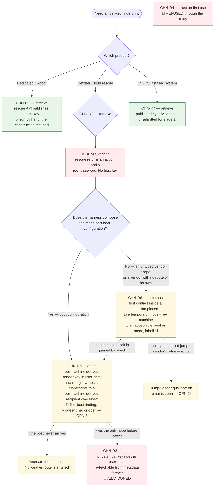
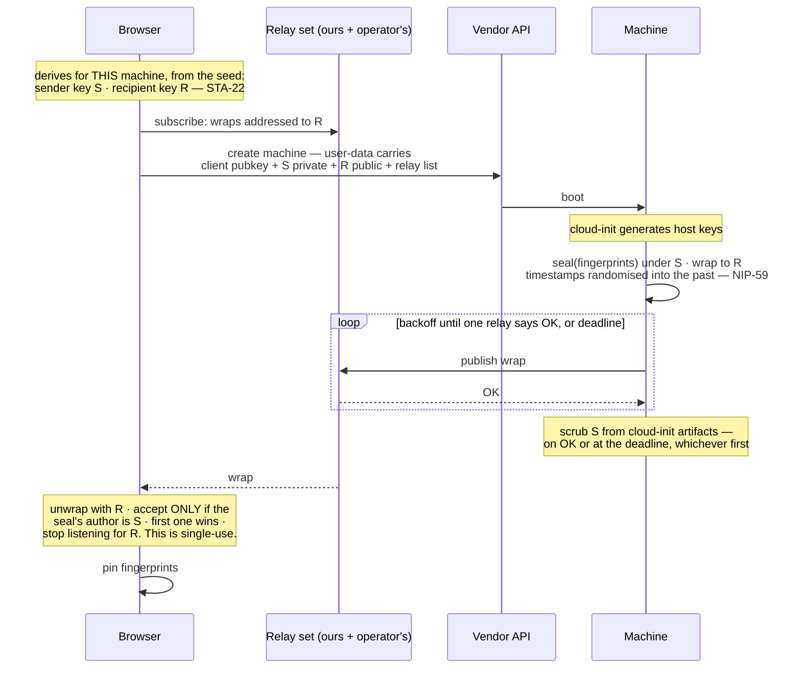

# 02 — The browser-to-machine channel

**CHN-1** The browser MUST reach a machine over SSH, verifying the host key against a
fingerprint obtained by other means, through a WebSocket-to-TCP relay
([ADR-0015](./docs/adr/0015-the-browser-reaches-a-machine-over-pinned-ssh.md)). A browser
cannot open a TCP socket to port 22 at all, so a bridge is forced regardless of who runs it.
The check that matters happens inside the SSH protocol at the application layer, so once the
right key is pinned the transport underneath is irrelevant to confidentiality and integrity.

**CHN-2** An SSH session MUST check the host key against the stored fingerprint, and a key
that does not match MUST halt the session. A first contact with no stored fingerprint MUST be
refused through the relay (`CHN-R4`). The one such contact the harness makes runs from a jump
host, inside a session pinned out of band (`CHN-R6`); it is trusted, not checked against a
pin, and MUST be presented to the operator as such. No other path may accept a key no pin was
stored for.

**CHN-3** The mechanism is chosen **and demonstrated elsewhere**. Browser-resident SSH over a
WebSocket-to-TCP bridge ships in production in several Go implementations, and exists as a
single-author proof in Rust on `wasm32-unknown-unknown` using the same UI and build stack this
design specifies
([ADR-0024](./docs/adr/0024-the-ssh-client-is-rust-following-a-known-good-configuration.md)).
What remains is integration; the one property the references skip, **host-key pinning**
(`SEC-11`), was demonstrated on the spike of 2026-09-07 (`OPN-1`, closed) and `CNF-21` and
`CNF-79` carry it for the real build.

## The routes to a fingerprint

Everything rests on pinning the *right* key, so the routes are part of the decision rather
than an implementation detail. They are numbered in the order they were found — the `CHN-R`
identifiers below are the list — and discussed strongest first, so the refused one comes last.

LNVPS's published host keys are admitted by `CHN-R7`, on the phase-B observations
([finding](./docs/findings/2026-10-11-lnvps-phase-b.md)); `OPN-24` retains the probe's
historical criteria and the separate jump-vendor qualification.

**CHN-R1 — retrieve, dedicated servers.** Hetzner's Robot webservice exposes `host_key` on
`GET /boot/{server-number}/rescue/last`. **Run 2026-09-08** (`CNF-48`,
[findings](./docs/findings/2026-09-08-first-stage-rehearsal.md)): the harness activates rescue
over HTTPS (`POST /boot/{n}/rescue`, which publishes **nothing** — its `host_key` is empty),
triggers the hardware reset, then polls `GET /boot/{n}/rescue/last` until `host_key` fills
**with a set sharing no fingerprint with the one snapshotted before the reset**
(`STG-4`: the previous
boot's keys are still there until the new boot publishes), which happens about **80 s after
the reset and some 10 s before the rescue's sshd answers**,
together with a `boot_time`. The field holds **SHA-256 fingerprints, one per host-key
algorithm, and no public key material**; the browser derives the presented key's fingerprint
at first contact and compares. **Every rescue boot has fresh host keys**: confirmation
requires no fingerprint shared with the pre-reset snapshot, including a reordered set.
The pin is per boot, not per machine, and the plain rescue endpoint reports inactive and empty
once the boot
has consumed the activation — only `/rescue/last` knows. Never trust-on-first-use: a client
that connects before `/rescue/last` fills has nothing to check against and MUST wait. The
input side, `authorized_key[]`, takes MD5 colon fingerprints of keys registered at Robot.

What a pin is held per — a boot, or a machine — is `TauWeb.Pins.Per` (ADR-0032), and the two
rules above are `TauWeb.Pins.rescue_pin_per_boot` and
`TauWeb.Pins.no_rescue_session_before_fill` over every trace, with
`TauWeb.Pins.rescue_pin_not_reused_across_boots` and
`TauWeb.Pins.connection_before_fill_refused` their decided traces.

**Robot is NOT reachable by a browser `fetch`, verified 2026-08-31.** An earlier probe recorded
the opposite and was wrong — almost certainly run with a tool that does not enforce CORS. Live
results against the API, on a real account: an unauthenticated preflight returns 401, and an
**authenticated** `OPTIONS` and an **authenticated** `GET` both return **200 with no
`Access-Control-*` header of any kind**. So this is not an auth-before-CORS ordering bug that
the vendor might fix; the API has no CORS support, and no browser origin can read its responses
regardless of credentials. Since Robot uses HTTP Basic, every request carries an `Authorization`
header, which forces a preflight the API will never satisfy.

**This does not kill the route — it moves it off `fetch`.** CORS is a restriction on the
browser's own HTTP stack, not on bytes. A TLS session terminated *inside* the browser and
carried over the relay is not a `fetch`, has no origin, and is subject to no CORS check — which
is exactly why the SSH channel works.

Reaching Robot therefore needs a WebAssembly TLS client — but the **pinned** kind (`CHN-12a`),
not the general kind. Robot is one destination, named at build time, so it is pinned to its
issuing authority and **no certificate-authority set beyond that one authority, and no new
trusted party, are involved**. That cost has now been paid once: a pinned client in WebAssembly
read Robot through a bridge on 2026-09-07 (`OPN-21`), and it is a far smaller cost than
`CHN-12b`.

Two further caveats stand: Robot is a different product from Hetzner Cloud with a different auth
scheme, so it is a second integration rather than a free extension; and the contents of
`host_key` are undocumented by the vendor — what the field holds is known from the run, not
from documentation (`CNF-48`), so a format change would arrive unannounced.

Rescue boots its own sshd with its own host keys, and the installed system's are different.
That is not a gap — the installed system is put there *from inside the trusted rescue
session*, so its host keys are **generated there, per machine, and read before reboot**. No
trust-on-first-use at either hop.

**Host keys MUST NEVER be baked into a reusable image.** An image is built once and booted
on every machine, so a host key inside it is the same private key on all five machines:
anyone holding the image, or compromising any one machine, can then impersonate every other
machine *and pass the fingerprint check*, because the fingerprint is genuinely the one that
was pinned. Reusing an image for the operating system is fine and is the point; reusing it
for identity is not.

**CHN-R2 — retrieve, Hetzner Cloud rescue. Dead, and verified dead.** Hetzner Cloud's rescue action
returns an action and a root password and no host key, checked against the API client. The
cloud path's identity problem is `CHN-R5`'s, designed for exactly it; `CHN-R6` serves a
vendor with no route of its own, `CHN-R3` is abandoned and `CHN-R4` is refused.

**CHN-R3 — inject. Abandoned.** The browser generates the host keypair and writes it into
`/etc/ssh/` through cloud-init. No retrieval endpoint is needed at any vendor and the browser
knows the fingerprint because it made the key. **This route MUST NOT be used.**

The recorded objection was that the *private* host key rides in user-data, which the vendor
stores, contradicting the credential inventory. The objection that actually ends it is worse
and was missed: **on the vendors this design targets, boot-time user-data is served back to the
machine by the metadata endpoint for the life of the instance.** Anything running on that
machine can re-fetch the host private key at any time and impersonate the machine — passing the
fingerprint check, because it is genuinely the pinned key. The proposed mitigation cannot reach
it: scrubbing deletes cloud-init's cached copy on disk and the endpoint goes on serving the
original.

**This is vendor-dependent and must not be restated as universal.** It holds on DigitalOcean,
which documents that user data cannot be modified after creation, and in practice on Hetzner
Cloud — whose user-data route is undocumented and which removed its EC2-compatible metadata
routes in August 2026, so the surface drifts. It is **false on AWS**, where user data is mutable
on a stopped instance, can be cleared entirely, and where the metadata service can be disabled
outright. A reader porting this reasoning to another vendor must check rather than assume.

`ARC-36` sharpens it. A machine renting slices hosts parties the operator has never met, and a
guest querying the metadata endpoint obtains a permanent impersonation credential for the box it
is a guest on.

**The contrast with `CHN-R5` is the whole reason one survives and the other does not.** Attest
puts a *single-use* credential in a permanently-readable place; injection puts a *permanent*
one there. An introduction key the browser has already accepted once, and will never accept
again, is worthless to a later reader. A host private key never expires.

Attest covers the same vendors — anywhere with boot-time user-data — so nothing is lost but the
route.

**CHN-R5 — attest.** The machine introduces its own host key to the browser over Nostr, under
keys the browser **derives** rather than stores
([ADR-0029](./docs/adr/0029-the-machine-speaks-nostr-and-keys-derive-from-a-seed.md)).

At creation the browser derives two keypairs for this machine from the operator seed
(`STA-22`): a **sender key**, whose private half goes into user-data beside the SSH client
public key, and a **recipient key**, whose public half goes there too. A first-boot hook reads
the machine's freshly generated host-key fingerprints, seals them under the sender key, gift-wraps
the seal to the recipient key, and publishes the wrap to the relay set (`CHN-18`). The browser,
subscribed for that recipient since creation, unwraps with the recipient private key it
re-derives at will, and accepts the fingerprints **only if the seal's author is the sender key
it planted**. A relay cannot forge that seal, so there is no trust-on-first-use. The vendor
holds the sender key and could forge one — but it owns the machine's disk and memory and could
replace the host keys wholesale regardless, so attest hands it nothing it lacks.

The author check is carried by `TauWeb.Pins.wrong_author_refused` and
`TauWeb.Pins.wrong_author_admitted`; a valid introduction admits a matching installed-system
connection in `TauWeb.Pins.attest_admits_and_connects` (ADR-0032).

**A private key does ride in user-data now, and the reason `CHN-R3` died still does not apply.**
What killed injection was what its key *authorized*: a host private key impersonates the
machine for life, and the metadata endpoint serves user-data for life. The sender key
authorizes **one introduction**, and the browser stops listening for it the moment one is
accepted (`CHN-5`). A later reader of the metadata endpoint finds a key nothing will ever
believe again. The bound is the same one the one-time secret had; only the envelope changed.

**Nothing about this needs the browser to remember anything.** Both keys re-derive from the
seed and the machine's index, so a phone that locks between creating the machine and receiving
its post loses nothing — which is the case the previous design could not survive, since a
random secret redacted from the record had nowhere to live.

**If the introduction never arrives, the machine is recreated, and nothing weaker is
entered.** A window that closes with no accepted seal ends that machine's first contact: the
harness offers to destroy it and create it again, which re-runs attest under a fresh index.
*What this route used to offer beside that* was a keyed rescue login to a system whose host key
nothing could check, "with the leap of faith displayed". It was withdrawn on 2026-10-05: it is
trust on first use through the relay under another name, and `CHN-R4` refuses that. `SEC-14`
says "A failed check halts".

**CHN-R6 — a first contact from a jump host.** For a machine at a vendor with no route of its
own — no endpoint that publishes a host key, and no boot configuration the harness composes —
the browser makes the first contact from a **jump host**: a temporary machine no model has
touched, whose own host key is pinned out of band — by attest (`CHN-R5`), or by a retrieve
route where the jump vendor offers one
([ADR-0036](./docs/adr/0036-first-contact-is-never-trusted-through-the-relay.md)). The browser
opens a pinned SSH session to the jump host through the relay, and inside it a forwarded
channel to the target — `direct-tcpip`, which is what `ProxyJump` does — through which the
target's own SSH handshake runs end to end. The relay carries the outer ciphertext and nothing
else, so it can neither read that handshake nor replace the key in it: `CHN-1`'s argument,
applied to the outer hop.

**This is trust on first use moved from the relay's position to the jump host's.** It is an
acceptable weaker mode (`SEC-14`), never a pin obtained out of band, and it is the route for
any vendor without one of its own; attest is then needed only at the jump vendor. Each of the
following is a condition of the route, and without any one of them the route is unavailable:

- **The jump host is pinned out of band**, by retrieve or by attest, before anything is sent
  through it.
- **It is model-free by construction.** Harness code creates it through the jump vendor's
  typed adapter, with boot configuration the harness composed: no model writes its user-data,
  chooses its image or issues a command on it. The flow that creates, uses and destroys it is
  a harness flow and not a session, as `ARC-21`'s is; no session holds its key or its vendor
  identity, and the model never reads its output. Nothing on the machine can show this, so it
  is shown the way `CNF-8` shows a like absence: by what sessions are given.
- **It has its own index and its own credential rows.** The jump host is allocated an index
  in the machine family, journaled before its create (`STA-22b`) and never an entry of any
  session's bound set; its client key and its vendor credential are `SEC-5` rows 3 and 21, and
  where it is pinned by attest its attest keys are rows 7 and 16.
- **Its vendor identity is separate from the target's.** Until a derived vendor identity can be
  derived (`SEC-5` row 22), that is met only by a separately supplied vendor credential — row
  21, held by the flow and by no session. Where the operator supplies none, the route is
  unavailable.
- **The jump vendor is paid in Bitcoin and needs no account**, and it is not the publisher: a
  publisher-run jump host is the relay's own operator standing in a second place, which is the
  party this route exists to take out of the first contact. The bundle carries a jump-host
  adapter only for a vendor that meets this condition. `OPN-24` records LNVPS evidence;
  jump-vendor qualification remains open.
- **The target's address comes from the target's vendor**, read over TLS the browser
  terminates — a direct fetch, or a pinned tunnel (`CHN-12a`) — and journaled against the
  machine's approved entry before the jump. An address from relay metadata or from model text
  is not used.
- **The jump host forwards to the target's public address and nowhere else.** The harness asks
  it to dial the journaled address on the SSH port; it asks for no other destination.
- **The pin is checked on a second path.** The first direct connection to the target through
  the relay MUST present the key pinned from the jump host; a different key halts the session
  (`SEC-11`).
- **One jump host per first contact, per machine, never reused.** It is destroyed once the
  target is pinned. One whose destroy is unresolved is not reused either, and is shown as
  possibly still existing and billing (`ARC-22`).
- **A reinstall through the vendor's API is a new first contact**, with a new jump host: the
  reinstalled system has new host keys and the old pin vouches for none of them.
- **It is in the batch.** The jump host and its cost appear on the approval that creates the
  target (`ARC-15`).

**What stays trusted, stated in full and shown.** The jump host itself for the length of the
contact, and the jump vendor with its image and whatever else runs on that host. The whole
Internet route between the two machines — transit networks, anyone able to hijack a route,
both vendors' edges — which "the path between two datacentres" undersells. Whoever supplied
the target's address. Anyone holding a host key baked into an image, on either machine. And a
common mode: one jump vendor introducing machines at several target vendors is one party at
the first contact of all of them. With the second-path check in force, a substitution survives
only where one party presents one key on both paths — the target's vendor, its last-hop
network, or the jump side together with the relay. These are `TRU-E11`'s row.

**The label.** The trust display says, for the machine's life, how each machine's pin was
obtained: retrieved, attested, or *first contact trusted through a jump host at* the named
vendor, with the date. It never describes this route as pinned out of band, and destroying the
jump host does not remove the line.

**CHN-R7 — retrieve, LNVPS.** For the installed-system host-key pin, the browser MUST read
the published host keys from the machine's recorded vendor status response by direct fetch
over TLS terminating in the browser. This is a direct path under `CHN-10`; `CHN-12a` remains
the pinned-tunnel rule for a vendor that refuses browser fetch. The publication is the
vendor's hypervisor scan of whatever answers on the machine's address, served over TLS
([research](./docs/findings/2026-10-08-lnvps-research.md) §1); the phase-B finding records
matching presented and published keys in every family before and after reinstall
([finding](./docs/findings/2026-10-11-lnvps-phase-b.md)).

When establishing a pin through this route, before any connection to the machine the harness
MUST wait for a complete, non-empty published set containing all three scanned families:
Ed25519, RSA and ECDSA. An absent, empty or partial set admits no contact through this route.
The machine's publication history MUST be grouped
by installation. An operator-chosen destructive reinstall, whether through the vendor API or
from rescue, closes the current group and opens another, even
if neither group contains a fingerprint; restart and Restore do not. A complete candidate
for the current installation MUST share no fingerprint with any observation or installed-system
pin from any source in any earlier installation of that machine, including incomplete
observations, refused complete candidates, and groups older than the last one. Within the
current installation, a complete
candidate MUST contain every fingerprint previously observed there: a partial reading can
become complete, but no observation can be contradicted or forgotten. Compare against the
prior knowledge before retaining newly observed fingerprints, even when a candidate is
refused. Record an observation only when it adds a fingerprint to that installation's
accumulated knowledge or opens its group; repeated empty, exact, reordered, and wholly
contained readings do not extend history. Keep every installation boundary.

An operator-chosen destructive reinstall through the vendor API or from rescue is a new first
contact: the old installed pin authorizes no new contact. `STG-20` says it "opens a new
installation when it is **dispatched**: the reset into rescue on a dedicated server, or the
vendor's reinstall call at LNVPS". That reset into rescue dispatches the operator-chosen
destructive reinstall. Any other reset, reboot, restart, Restore or non-destructive recovery
does not open an installation or permit replacement. A valid source
may establish the next pin under its own rules; a complete
publication satisfying these comparisons can do so here. Without a reinstall, no
installed-system pin from any source replaces an active pin on that machine, even if its
keys or source differ. A refused or repeated observation cannot rewrite the active pin or
its provenance.

The first connection MUST present a key in that admitted set; a key outside it MUST halt
under `SEC-11`, whose rule is "An SSH session MUST check the host key against the stored
fingerprint, and a key that does not match MUST halt the session." Later contacts keep that
check. Status polling during the wait uses `bundle/timing.toml`'s
`lnvps.published_key_poll_interval`; the wait ends at
`lnvps.published_key_wait_max`. Past that maximum, first contact is unresolved: the harness
MUST offer only operator-chosen vendor reinstall, which starts a new first contact, or
abandonment under `ARC-22`. It MUST NOT log in, retry the unresolved contact on a timer,
automatically reinstall, fall back to an unpinned login, or trust on first use.
For abandonment, see `ARC-22`. Polling during the allowed wait is not a retry after its
deadline.

The trust display MUST identify the pin as **retrieved from the vendor's hypervisor scan**,
never attested, and MUST state the residual in full: **the vendor, and anyone able to
answer on the machine's address inside the vendor's network at scan time**. This is a
vendor-published observation, not an attestation.

`TauWeb.Pins.complete`, `TauWeb.Pins.fresh` and `TauWeb.Pins.withinInstallation` state the
symbolic publication guards;
`TauWeb.Pins.retired_pin_not_active` states what the previous pin admits during a
reinstall wait. The named refused and admitted traces in the pins witness file exercise
incomplete and complete overlap, older history, pending reinstall across restart, machine
isolation and membership. These properties concern
harness knowledge and attempted handshakes; `CNF-23` requires absence of contact on the
integrated harness.

**CHN-R4 — trust on first use. Refused through the relay.** Accepting the key on first
connect, pinning it and alarming on any later change is what ordinary SSH clients do, and the
harness MUST NOT do it through the relay. Every connection the browser makes to a machine runs
through the relay, so a key accepted there is the relay's word; an impostor at that position
would have its own key pinned and receive every secret placed afterwards. A first contact with
no independently obtained pin is admitted only from a jump host (`CHN-R6`).

What survives of this route is **continuity**, which `SEC-11` applies to every pin however it
was obtained: a later change halts. It detects a network or relay attacker that turns hostile
later. It does **not** detect a vendor that turns hostile: the vendor can read the host private
key off the machine's disk and go on presenting the same fingerprint. Continuity is protection
against the network, not against the vendor, and it assumes the pin survives, which is what
`03-state-and-recovery.md` supplies.

*What this requirement used to say* was that trust on first use stood behind every other route
as the one always available, presented to the operator as trusted. Until 2026-10-05 a withheld
attest post led there.

## The attest sequence

**CHN-4** The attest post is a **gift-wrapped Nostr event** — a NIP-59 wrap around a NIP-44
seal — published to the relay set of `CHN-18`, and the browser receives it by subscription.
*What this replaced:* a drop-box the browser had to open at the relay before creating the
machine, with a collection token to fetch it afterwards. Both are gone. The relay is
browser-initiated and a first-boot machine still needs a rendezvous; the rendezvous is now a
standard inbox that any Nostr relay provides, rather than a custom buffer only ours did.

**CHN-5** Single-use MUST be enforced by the browser, not by any relay. A relay cannot
distinguish a genuine seal from junk — it never holds the sender key — so a relay enforcing
"one post" would enforce it on the first post of *any* kind, a denial of service dressed as a
property. The **browser** unwraps, checks the seal's author against the sender key it planted,
accepts the first match, pins, and **stops listening for that recipient**. Anyone able to write
to the inbox — everyone, on a public relay — can flood it with garbage or race it: garbage fails
the author check, and a *validly sealed* race requires the sender key, which only the vendor also
holds. A flooded or empty inbox is a denial of service that forces a recreate (`CHN-R5`),
nothing more.

**Attest is a first contact only for the current installation.** Once a machine holds an
active installed-system pin from any route, the browser MUST stop listening for that
installation's introduction and MUST refuse an introduction that arrives later, without
journaling a pin or consuming an introduction. This applies across restart: the browser
reads the active pin before subscribing again. After a vendor-API reinstall, an unused
introduction may establish the new pin only while its original browser window is still
open. Reinstall neither renews a consumed introduction nor reopens an expired window.
The job-pin trap is `TauWeb.Pins.attest_after_job_pin_refused` and
`TauWeb.Pins.attest_after_job_pin_admitted` (ADR-0032).

**Single-use survives a restart.** Acceptance is journaled — the machine, the pins and the
consumed state of its introduction — before the pins are used (`STA-3`), and a worker that
restarts and re-derives the recipient key reads that record and does not subscribe again.
"Stop listening now" and "never accept again" are different properties, and only the journal
supplies the second: a re-derived key is the same key, and without the record it would reopen
the window the acceptance closed.

`TauWeb.Pins.no_later_attest` preserves refusal after consumption across later traces,
including restart, under its stated journal assumptions.

**CHN-6** The first-boot hook MUST retry with backoff until at least one relay in the set
answers OK or a deadline passes, and MUST scrub the sender key from cloud-init artifacts on
whichever comes first. Networking at first boot is exactly when routing and DNS are least
settled; a single-shot post followed by an irreversible scrub converts a transient blip into a
destroyed machine, on the one route that has no alternative.

**The only clock that matters is the browser's.** The old design had the machine's deadline
"inside the voucher's expiry", a relationship between two numbers neither of which existed.
Nothing on the machine can expire anything: the metadata endpoint serves user-data for life,
and a gift wrap's timestamps are deliberately randomised up to two days into the past, so they
say nothing about when it was sent. The window is **the browser's own clock, from machine
creation**, after which it stops listening for that recipient and offers the recreate
(`CHN-R5`). The machine's deadline is housekeeping — when to give up retrying and scrub — and
the browser's window MUST be set from a **measured** slowest first boot rather than a guess, and
stated as an outcome with its named remedy rather than something the operator discovers.

**The scrub is defence in depth, and MUST NOT be described as the bound.** It removes
cloud-init's cached copy from disk; the vendor's metadata endpoint goes on serving the original
user-data for the life of the instance, so the sender key stays re-fetchable by anything on the
machine. **What bounds the exposure is `CHN-5`**: the browser accepts one introduction and never
another from that key, so a later reader holds a key nothing will believe. The realistic window
is the minutes before any tenant software exists. A machine that blocks its own metadata
endpoint after first boot closes the rest, and that is a hardening step to declare (`ARC-39`)
rather than assume.

**CHN-7** The attest **sender key** is an **introduction credential**, not a non-credential.
Possession of it lets an actor seal an *arbitrary* fingerprint the browser will then trust — it
authorizes the introduction, which is the whole game. It carries a credential's lifecycle in
`SEC-5` row 7: single-use per `CHN-5`, scrubbed from the machine's cloud-init artifacts, redacted
from anything recorded or shown to a model, and **never stored in the browser**, because it is
re-derived on demand (`STA-22`). The **recipient key** is a credential too — it decrypts the
introduction — and is row 16 on the same terms. Both are per machine: user-data for machine 1
says nothing about machine 2, and an inbox on a public relay, which anyone can list, maps to one
machine and not to an operator.

**CHN-17 The notify channel.** Attest is the first use of a general rule, stated once so nobody
re-derives it when a second use arrives: **a machine may send the harness an event, and an event
is an observation.** It is typed untrusted, exactly as every box-plane output already is
(`ARC-28`); it never gates a step, never triggers an action, never enters model context as
anything but content. Attest's introduction is the one exception, and only for the step the
browser is already waiting on: sealed by the sender key the browser planted and accepted once
(`CHN-R5`, `CHN-5`), it gates that machine's first contact and nothing else. `ARC-1` stands because of that typing — a machine that can *tell* the
browser something is not a machine that can *make* it do something. **The list of uses is one
entry long**, and each addition is a stated design change rather than a use of an open door.
Candidates exist — a job record's completion (`STA-20`), a delivery check's result (`ARC-39`) —
and none has been added.

**CHN-18 The relay set.** The publisher's Nostr relay, on the same host as the TCP bridge
(`CHN-11`), is **mandatory**, and the operator MAY add public relays for resilience. First boot
is the one message with no other route, so it must not depend on a relay nobody runs on the
operator's behalf. Ours serves a recipient's wraps only to a subscriber who has authenticated as
that recipient (NIP-42), which is what the standard asks of relays and what three of four public
relays tested did not do: on those, anyone can list every wrap addressed to a key. Per-machine
recipients bound what that reveals, and the publisher's relay is the one place the inbox is not
public. A public relay in the set is a party the operator chose, named in `TRU-E10`.

**The first-boot tool is an artifact.** A machine needs a Nostr client before anything else is
installed. On NixOS it is a distribution package, admitted as everything there is (`ARC-25a`).
On Alpine there is no package, and the upstream release binary is glibc-linked and fails on
musl; the publisher therefore ships a static build, which is an artifact pinned under `ARC-25`
and signed under `TRU-E7`, about thirty megabytes at first boot. Two traps verified on a real
run: standard input must be redirected from the null device explicitly, since a *closed*
descriptor crashes the tool, and gift-wrapping must be told to use the identity keys directly,
or it spends seconds looking up optional keys on the network before an inbox exists.

## The relay

**CHN-8** The relay MUST NOT be a generic open proxy — [paid-tcp-relay][relay-source]'s `OPR-1`
([source revision][relay-source]), where the combination that makes a relay defensible —
paid, recorded, capped, paced, revocable — is stated once. The archived specification's §21
requirements were the origin; the rule moved there on 2026-09-24, and the harness relies on
that set and adds nothing.

**CHN-9** The relay has two duties: the TCP bridge — the SSH channel, `ARC-26`'s surface
probes, the pinned vendor tunnel (`CHN-12a`) and a profile-declared post-harness credential's
traffic (`ARC-19a`) — and, **designed but not built**, a tunneled fallback for untyped calls
(`CHN-12b`).
Beside it, on the same host and under the same operator, runs a **Nostr relay** for the notify
channel (`CHN-18`). It is a separate, standard service rather than a third duty of the bridge,
and the attest drop-box it replaces is gone.

**"The relay" means the TCP bridge.** A Nostr relay is always called that, in full. The two
share a host and an operator and nothing else, and a sentence that says "the relay" about the
inbox is wrong.

**CHN-10** The relay MUST be **direct-first**. It is never in a path the browser can take
alone. An off-machine call goes straight from the browser to the service wherever the
service permits it; the relay carries only raw TCP — the SSH channel, `ARC-26`'s surface
probes, the pinned vendor tunnel where a vendor refuses CORS (`CHN-12a`), and whatever a
profile's post-harness credential speaks to its machines after delivery (`ARC-19a`) — and, if
`CHN-12b` is ever built, untyped calls whose destination refuses browser CORS.
The machine-originated attest post no longer crosses it at all. Minimum usage is a design
property, not an accident; the relay-side statement of the same property is [paid-tcp-relay][relay-source]'s
`OPR-2`.

**CHN-11** The relay's operator is the **publisher** by default, with bring-your-own as the
escape hatch ([ADR-0019](./docs/adr/0019-the-publisher-operates-the-default-relay.md)). The
publisher's seat is a **bootstrap**: before the operator has any machine, someone must carry
the bytes that provision the first one. The product actively offers the move to a relay on
the operator's own maintained machine once one exists. Who runs a relay and what a self-hosted
one still depends on is stated once in [paid-tcp-relay][relay-source] (`OPR-3`, `OPR-4`, its ADR 0002); this
requirement is tau-web's decision to adopt that default.

The publisher default is located through CHN-19. Bring-your-own uses an explicitly entered direct
relay URL, independently of publisher discovery and its availability.

**Publisher-operated hosting profile.** The default MUST run as a pod in the publisher's k3s
cluster, on a separate domain whose name remains unselected. TLS MUST terminate in the relay
process, reached through end-to-end L4 TLS passthrough or a dedicated public port. A dedicated
port alone establishes neither termination location nor absence of logs. No destination-logging
proxy or traffic/logging sidecar is permitted. The admitted pod/init configuration, forwarding
path, operator-controlled host collectors and retention surfaces are all in scope. For the
shared operated-path privacy and WSS rules, see [paid-tcp-relay][relay-source] OPR-5 and OPR-8;
for their demonstrations, see its CNF-16 and CNF-19. This profile adopts OPR-5 without an
additional retained-state allowance.

The publisher MUST adopt the `/v2/` DST-4 environment-exclusion mechanism for cluster pod/service
ranges, node/control-plane/metadata addresses and shared-host services, including globally routed
addresses. Declare the actual addresses/ranges, keep their required inventory complete and
current, and exclude whole destination hosts. For the shared self-address inventory and
registration/every-dial enforcement, see DST-4; for address resolution, see DST-5. An excluded
target MUST be shown as unavailable coverage, never as closed ports or a successful outside-in
verification. For external-route demonstrations, source privilege and equal-view claims, see
`ARC-41`.

This publisher profile MUST enforce an independent workload-selecting egress barrier against
non-global, self and declared environment tunnel routes in both address families, preserving
arbitrary ports to eligible public destinations. The only permitted forbidden TCP exception is
one precisely declared private resolver endpoint on TCP port 53. Declare its exact address,
protocol, port and whether the tunnel connector's network identity can use it. When usable by
that identity, this exact route is **outside the egress-policy second wall**; never claim
universal independent denial or call the exception safe merely because it serves DNS. No broad
private-subnet, neighboring-address, other-port or all-port exception is permitted. This
exception never authorizes a tunnel destination; for relay-side eligibility, see DST-4 and
DST-5. For shared barrier coverage and exception accounting, see DST-7. A policy object alone
establishes no enforcement.

Admission of the publisher default requires `CNF-113`, including effective deployment evidence;
source inspection and isolated results alone cannot admit it. This hosting profile does not
impose process-local TLS or this mandatory independent barrier on bring-your-own or a future
self-hosted migration target. For those relays, see the shared requirements and `CHN-16a`.

That move retains an **external relay route for the relay-host machine itself**, for SSH,
recovery and outside-in scans. For destination eligibility, see `CHN-16a`.
Before switching the default, configure and demonstrate that external route and preserve its
access metadata. It may remain the publisher's relay or another operator-chosen relay; its
availability and metadata visibility remain in the trust display. Do not claim that one
self-hosted relay eliminates this dependency. If no external route is available, migration
does not complete; never relax the self-address prohibition to make it appear successful.

**Under out-of-band pinning a hostile relay is a denial of service and nothing worse. That is
why `CHN-R4` is refused through it**: at a first contact with nothing to check the key against,
a hostile relay could present its own, have it pinned, and read the session from then on.
Under `CHN-R6` the relay carries the outer ciphertext of a session pinned out of band, and
stays a denial of service.

**CHN-19** **Publisher-signed relay discovery.** The build MUST compile the publisher discovery
public key P and a nonempty public Nostr discovery starting set B from
`bundle/relay-discovery.toml` at its pinned specification commit. P is a lowercase hex BIP-340
x-only public key. B contains records pairing `wss` Nostr URLs with their operators' names for the
trust display; those endpoints permit anonymous reads of [paid-tcp-relay][relay-source] WIR-14; at least one is
hosted independently of the TCP service. B is separate from CHN-18's private notify-inbox set. The
build's pin delegates only the locator authority defined by SEC-8. It inherits the glossary's
signed-bundle qualification; no runtime bundle signature is claimed. The publisher's publication
and continuity duties are [paid-tcp-relay][relay-source] OPR-10.

Before a new publisher-default connection, query every endpoint in B for the WIR-14 address, using
a NIP-01 filter with `authors:[P]`, `kinds:[30079]`, `#d:["paid-tcp-relays"]` and `limit:1`. Bound
the complete discovery attempt by `relay_discovery.fetch_max` in `bundle/timing.toml`; close its
subscriptions when that attempt ends. Validate each candidate's NIP-01 id and BIP-340 signature,
`pubkey=P`, kind, d tag and complete WIR-14 schema. Reject a future `created_at` by the browser's
clock in newly fetched or bundled candidates. Invalid candidates do not change discovery state.
Local high-water records and signed records imported from a recovery sheet retain their ordering
evidence independently of current route usability; validate their id, signature, recorded
publisher-key association and complete schema before merging them. A recorded event whose
`created_at` is future by the current browser clock remains recorded and participates in ordering,
but cannot supply a route until it is no longer future. Do not discard such a record to reveal an
older locator, and do not reject an otherwise valid sheet merely for that clock difference.

Among admissible candidates and retained records for P, select greatest `created_at`, then
lexically smallest id on a tie. Atomically merge the selected full signed event into the durable
high-water record for P, including when empty, expired or retained from recovery while future by
the current clock. Concurrent discovery attempts and Restore MUST NOT overwrite a higher-ranked
record with a lower-ranked one. Complete this retention before using a publisher locator; if
retention fails, block publisher-default attempts until it succeeds. Neither fetch failure nor
withdrawal nor expiration permits fallback below the retained high-water event. Fetched, bundled
and recovered records share id, signature, key, schema and ordering checks; the recorded-event
clock rule above distinguishes retained evidence from newly admitted network data. Bundle
snapshots are optional supplementary signed data and confer no extra validity. Restore cannot roll
back a newer locally held event.

Use only the selected event, only when its `created_at` is not future by the browser's current
clock, only while that clock is strictly less than its signed expiration, and only with a nonempty
URL array. A still-valid cached event may be used after a bounded fetch fails; label that use with
its `created_at` and expiration. Without such an event, or after an empty withdrawal, block the
publisher default and offer explicitly entered bring-your-own under CHN-11. Never silently use a
compiled or formerly selected TCP URL. A signature and unexpired validity do not establish that a
fresh restore has seen the publisher's newest event. Store loss, older sheets, incomplete
publication or an endpoint withholding a successor can leave that successor unknown.
[paid-tcp-relay][relay-source] `OPR-10` says "Each newly issued replacement announcement, including an empty
withdrawal or expiration renewal, MUST have a `created_at` strictly greater than every earlier
announcement issued at this address, and an expiration no earlier than any announcement it
supersedes." This removes the case where a correctly published successor disappears solely by
expiring before a still-valid predecessor; it does not prove delivery or restore lost knowledge.
An older, still-unexpired signed list can remain selectable when no newer record is known. No
maximum announcement lifetime is specified here; the residual window lasts until that list's
signed expiration. The interface MUST not claim otherwise.

Try the selected event's TCP URLs in listed order, with the same holder pass identity and
admission checks. Pin R for each connection before opening the [paid-tcp-relay][relay-source] `/v2/` request.
Before sending AUTH, require the challenge's `relay` to equal R byte for byte, and sign exactly R
in AUTH's `relay` tag. On mismatch close with 4002 and send no AUTH. Do not follow a redirect to a
different base URL as discovery. List updates and expiration affect future attempts, never
retarget an open connection. Explicit BYO and recovered direct locators use the same connection
binding, independently of P or discovery availability. A newly entered direct URL is normalized to
WIR-14's WHATWG form before its first recording. Historical direct locators are preserved exactly;
a nonconforming historical value remains recorded and blocked pending an explicit correction,
rather than being silently rewritten.

A recovered publisher locator is usable only when its P equals the build pin. A different
recovered P remains recorded but blocked; do not substitute the build P. Publisher-key rotation
requires an explicitly chosen build-pin and sheet-locator migration, with pass-state continuity
checked separately. An announcement cannot rotate P, alter B or reinterpret a direct locator. The
migration is not inferred from matching URLs. CHN-19 owns this publisher-key migration condition;
it is distinct from STA-17's seed Replace. Record the operator's explicit build-pin and
sheet-locator migration choice, retain the old identity until that migration completes, and export
the updated locator. Discovery supplies no implicit migration act. Discovery locates only the TCP
service: an announcement does not move CHN-18's notify set. A TCP-service move that separates it
from the same-host Nostr notify service in CHN-9/CHN-18 requires a separate build change to those
notify rules and inputs.

**CHN-15** Relay access is **bought, not granted**, and what is bought is recorded against a
**relay key** the browser derives from the seed (`STA-22`), one per purchase. The model — the
`402` purchase, the key-bound pass, the challenge the browser signs in the NIP-42 shape it
already implements for the Nostr relay, and the wire with its check order — is [paid-tcp-relay][relay-source]'s
(`PAS-1`–`PAS-8`, `WIR-1`–`WIR-14`; [source revision][relay-source]), adopted by
[ADR-0025](./docs/adr/0025-relay-access-is-bought-not-granted.md) and moved there on
2026-09-24; `docs/design/relay-protocol-v1.md` is retained as history. What tau-web owns: the
key derives from the seed and re-derives from the seed plus its exported pass index (`STA-22b`),
so **nothing bearer is stored** and missing allocation metadata can lose access to paid quota;
and the operator's own wallet pays the invoice (`ARC-30`, `SEC-13`). The historical `/v1/`
handshake and check order are carried in Lean under `TauWeb.Relay` (ADR-0032) until the port to
[paid-tcp-relay][relay-source] lands (T30); that note names the declarations. Those declarations and
`relay-witnesses-v1.json` do not certify the `/v2/` additions. The consumer uses `/v2/` for
CHN-19 connections; shared behavior remains [paid-tcp-relay][relay-source]'s rather than a second wire contract
here. All references to that set in this specification use merged source revision
[`49309df54dea3841f3cb1a37527f8d4ec9b5f1ab`](https://github.com/douglaz/paid-tcp-relay/commit/49309df54dea3841f3cb1a37527f8d4ec9b5f1ab).
The selected wire profile is `/v2/`; `/v1/` and the historical companion remain explicitly scoped
to v1.

**No account, and therefore no identity party.** That is the point: an account system is a party
that knows every operator and can deny them service, which `SEC-10` prices as a schema
migration. A relay key is not an identity: it is one random-looking public key, derived per
purchase, and the relay cannot link two purchases by their keys. What it can link is the
destination set, which `CHN-13` already prices.

**CHN-16** A pass's **destination record is the authorization**, not a separate system
([paid-tcp-relay][relay-source] `PAS-4`, `DST-1`, moved 2026-09-24). A pass is bought before the machines exist,
so its destination list grows as the operator creates them — the moment the relay learns
topology, already priced at `CHN-13` — and recording a destination requires the relay key's
signature, so nobody but the key holder can widen a pass. For reachability,
[paid-tcp-relay][relay-source] DST-2 says "A recorded destination eligible under DST-4 is
reachable on **any port**, never on one port alone (`ADR-0003`)." For equal-view claims and
unavailable coverage, see `ARC-41`; for surface scans, see `ARC-26`. The record is read at the
host and not at the port, as
`TauWeb.Relay.recorded` (ADR-0032) carries it until T30; `TauWeb.Relay.recorded_any_port` and
`TauWeb.Relay.unrecorded_destination_refused` are that reading and its refusal. A revoked pass
closes its live connections and refuses new ones (`PAS-5`), which is the teardown rule `CNF-60`
was waiting for. For revocation's rationale, see that set's ADR 0003; for eligible-target
equality and unavailable coverage, see `ARC-41`.

**CHN-16a Destination authorization never grants access to the relay's private network.**
For the destination policy, see [paid-tcp-relay][relay-source] DST-4–DST-7; for stage 1's
hand-recorded pass, see PAS-6. For the publisher-specific hosting adoption, see `CHN-11`.

The check on every outbound connection is carried as `TauWeb.Relay.parse`,
`TauWeb.Relay.classify` and `TauWeb.Relay.dial` (ADR-0032), whose argument is by type the
classified numeric address, so a hostname cannot be passed to it; the check at registration is
the recording message, which the first stage does not carry.
`TauWeb.Relay.forbidden_answer_refuses` is the DNS rule above,
`TauWeb.Relay.dialed_admitted` proves over every trace that the dialer receives only an admitted
address, `TauWeb.Relay.mapped_forbidden_refused` closes the IPv4-mapped spelling and
`TauWeb.Relay.parse_fails_closed` the forms the grammar does not admit. The special-purpose
tables enter the companion as an assumption it quantifies over, never as data it owns. The
any-port rationale, pacing as the anti-abuse control, and the economic bound on a destination
the relay cannot verify are that set's `DST-2`, `DST-3`, `DST-8` and ADR 0003; `ARC-26`'s
per-target limit is the same figure [paid-tcp-relay][relay-source] names as pacing.

**CHN-12** A tunnel terminates TLS **inside the browser** and carries ciphertext over the
relay, so the relay stays a carrier and learns nothing of the contents. Browsers do not expose
their root certificate store to WebAssembly, so such a client must decide for itself what to
believe — and **that decision costs radically different amounts depending on where it is
going.** An earlier version of this requirement priced both cases as one and got the expensive
answer for both.

**CHN-12a — a known destination is pinned, and needs no certificate-authority set beyond the
one pinned authority.** A vendor API is named at build time and there are a handful of them.
The browser validates against a **pinned issuing authority shipped in the bundle**, exactly as
it pins a host key (`SEC-11`) and an artifact hash (`ARC-25`). **No
trusted party is added**, because a pin is a fact about one endpoint rather than a delegation
to a category. Mechanically the pin *is* a trust store holding exactly that one certificate
and nothing else, against which the TLS library's ordinary verifier checks chain, name and
validity — a store of one is a pin, a store of many is `CHN-12b`'s object. Run 2026-09-07
(`OPN-21`): Robot's response read, a valid certificate from another issuer refused before any
byte was sent. The validity check uses the browser's clock, so a phone with a badly wrong
clock refuses a good pin; that failure names rotation (`CNF-64`) and is wrong about the cause.

Its honest cost is **rotation**. A vendor changing its issuing authority makes its API
unreachable until a release ships the new pin, and briefs already ship on release cadence
(`ADR-0005`). Pinning the issuing authority rather than the leaf makes this rare rather than
routine; it does not make it impossible, and the failure mode — loss of reachability, not loss
of confidentiality — must be stated wherever a pin is relied on.

**CHN-12b — an arbitrary destination needs a general trust store, and remains unpriced and
unbuilt.** A service that refuses browser CORS cannot be known in advance, so reaching it means
carrying a certificate-authority set, keeping it current as authorities are distrusted, and
owning revocation. That is a trust decision about roughly 150 parties sitting in a credential
path, it is a growth `SEC-10` guards, and `OPN-20` still prices it. Until it is priced, **an
arbitrary service refusing browser CORS is out of reach for untyped calls.**

## What the relay learns

**CHN-13** The relay learns the **machine topology** ([paid-tcp-relay][relay-source] `OPR-6`), and the product
MUST say so. Which
operator, which destination, when, accumulated over time, *is* the machine set for a
federation. That is the same knowledge `TRU-E5` prices as a named trust row for the scanner,
and calling it merely "connection metadata" understates it.

It cannot read or alter a session pinned out of band, so the addition is visibility, not
authority over content. A jump-host first contact (`CHN-R6`) adds the jump host to what it
sees, and timing ties the jump host to its target: still visibility. But a party that serves the bundle *and* sees every connection is a
bigger observer than one that serves the bundle alone.

**The Nostr relay on the same host learns the same thing by a different route**, and the product
MUST say so too. It sees a cloud address publish a wrap to recipient R, and it sees the
operator's address authenticate as R to read it — one machine, one inbox. Per-machine recipients
mean it learns N unrelated inboxes rather than one operator's N machines; the operator's
subscriptions arriving from one address correlate them anyway. That is `CHN-13`'s knowledge,
held by `TRU-A2`, and nothing new. A **public** relay in the set learns the publish half without
the authentication — and, on the relays tested, serves the inbox to anyone who asks — which is
why the operator's choice to add one is a named party (`TRU-E10`) and not a free resilience knob.

**This is why Certificate Transparency was rejected, and the comparison reads stronger
stated honestly:** one party the operator chose learns the topology, against *everyone*
learning it permanently and unpublishably in a public log. Every publicly trusted
certificate is published in searchable logs and browsers require it, so a certificate for a
bare IP publishes that IP; for a federation the members' addresses appear as a correlated,
timestamped set, several issuances minutes apart across several hosting providers. Renewal
compounds it. The relay wins that comparison, and it wins it while knowing the same thing.

None of this touches an lnrent box, whose address is already public by design in its Nostr
listing. An lnrent box serving as the operator's own *relay* is the one machine that does
need a WebPKI certificate, because a browser demands `wss://`, and the objection does not
bite it.

**CHN-14** Self-hosting has its own honest price, named rather than hidden: the hosting
machine's **bound model** has box-plane reach over whatever the relay retains, so the
relay-install brief adopts [paid-tcp-relay][relay-source] OPR-5, and the trust display prices
the host machine's model as a potential metadata observer regardless.

[relay-source]: https://github.com/douglaz/paid-tcp-relay/tree/49309df54dea3841f3cb1a37527f8d4ec9b5f1ab
