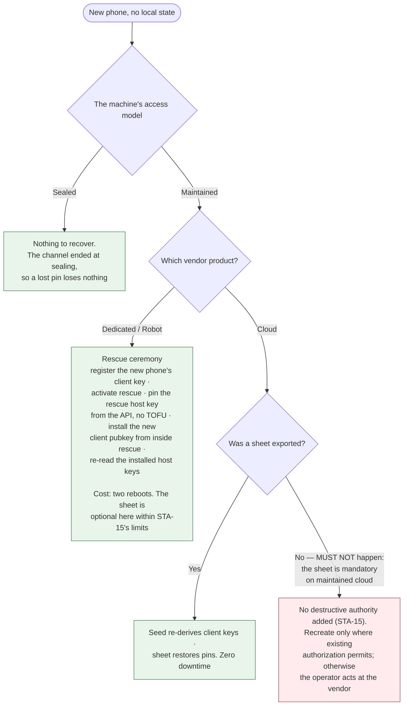

# 03 — Durable state and recovery

Two halves of one problem. **State** is what survives the worker being killed while the
phone is in the operator's hand. **Recovery** is what survives the phone being lost. The
decisions are in [ADR-0022](./docs/adr/0022-durable-state-is-an-append-only-journal.md) and
[ADR-0020](./docs/adr/0020-recovery-roots-in-the-vendor-account.md).

## Durable state

**STA-1** A single **harness worker** MUST be the only writer of durable state. Tabs,
command workers and adapters submit observations and requests; they do not mutate canonical
state.

**STA-2** Canonical state MUST be an **append-only event journal** with replayable
transitions, held in origin-private storage. Content-addressed with periodic compact
snapshots; in-memory state is authoritative only while a worker is running.

**STA-3** A canonical event MUST be durably appended **before** it is applied to in-memory
state. If the append fails, the transition does not occur. The rule is carried as
`TauWeb.Dispatch.append` (ADR-0032); `TauWeb.Dispatch.failed_append_keeps_barrier` is what it
costs a resolution whose own append fails, and `TauWeb.Dispatch.resolution_append_failed_refused`
and `TauWeb.Dispatch.resolution_append_failed_admitted` are the pair.

Session creation's existing one-time inference-request approval (`ARC-31a`) is the admission
record: its session identity and approval are durably appended before that session gains
authority. On the procured path the confirmed choice and its durable relation to the one
mint intent remain `ARC-31a`'s additional existing records, not another admission kind.
Reservation alone admits nothing. Resume is not admission and cannot revive an End.

**STA-4** A side-effecting call MUST have a durable record, an approval decision, and an
idempotency identity **before execution begins**. For an off-machine call this is `SEC-12`;
for box-plane work it is the per-command record of `ARC-8`. The record is appended immediately
before the bytes leave, so on replay an intent with no terminal record means the call **may have
been sent**, never that it was not; an intent with no journaled approval decision was never
dispatched, and that is what `STA-7` cancels. A "sent" record written *after* transmission
would not help: its absence could mean a kill between the send and the append. The check a
request passes before its bytes leave is `TauWeb.Dispatch.admit`, run by `TauWeb.Dispatch.step`
(ADR-0032), and `TauWeb.Dispatch.dispatched_only_if` is what it establishes over every journal,
request and approval.

**STA-5** Every tool MUST declare its retry safety: pure, idempotent with a key strategy,
reconcile-before-retry, or never-retry-automatically. The Robot adapter is
**reconcile-before-retry**: its mutations return nothing that identifies the request, so each is
confirmed by observable state, as `STG-4` states. The inference adapter is
**never-retry-automatically for its record and unbarred for its dispatch**: a lost response
leaves its intent unresolved (`ARC-31a`) and does not stop the next request (`STA-24`).

Catalogue reads are pure. Authenticated account, inventory, machine-status and SSH-key-list reads, and renewal quotes, are repeat-safe reconciliation reads, idempotent under the same account public key; they can create its empty account row. Quote does not create a payment/invoice. Renewal-off is an idempotent assignment scoped to the recorded account, machine and subscription. Create/order, SSH-key registration, stop, restart and reinstall are reconcile-before-retry. No unresolved mutation is automatically replayed, including under a fresh call id, a fresh allocation index for the same approved entry, replay or successor session. No retry classification bypasses STA-8/STA-24.

Account PATCH and invoice-producing renew are never-retry-automatically. None bypasses STA-8 or STA-24.

`STA-8` says "It MUST NOT be retried automatically and no timer may clear it."
`STA-24` owns the dispatch barrier: "The unresolved barrier holds per resource, not per call."

**STA-6 Box-plane work is never-retry-automatically.** Arbitrary shell on a remote machine
cannot declare itself idempotent, so no honest declaration other than this exists. Its
recovery path is `ARC-10`: reconnect, read the machine's state, converge.

**STA-7** After a crash the worker MUST acquire its lock, load the latest snapshot, replay
subsequent events, classify incomplete calls, cancel those that cannot still exist,
reconcile or surface uncertain ones, and resume only where policy permits. **No model turn
is silently resumed from an uncertain destructive operation.** What replay does not change is the
barrier: `TauWeb.Dispatch.replay_same_unresolved` (ADR-0032) is that the worker reads back the
unresolved set it had. Cancelling the calls that were never dispatched is not carried there.
Same-session context reconstruction and discarded unfinished turns are `STA-23`'s.

**STA-8** A call that may have produced an external effect but has no terminal record MUST
enter an unresolved state requiring evidence or operator inspection to leave. It MUST NOT be
retried automatically and no timer may clear it. Establishing *what happened* by a status
query is permitted and required where a tool supports one; doing it *again* is not. What the
unresolved state **blocks**, and for which resource, is `STA-20` and `STA-24`; an operator disposition ends
that state without establishing the earlier call's outcome, and what it restricts afterwards is
`STA-24`'s too. The state is derived and never journaled as its own event:
`TauWeb.Dispatch.unresolved` over `TauWeb.Dispatch.openIntents` and `TauWeb.Dispatch.settles`,
read through `TauWeb.Dispatch.inEffect` (ADR-0032).

**STA-9 The journal records what was sent, not what the machine did with it.** This is the
honest limit across the channel: `STA-2` says "Canonical state MUST be an **append-only event journal** with replayable transitions, held in origin-private storage."
If a mid-install interruption kills the worker
or drops SSH, on reconnect the journal knows exactly which commands were
recorded before transmission — and so may have been sent (`STA-4`) — and nothing about which
arrived or completed. Four outcomes are indistinguishable from the
journal alone: never arrived, started and died with the session, **still running**, or finished
with the output lost. Re-running is safe for three of them and is the corruption case for the
third.
`STA-23` says "An ordinary visibility-only hide MUST NOT end or pause an unlocked session, clear its runtime authority, or invalidate its approvals."
Hiding is therefore not itself proof that a worker or SSH session died.

**STA-20 Every box-plane command runs as a tracked job**, and on an installed system the
machine keeps a record on persistent disk (`/var/lib/tau-web/jobs`, root-only) holding:
the **command as received**, its output, its exit code once it has
one, and enough to tell whether **the command itself** is still alive. On reconnect the session
reads that record rather than guessing — exit code present means finished, the command's own
process alive means wait. A record with no exit code and a proven-ended command means it died;
the call stays unresolved (`STA-8`: it "has no terminal record") until the operator's
disposition (`STA-24`), and a continuation that continues then converges as `ARC-10` says:
"reconnect, read the machine's state, and continue from what is found". `ARC-43`'s
`delivery_reboot` is settled by its boot change instead. A missing record is unresolved, never
proof of death.
Record the boot identity with the job; a PID from another boot cannot establish liveness.

**Durably deleted machines.** Once the existing deletion evidence has been admitted by
its reconciliation contract and durably recorded, the worker MUST refuse every new command
and job-record collection send to that machine. The check uses its exact immutable machine
identity through independently admitted mappings, not shared entry equality. This includes harness-started jobs; the
per-request connection-opening and reuse boundary belongs to `CHN-2`. Previously sent work
retains its recorded uncertainty; local transport closure establishes neither remote
cancellation nor completion. A stopped machine, installation failure, loss, disposition or
allocation status is not deletion evidence. An unsuccessful deletion append changes no admitted
state. The retained membership and history and destruction's exposure accounting remain under
`SEC-1`; output release remains under `SEC-5` and `ARC-43`. Separately authorized typed vendor
evidence reads are qualified by `STA-24` and `SEC-4`, without new authority here.

**Startup is part of the tracked launch.** A single journaled launcher MUST acquire any
required privilege, create and use the root-only installed-system directory and its own
root-only job record, and only then begin ordinary payload work. A separately dispatched,
untracked setup command MUST NOT be used to make tracking possible. The record's command
as received includes the launcher, privilege acquisition and payload, not merely the inner
payload; for sent/received comparison, see `STA-21`. The rescue exception remains `STA-20b`'s.
For LNVPS access, see `STG-21`.

A refusal before transmission MUST be shown as a refusal, without inferring a dispatched
payload; the journal and dispatch rules of `STA-4` still apply. After dispatch, privilege or
setup failure without the root-only job record MUST leave the call unresolved and its
machine held. This includes sudo denial, authorization error, a password or terminal requirement,
and directory or record creation failure. An elevation or setup diagnostic, SSH/sudo exit
status or connection success supplies no terminal job evidence and authorizes no payload
retry. A completed root-only job record, including a nonzero job exit, MUST instead supply
its real output and exit under the existing settlement and admission rules; `delivery_reboot`
retains its `ARC-43` exception.

Browser-held copies use the representation in
[Protected browser evidence v1](docs/design/protected-evidence-v1.md#2-job-schema-and-replay);
the raw machine record keeps the layout above.

**A record names its machine, and holds no job's input.** Every record carries the machine the
command named (`ARC-7`); one machine's record settles nothing about a command sent to another.
A harness job that takes a value on standard input — `place_secret` (`ARC-43`) — is recorded by
its command like any other, and the job wrapper MUST NOT write that input to any file but the
job's destination: the input is not part of the command as received, and a spooled copy in the
job directory would be a second cleartext secret on the machine. Through privilege
acquisition, that standard input MUST reach exactly the authorized destination, with no added
bytes, argument exposure, extra capture, spooling or logging, or consumption by an elevation
prompt. Destination checks and `SEC-5`'s provenance and redaction rules still apply.

**An unresolved command holds its machine.** While a box-plane command to a machine is
unresolved (`STA-8`), the harness worker MUST NOT dispatch another box-plane command to that
machine, whatever its call id, tool, requester or session; a read through `exec` is a command,
and a job the harness composes is held too. Collecting a job record is not held, and other
machines are unaffected. Collection MUST remain an available fresh privileged read of the
existing record, including while ordinary commands and harness jobs are held. It MUST NOT
require a new setup job or pass through ordinary `exec` admission. Only harness-composed
record collection qualifies: arbitrary repair, payload execution or a model-supplied command
MUST NOT be relabeled as collection. Collection bypasses no host-pin or authority check,
protected-evidence handling or other existing restriction; LNVPS access is `STG-21`'s.
Only a terminal record releases the hold: a finished record of any
command but `delivery_reboot`, `delivery_reboot`'s boot change (`ARC-43`), or a disposition,
which `STA-24` says "is a terminal record of its own kind"; otherwise an ended, missing or
incomplete record does not, and no timeout does. A disposition's continuation still restricts
as `STA-24` says, "A destructive continuation stops every box-plane job", and later evidence
does not lift that. The dispatch check carries the rule and the single writer serializes it
with the intent's append, so two requests cannot both pass. A held request is not run and
records no intent. The harness collects the calls holding it, waiting while a command's own
process or its runner is alive; a call whose own dispatch is still awaiting its record is not
collected separately, the held request waits on that same result. The wait does not hold the
writer, is shown to the operator and may be stopped; stopping settles nothing, and a machine
that cannot be reached is answered at once. Missing, incomplete or unreadable records supply
no unsupported liveness or completion evidence. Unavailable collection MUST be shown promptly,
including when the machine is reachable but refuses privileged reading; it MUST NOT wait as
though an unreadable record established a live command. Failed or malformed reads retain
those truthful kinds under the protected-evidence representation linked above, rather than
being converted to missing records. Neither unavailable collection nor an elevation diagnostic
releases the hold, supplies successful check evidence or permits automatic payload retry.
A held model request's result names the holding
calls, carries what collection read, and says what can release them (a finished record or a
disposition; for `delivery_reboot`, a boot change or a disposition); the model then decides
again. A held harness job is not queued: the flow that needs it stays shown and composes it
afresh once the hold lifts, a first issue and not a retry; after a stopped wait only the
operator resumes that flow, and nothing left armed survives replay.

**The command hold is journal-only.** It derives from unresolved command intents in the
surviving journal. For an earlier command whose send the restored journal does not record,
the harness worker MUST NOT add a recovery-time record-enumeration prerequisite, recovery
check, advisory wait or hold. New work after recovery — ordinary/model commands,
harness-composed check and delivery jobs, and Replace's model-free key migration included —
may therefore overlap that earlier command while it still runs. This is a limit of journal
knowledge, with no promise of remote concurrency safety and no exception to any other
admission requirement. For complete journal loss versus an imported local-store backup and
the effects of retained records, see `STA-24`; for machine evidence, see `STA-21`.

The admission guard is `TauWeb.Dispatch.commandHold`, consulted by
`TauWeb.Dispatch.barring` beside the cloud-plane barrier (ADR-0032). Its parameter's pair is
`TauWeb.Dispatch.second_command_held` / `TauWeb.Dispatch.second_command_without_hold`;
`TauWeb.Dispatch.hold_reads_and_other_machines` carries the permitted collection and independence.
The wait, collection, stopping, held result and harness-flow resumption remain prose here.

***"It" is the command, not everything the command started.*** A command that launches a daemon
finishes when the command finishes; whether the daemon it started is still up is a **service**
question, and services are `ARC-39`'s delivery declaration, which already distinguishes a tenant
needing a daemon *"enabled and surviving every reboot"* from one whose node *"dies on the first
reboot by design"*. Reading `STA-20`'s liveness to cover the spawned tree would duplicate that
requirement and cost the corpus its only non-POSIX dependency — because POSIX has no way to
observe a process that has left its session (`OPN-22`, closed on this reading). The job record
tracks the command; service lifecycle is declared, checked and owned elsewhere.

*Uniformly, rather than only for commands somebody marked long.* Nobody can reliably predict
which command is slow — a package install is ten seconds most days and ten minutes when a
mirror is struggling — and the mispredicted one is precisely the command that outlives its
session. Removing the prediction removes the failure. `ARC-7` already pays a round trip per
command, so the marginal cost is small against latency already being spent.

**STA-20a Output MUST be captured by redirection to a file, never by reading a pipe the job
holds open.** A command that starts a background process leaves that process holding the pipe's
write end, so a reader blocks until *the background process* exits rather than until the command
does. Measured on both declared distributions: a command that prints and exits immediately
returns after twenty seconds when captured through a pipe and immediately when redirected to a
file. This is not a liveness subtlety — it is `STA-20`'s "its output" field hanging, and it
inverts the failure mode in the damaging direction, since the record then reads *still running*
indefinitely and `CNF-40` requires the returning session to wait on exactly that.

The command and its runner MUST remain detached from the SSH connection through any
privilege acquisition, with command/runner liveness observable through the same route on
reconnect. A live runner MUST NOT be mistaken for terminal completion, and SSH or sudo process
status MUST NOT substitute for job evidence. This remains stateless execution with persistent
job files, not a surviving interactive shell or a new resident service.

**No orphan test may rest on a reparented process's new parent.** Verified: an orphan reparents
to PID 1 on one declared distribution and to a user-level subreaper on the other, so `PPID == 1`
is precisely the kind of check that is false on the other distribution.

The mechanism is POSIX and holds no init-system opinion, because `ARC-24` declares two
distributions with different init systems and anything specific to one would be false on the
other. That is a real constraint and a satisfiable one **precisely because `STA-20` tracks the
command**: a command's own process stays in the wrapper's process group and is observable by
ordinary POSIX means on both distributions. The wider reading — following a daemon that has
called `setsid()` out of its session — is what POSIX cannot do, and it is the service question
`ARC-39` owns rather than a gap here (`OPN-22`). **Jobs may be hosted inside a terminal multiplexer** so a human can attach and watch a
long install — useful during `STG-2`'s by-hand rehearsal — but that is an observation
convenience and never the record. On the installed system the files survive a reboot; the
recorded boot identity establishes that the old command ended, but not whether it succeeded.
`ARC-43` owns `delivery_reboot`'s boot-change result.

**STA-20b Rescue installation has a bounded exception to disk persistence.** Its tracked
jobs live in root-only `/run/tau-web/jobs` in the rescue system, outside every installation
disk. They survive an SSH disconnect, not a reboot. Each record carries the rescue boot ID
(`/proc/sys/kernel/random/boot_id`), the browser's command ID and the command fields of
`STA-20`. The wrapper runs detached from the SSH connection, captures output to files and
refuses to launch an existing command ID again within that boot. A reconnect checks this
record before issuing more work; the wait, including during partitioning, is `STA-20`'s hold.

Before a planned reset, the harness stops dispatch, waits until every tracked command has a
terminal record (`STA-20`), copies their records into the encrypted browser journal as
**advisory observations**, and durably records installed host-key pins and the reset intent.
If collection or the durable
append fails, it does not reset — and it does not *offer* the reset either: the offer is
checked against those durable prerequisites at the moment it is made, and an approval already
rendered is checked again at dispatch. **Dispatch resumes on the reset's confirmation
(`STG-4`), not on reconnection**: a reconnect to the rescue sshd while the reset has not yet
landed would otherwise let a disk-writing command race the reset that interrupts it. The
resumed probe uses the pin the reset intent named as its expected next pin, since two pins are
journaled at that point and a halt against the old one means the reset landed. On
installed-system entry it creates the persistent job directory before ordinary work. Rescue
records are not claimed to survive this transition. After `STA-17`'s root-label stop, the rescue
rekey's one reset back takes `STA-17`'s scoped host-key read, journaled with its intent, in
place of the installed host-key pins, for that reset only, as its durable prerequisite and its
expected next keys; that read is no pin.

**The reset into rescue at which a standing disposition's reinstall is dispatched is the one
exception to that wait** (`STA-24`; amended 2026-10-13, ADR-0044). It does not wait for a
command that disposition names and does not require that command's record: the missing evidence
is the uncertainty the operator accepted, and the reset ends the job. Every other tracked
command is still waited for and its record collected, as above; if one of those hangs, the
operator replaces the disposition to name it too. The reset's own intent is durably recorded
first, as always. A reinstall chosen while the server is already in rescue starts from a fresh
rescue boot — a new rescue activation and reset, then the install — and does so after an
unexpected rescue reboot too: one rule everywhere, and the second reset there is accepted.
Recording installed host-key pins is a prerequisite of a reset into the installed system, not of
a reset into rescue. Keeping the current rescue boot and running the install again is not a
destructive reinstall; it is continuing as if not done, under which `STA-20`'s hold still
applies to any other unresolved job. With an installed-system pin already recorded,
continuing as if not done keeps that installation: the re-run MUST NOT re-format the root
whose filesystem label equals the installation id the harness shows (`STG-20`). Changing the
installed system's keys requires a destructive reinstall. The reset into the installed system
MUST NOT be offered when the newest `ready_to_reset` read differs from the active installed pin;
the operator is told then, before reboot. It MUST NOT be offered either when `ready_to_reset`
refuses its read (`ARC-43`), or when a key it read shares a fingerprint with the current
rescue boot's own pin: `CHN-R1` says "Every rescue boot has fresh host keys", so a match means
the read did not reach the installed system's keys or that system would answer with the rescue
boot's, and a reset confirmed on them could not be told from a server still in rescue; the
operator is told then, before reboot. A read sharing the rescue boot's pin is refused before its
keys are journaled as pins: it is no pin and no prerequisite read, so a later read may still
make the offer under every prerequisite here. Whether that read's fingerprints are kept as an
observation is not decided. The offer MUST NOT be made when the current
installation's first durable prerequisite read shares a fingerprint with any earlier
installation's prerequisite read or installed-system pin of that machine, or with `STA-17`'s
scoped host-key read of it; the operator is told
then, before reboot. The offer MUST use the current installation's durable prerequisites to
make the offer; earlier installations' records are read only to withhold it.

The no-match, matching-entry and parent-path refusals of `ARC-43` ("It refuses the entire
read") MUST withhold both the offer and dispatch of the reset into the installed system, even
when an earlier read supplied prerequisites or an approval was already rendered. Earlier pins
and durable prerequisite reads stay intact; the refusal is not a first durable prerequisite
read. Restart MUST NOT erase this withholding or create an empty first-read anchor. Only an
independently admitted `ready_to_reset` command issued after the refused command, in the
browser journal's issue order, may lift this refusal's withholding with its durably appended
prerequisite result and under every prerequisite here, including the retained first-read
anchor. A delayed or duplicate collection of an older-issued command's result may remain
historical evidence but MUST NOT lift this withholding, irrespective of collection arrival,
reported read time or append time. Lifting it revives no ended authority.

Outside that lifting, where an older-issued `ready_to_reset` command's otherwise admitted
prerequisite result is first durably appended after a later-issued command's result, which of
the two is the newest read is not decided. Every existing first-durable-anchor, active-pin,
durable-result and authority requirement here still applies.

After an unexpected rescue reboot, a changed boot ID proves the old command cannot still be
running; it does **not** prove its effects or exit status. Missing output, a missing job record,
or a record from the old boot leaves the operation unresolved under `STA-8` until the operator's
disposition: continuing on what inspection shows, or a new destructive reinstall. The
browser's record of what was sent remains authoritative throughout (`STA-21`).

The precondition of the offer of a reset into the installed system is
`TauWeb.Dispatch.offersReset` (ADR-0032), which reads whether `ready_to_reset`'s record of the
installed pins and the reset intent was durably appended in the current installation, and
compares the newest read's keys against the first durable prerequisite read there. The rescue
rekey's reset back after `STA-17`'s root-label stop is outside it: `offersReset` reads only
`ready_to_reset`'s record, and `TauWeb.Pins` takes a reset's expected next keys only from a
machine pin. Where that
first read shares a fingerprint with an earlier installation's prerequisite read or
installed-system pin, the offer stays withheld for that installation whatever a later read
shows; a new destructive reinstall is needed. `offersReset` reads no earlier observation
and no rescue pin: a first read refused only for overlapping an earlier observation is outside
it, and the keys of a read sharing a fingerprint with the rescue boot's pin never reach it,
since `ready_to_reset` journals neither a pin nor a prerequisite result of that read;
`TauWeb.Pins` carries no such refusal, which is
Markdown-only.
The discovery refusals, `STA-17`'s written-root refusal among them, and their connection to
withholding are Markdown-only too. The
companion's list of durable prerequisite reads uses one opaque ordinal for each key set;
nonemptiness of that list is not a public-key cardinality check. The companion does not carry
file discovery or establish how these refusals map to a collection without a durable result.
It also lacks the originating-command correlation and issue-order mapping needed to distinguish
a delayed or duplicate old result from a genuinely later-issued read. Its collection and
prerequisite-result event is coupled and derives the installation at processing; this is no
faithful translation of late results or proof of actual reset dispatch checks.
`TauWeb.Dispatch.installationOf` derives that boundary from the journal's vendor reinstall
call, the reset into rescue that dispatches a standing reinstall disposition, or the reset
bound to a separately journaled reinstall approval not withdrawn since.
`TauWeb.Dispatch.prerequisiteKeys` reads those records. The guard's pairs are
`TauWeb.Dispatch.predecessor_reset_offer_refused` /
`TauWeb.Dispatch.predecessor_reset_offer_admitted_without_guard` and
`TauWeb.Dispatch.changed_keys_reset_offer_refused` /
`TauWeb.Dispatch.changed_keys_reset_offer_admitted_without_guard`.
Amended 2026-10-17: the earlier-keys comparison has the pair
`TauWeb.Dispatch.kept_keys_reset_offer_refused` /
`TauWeb.Dispatch.kept_keys_reset_offer_admitted_without_guard`;
`TauWeb.Dispatch.stale_first_prerequisite_keeps_offer_withheld` retains the first-read anchor.
Keys in this companion are one opaque ordinal per set: it carries identical sets only;
partial fingerprint overlap, the comparison against installed-system pins, the comparison
against the rescue boot's pin and the comparison against `STA-17`'s scoped host-key read are
Markdown-only.
`TauWeb.Dispatch.current_installation_reset_offered` carries a matching successor read and
`TauWeb.Dispatch.dedicated_reset_retires_prerequisites` the dedicated dispatch boundary.
The durable-append guard retains the pair
`TauWeb.Dispatch.reset_offered_after_failed_append_refused` and
`TauWeb.Dispatch.reset_offered_after_failed_append_admitted`.
Amended 2026-10-17: `TauWeb.Dispatch.failed_prerequisite_withdrawal_refused` /
`TauWeb.Dispatch.failed_prerequisite_withdrawal_admitted_without_guard` carries withholding after
any failed prerequisite append, including after an earlier durable read and across replay.
The durable per-command record of `ready_to_reset` precedes collection; without its durable
result the offer stays withheld, per entry and current installation, until a later durable
prerequisite read. `TauWeb.Dispatch.failed_collection_per_entry_and_installation` carries that
isolation. That a reset into rescue
under a disposition waits for the command the disposition does not name, and not for the one it
names, is `TauWeb.Dispatch.reset_waits_for_other_commands`, decided. What a changed boot ID
establishes is `TauWeb.Dispatch.confirms`, whose lattice keeps *ended* below *succeeded*, with
`TauWeb.Dispatch.boot_id_change_not_success_refused` and
`TauWeb.Dispatch.boot_id_change_not_success_admitted` its pair. That the halt against the old
pin is the reset's confirmation rather than an error is
`TauWeb.Pins.halt_on_expected_pin_confirms` over every trace, with
`TauWeb.Pins.pin_halt_is_confirmation` its decided trace.

**STA-21 The job record is machine-reported and advisory.** The browser journal is authoritative
for what was **sent** (`STA-3`, `ARC-8`); the machine's record says what it **received** and what
happened next. Comparison MUST use the actual journaled command bytes and actual received
command bytes, including the launcher, privilege acquisition and transmitted payload. Comparing
only an inner payload, a reconstructed command or a normalized surrogate is insufficient;
secret standard input remains separate. This comparison precedes protected removal of facts
under the representation linked below. Comparing the two catches truncation, quoting damage and a mangled multi-line
command — the honest-mistake class, and a real one. It catches nothing against a machine that
lies, because such a machine writes whatever it likes. This stands exactly where the
deterministic verifier stands and MUST NOT be reported as more (`SEC-2`).

The protected browser copy and its genuine comparison outcomes are represented by
[Protected browser evidence v1](docs/design/protected-evidence-v1.md#2-job-schema-and-replay).
This does not add machine-truth or settlement authority.

Enumerating machine records cannot reconstruct lost journal intents or approvals, establish
completeness against a hostile machine, discover a command that left no record, or promise
that an old phone cannot issue further work. A machine record without a journal intent
creates neither an intent nor an approval; the recovery command-hold boundary is `STA-20`'s.

**STA-24 The unresolved barrier holds per resource, not per call.** While any call naming a
resource is unresolved (`STA-8`), the harness worker MUST NOT dispatch a side-effecting
operation naming that resource — whatever its call id, through whichever tool, and whichever
session or model requests it, including a session that re-enters or succeeds the one that
raised it, and including the operator's abandonment flow. A machine with unresolved calls
therefore needs a disposition naming every one before that flow's destroy; an unnamed call
keeps barring it. A machine with none needs no disposition. The request is refused and the
unresolved call is shown in its place: to the model as the tool result where a model requested
it, to the operator on the screen. An approval already rendered does not clear
the barrier; it is checked again at dispatch.

**The resource is what the intent record named, assigned or checked by the harness and never
taken from the model.** For a machine it is the **approved machine entry** of the setup
(`ARC-15`'s batch), to which the reserved allocation index (`STA-22b`) and, once learned, the
immutable vendor machine id are associated — so a create and the machine it produced are one
resource, and a second attempt at the same entry sits behind the same barrier even if it would
reserve another index. A different approved entry is independent, and creating it while a sibling is unresolved is permitted under its own approval, whose card shows the unresolved sibling and that it may be billing, unless the unavailable-identity exclusion below bars its order. For the in-setup replacement rung's new entry, see `ARC-22`. For a different entry replacing a never-sent machine entry in the same session, see `STA-22b`: the old entry keeps its barrier, and every exclusion below that applies to the replacement, one arising from the old entry included, bars it as it bars any other entry. For an untyped call it is the **scope** itself, since no
adapter can say what the call touched (`SEC-4`): no further call under that scope is dispatched
while it is unresolved, and once the operator disposes of it only as the disposition permits
(below); nothing under a scope counts as a read, because nothing types it. A scope re-approved
for the same origin and credential inherits the outstanding call. *Amended 2026-11-03*
(ADR-0054): so does every later untyped vendor scope at the same exact origin after a credential
change. No credential is compared, and a different credential does not exempt the later scope,
so a different account at that origin is barred too until the original call has a valid terminal
record. Session end, credential erasure, reapproval and work done at the vendor by hand are not
that record. The inheritance supplies no approval or binding authority, and every other
admission still applies; an origin other than the exact one is not reached by it. The original
call and its scope keep their identities and recorded uncertainty, with no automatic retry,
rewrite or synthetic settlement. Where the terminal record is a destructive disposition, the
hold below carries to the later scope's calls and adds nothing to the machines it covers; a
continuation that continues creates no hold. The pause below keeps the reach it has; this
amendment adds none. An untyped vendor scope (`SEC-4`) is a
scope like any other here.

A received-present but withheld vendor identity keeps the approved-entry barrier until independently admissible operation evidence or disposition. Its confirmation, settlement, targeting and disposition effects are specified in Protected browser evidence v1 §3a.

A different entry remains a separate resource. New vendor identity admission, including quarantine, refusal and existing admitted-map authority, is governed by Protected browser evidence v1 §3a.

While the unavailable-identity exclusion in Protected browser evidence v1 §3a applies to an entry, an order for it refuses before send with a typed identity-exclusion reason naming the risk records; reads, dispositions and operations through already admitted mappings are unaffected.

**What stays permitted.** Reads naming the resource — the adapter's status queries, the pinned
SSH attempt that is `STG-4`'s third predicate, the collection of job records — are permitted
and are how the barrier clears. Job-record collection remains subject to `STA-20`'s
machine-traffic admission and the per-request channel boundary in `CHN-2`. A typed vendor
evidence read retains its ordinary
`SEC-4` authorization independently; this read exception grants none. Box-plane dispatch to the machine is governed by `STA-20` and
`STA-20b`, not by this rule, with one exception stated here: a cloud-plane operation that
**changes what the machine is running** — a reset, a reinstall, a destroy, or the stop that
stands in for a destroy (`ARC-22`) — stops box-plane dispatch to that machine from its intent
until its confirmation. Where the operator disposes of it instead, the stop lifts only as the
disposition permits (*What a disposition reaches*, below). An unresolved activation or key
registration touches no running system and blocks nothing on the box. Under
an untyped vendor scope no adapter can say which call changes what a machine is running, so the
same exception is taken wider there: while a call under that scope is open — sent, and not yet
answered — or unresolved, the harness worker MUST NOT dispatch a box-plane command to any
machine of the session's bound set at that vendor. The pause ends with the call's terminal
record: where that record is the operator's disposition, a continuation that continues ends
the pause and a destructive one does not (*the hold*, below). *Settled 2026-11-03* (ADR-0054)
as the existing same-credential rule, not an amendment: in a successor session using that same
credential, an inherited unresolved call still refuses a new call and keeps this pause on the
machines it already covered; whether the pause reaches anything more in a successor is
undecided (`TASKS.md` T47). This pause is not carried by `TauWeb.Dispatch` below. The inference request (`ARC-31a`) keeps its unresolved intent under
`STA-8`, shown as unaccounted spend against the session key's cap, and does **not** bar the next
request: its only effect is bounded spend, and the next request is the session's only way to
continue.

**What clears it.** Evidence is the observation the operation's own reconciliation contract
admits, or its expressly admitted exact-call receipt — for Robot, `STG-4`'s predicates, read from the vendor or from a pin-checked handshake
— durably appended before dispatch resumes (`STA-3`): a status read followed by a failed append
leaves the barrier standing. LNVPS's operation predicates are `STG-21a`'s.
Confirmation evidence MUST identify the expected account, machine and operation and be durably
appended before taking effect. Failed append, timeout and operator disposition establish no success.
Receipt evidence binds the successful response to the exact dispatched call, signed request,
account and target, received over browser-terminated vendor TLS, with its operation-specific
interpretation. A generic 2xx, an unrelated response or an unvalidated/malformed body is
insufficient. Receipt authority is limited to order, stop and restart;
no other mutation response becomes confirmation. For their predicates, see `STG-21a`.
The formal receipt operation mapping is:

<!-- formal: TauWeb.Render.receiptTable -->
| Receipt operation | Dispatch kind |
|---|---|
| `order` | `create` |
| `stop` | `destroy` |
| `restart` | `reset` |
<!-- /formal -->

`destroy` carries the LNVPS stand-in stop here; its successful receipt establishes stopped,
not destruction. Only LNVPS approvals carry a receipt binding; Robot's reset remains read-confirmed.
`TauWeb.Dispatch.cloud_observation_sources` retains read provenance refusal;
`TauWeb.Dispatch.cloud_receipt_correlated` states exact receipt correlation.
The deletion evidence record is distinct from
a dispatched-call receipt: it names the recorded key, account result, associated id, complete
listing omission and decoded exact-id error, and takes effect only after durable append. It
correlates no dispatched call and does not itself settle a distinct unresolved stop or renewal-off
call. A job record can settle the box-plane command it records, as
`STA-20` says and with the standing `STA-21` gives it; it cannot clear a cloud-plane barrier,
and neither can model text (`SEC-8`). Otherwise the operator **disposes**: a record of its own
kind naming the unresolved calls it ends, the continuation the operator chose — a destructive
reinstall (`STG-20`), abandonment (`ARC-21`), continuing as if done, continuing as if not done —
and the uncertainty accepted. A disposition keeps the outcome *unknown*; it is never written as
success, failure, zero spend or non-execution. Neither a timer nor the model supplies one.
**A disposition is a terminal record of its own kind**: it ends the call's unresolved state
with the outcome recorded as unknown, so the barrier stays one derivation — an intent with no
terminal record — and a disposed call is not an open one.

**What a disposition may name.** A disposition names at least one call, and every call it names
MUST be unresolved, on the disposition's own resource, in the journal as it stands before the
disposition. Otherwise it is refused and nothing is recorded, and the operator is shown that it
was refused, the record that settled the call if one did, and what is unresolved now. Naming
some of several unresolved calls is permitted; the unnamed ones stay unresolved and keep their
barrier. For an untyped call the resource is the scope. The operator MAY replace a standing
disposition: a new disposition may name the calls the standing one disposed, which is the one
exception to naming unresolved calls, since those calls already carry the standing disposition
as their terminal record. One disposition stands per resource, the latest, and its continuation
is the one in force; the operator is shown what it replaces. Neither a timer nor the model
replaces one. A call omitted by a replacement stays settled under the replaced record with
outcome unknown, adds no restriction, and may never be named again. The replacement screen
MUST list the calls it drops. This holds at LNVPS too. Which calls a disposition names decides
acceptance and display, never what it refuses on a machine: every disposed machine call barred
every cloud-plane side-effecting operation, and a destructive choice adds the box-plane stop.
Only the continuation changes those refusals.

When a destructive reinstall continuation is replaced by one that continues, the screen MUST
say that the model's commands resume and any reset is admitted subject to the other dispatch
checks. Where no reinstall approval stands it MUST say "the reinstall is cancelled", except
under an untyped vendor scope: there it MUST describe releasing the hold, without implying
that work done by hand at the vendor was cancelled. Where an undispatched reinstall approval
stands, the screen MUST instead make the operator choose "keep the reinstall approval" or
withdraw it, for each such approval. `STG-20` says "Only the operator's journaled withdrawal,
naming the entry, the reset call and the approval, withdraws a reinstall approval"; the
replacement and the withdrawal are separate journaled acts, neither implied by the other.
On the dedicated path only, the screen MUST say that, with the activation's state unknown,
a reset other than a standing approval's own reset may boot the installed system. It MUST
there offer the likely intent, a disposition of the activation with the reinstall continuation:
"retry the activation, keep the reinstall".

Visibility alone changes none of these approval choices. `STA-23` says "An ordinary visibility-only hide MUST NOT end or pause an unlocked session, clear its runtime authority, or invalidate its approvals."
`STG-20` says "An approval **stands** from its record until its reset is dispatched, a matching withdrawal is recorded, or the session it was rendered for ends; several approvals for an entry stand independently."
The keep/withdraw presentation above therefore still applies to a surviving session after an
ordinary hide. A previously chosen destructive continuation may remain eligible while
hidden; the permission is neither dispatch nor proof of an unknown outcome. Before each
dispatch the barrier and all other checks still apply, with no automatic replay of an
uncertain mutation.

**What a disposition reaches.** A standing disposition restricts, to its continuation, what the
calls it names barred while they were unresolved. An operation outside that reach is neither
restricted by it nor ends it. A read and the inference request are never restricted. A read
here is one named under *What stays permitted*; a box-plane job that reads is a command
(`STA-20`). So a disposed reset, reinstall or destroy keeps box-plane dispatch to that machine stopped except as
the continuation permits; a disposed create, activation or key registration bars nothing on the
box plane; and a disposed box-plane command restricts only what an unresolved box-plane command
bars. The disposition releases the named command's hold; unnamed unresolved commands retain
theirs. Within the reach the harness worker MUST NOT dispatch an operation the continuation does
not permit. A destructive reinstall permits only the reinstall, abandonment only the
abandonment flow. Continuing as if done and continuing as if not done restrict nothing:
everything the disposed calls barred is permitted again, a re-issue of the same operation
included. The two differ only in the assumption the operator recorded, which is shown and
never written as success, failure, zero spend or non-execution. A re-issue under either is the
operator's explicit choice, and `STA-8`'s prohibition of an automatic one is untouched. A
permission is not a dispatch: an operation the continuation permits still meets every other
dispatch requirement, the approval and the binding (`SEC-4`) among them, and for a reinstall
`STA-20b`'s prerequisites.

**A destructive continuation stops every box-plane job.** When the continuation is a
destructive reinstall or abandonment, the harness worker MUST refuse every box-plane job to
that machine, whatever the disposed call was and whoever starts it: the model's commands, a
harness-owned job the model requests (`ARC-43`), and the jobs the harness composes itself,
`delivery_reboot`, `replace_root_label`, Replace's key install and old-key removal (`STA-17`),
`digest_secret` and the delivery check's harness-composed reads among them. That the harness
composed or started a job changes nothing here: a stray command would pre-empt the reinstall
the operator chose, and each further one would defer it again. This is the one case where the
restriction exceeds what the disposed calls barred. Reads stay permitted throughout, the
pinned SSH attempt that is `STG-4`'s third predicate and the collection of job records among
them: they are how the operator learns whether a reinstall landed.

**When the restriction ends.** The restriction ends when the continuation it names is
dispatched, its intent durably appended (`STA-3`); from then on that call's own barrier governs,
and if it goes unresolved the barrier stands again. A continuation is its owner's flow and can
take several operations: it is dispatched at the one that changes what the machine is running.
For a destructive reinstall that is at LNVPS the vendor's reinstall call
(`ARC-22`), and on a dedicated server the **reset into rescue**. While its disposition stands,
the operations of that machine's return to rescue that touch no running system — the rescue
activation, and a key registration where one is owed — are admitted and do not end the
restriction, and the reset into rescue is a reset dispatched after that rescue activation is
confirmed and while the newest read of that activation still confirms it. Only an activation
dispatched after the standing disposition counts: it is the activation approved under the choice
in force, and one boundary scopes both the activation and its read. `CHN-R1` says the
plain rescue endpoint "reports inactive and empty once the boot has consumed the activation":
a confirmation already given can be stale. The newest read is the read of the activation
predicate (`STG-4`), `GET /boot/{n}/rescue`, journaled before the reset's intent at its dispatch
check, not a read of `/rescue/last`. The duty to read the activation again is `STG-4`'s.
A read whose append failed is not in the journal (`STA-3`)
and cannot be the newest read; reads after the reset's intent are irrelevant, since from that
intent the restriction has ended. A read that does not confirm the activation, inactive or one
that tells nothing, leaves it not counted: it settles nothing and reopens nothing, and the
activation call stays terminal. It only means the activation is not the one the reset into
rescue follows. Any other reset is refused while the disposition stands: with no confirmed rescue
activation it boots the installed system and would hand the machine back. A later read that
confirms it, or a fresh activation confirmed, admits the reset.

A reboot between that read and the reset leaves a window this rule does not close. The pin check bounds it only before first contact: if `/rescue/last` still has the pre-reset
snapshot's keys, the reset's confirmation never holds and its barrier stands. Fresh disjoint
keys published by an unrequested rescue boot can satisfy that predicate and match the pinned
SSH attempt; a late reset landing after first contact can then kill the install mid-write.
The real bounds are key publication taking about 80 s after the reset (`CHN-R1`) and damage
limited to disks already chosen for erasure. *What this requirement used to say* was that
"the pinned SSH attempt remains the bound"; that misses a reset landing after first contact.
If the activation itself goes unresolved, its own barrier refuses the reset; evidence can
settle that call but does not lift the reinstall's box-plane stop, which holds until the reset
or replacement of the disposition. *What this requirement used to say* was "the box plane stays
stopped until evidence or a further disposition"; evidence does not undo the operator's choice.
The model's install commands
follow the reset's confirmation: `STA-20b` says "Dispatch resumes on the reset's confirmation".
For abandonment it is that flow's operation naming the machine: the destroy, or the stop that
stands in for it (`ARC-22`), whose own barrier then holds the box plane as the exception above
says. A session's request for that destroy or stop under a standing abandonment MUST be refused:
abandonment permits only the abandonment flow. At LNVPS renewal-off waits for the stop's
confirmation: renewal control names the same resource and its barrier still holds.
Abandonment is setup-wide (`ARC-22`) and the restriction is not: apart
from the hold below, it covers a machine with a disposed call and nothing else; what an
abandoned setup permits afterwards, including the holding-session Ends, and that the flow runs outside any session, are `ARC-21`'s,
`ARC-22`'s and `STA-18`'s. A continuation that continues has no operation to be dispatched at:
it stands, restricting nothing, until the operator replaces it. Evidence about the calls the
disposition names that arrives after it is journaled and shown: it
neither reopens the call nor removes the disposition, which stands until its continuation is
dispatched or the operator replaces it. A read of the activation now decides which reset counts
(above), whatever call it also bears on; it still reopens nothing and removes nothing.

The rescue rekey (`STA-17`) chooses no disk for erasure: a late reset of that flow reboots its
one server into rescue or its installed system and, under the conditions below, erases nothing;
for a reset into rescue, key publication still takes about 80 s (`CHN-R1`). The writes such a
reset can interrupt include `rescue_install_key`'s line in one root's `authorized_keys`, in
rescue, `replace_root_label`'s label write, in the installed system, and the old-key removal
from that file after the confirmed readback. Each is covered by its own rules in `STA-17`: the
relabel runs "only after the installed system accepts a login authenticated with the new client
key", and "the harness then confirms the write by a harness-composed read of the label". For
the two writes to `authorized_keys`, "erases nothing" holds only if an interrupted write keeps
the file's other lines: `STA-17` says the job adds the key "keeping every other line" and the
removal "keeps the new key and unrelated authorizations", and whether either write keeps them
when interrupted is not decided. For the label write,
[ADR-0056](./docs/adr/0056-the-rescue-rekey-keeps-a-proposed-ordinal.md) says "Whether that
placement can relabel and read back the mounted root safely still needs implementation
evidence."

**On replay.** A disposition found in a replayed journal (`STA-7`) that the test above — what a
disposition may name, the replacement's exception included — would have refused is read as if
it had never been recorded: it ends no call and restricts nothing, every call it named that is
unresolved stays unresolved and keeps its barrier, and the operator is shown the record. The
same test decides at recording and at replay: a replacement that was valid when recorded is
valid on replay, and the continuation in force after a restart is the latest valid one.

**Under an untyped vendor scope a destructive continuation is a hold.** Nothing under a scope
can be recognised as the reinstall or the abandonment, so no call there counts as the
continuation. A destructive disposition on a scope refuses every further call under the scope
until the operator replaces it. Before either destructive choice the screen
MUST say that the harness cannot carry it out there and that the operator acts at the vendor by
hand; doing so releases nothing by itself, and the replacement does.

*Amended 2026-11-02* (ADR-0054): **while that disposition stands, the harness worker MUST refuse
every new box-plane job to a machine the hold covers, whoever starts it** — the model's
commands, a harness-owned job the model requests (`ARC-43`), and the jobs the harness composes
itself, `digest_secret`, `delivery_reboot`, the delivery check's harness-composed reads,
`replace_root_label` and Replace's key install and old-key removal (`STA-17`) among them. A read
job freshly issued to the machine is a new job and is refused like any other. Collecting an
existing job record is not a new job: `STA-20` says "Collection MUST remain an available fresh
privileged read of the existing record, including while ordinary commands and harness jobs are
held." The local paste stays available too: `ARC-43` says "The local paste writes nothing to the
machine; no scan material goes to the page, machine or sheet." It clears nothing of the hold and
authorizes no job. *What this
requirement used to say* was that the disposition "keeps the model's box-plane commands to the
machines of the session's bound set at that vendor stopped until the operator replaces it"; this
is an amendment, not a reading of that wording as having already held every job.

**What the hold covers.** The machines at that vendor of the bound set of the session that
approved the scope, including those the set lawfully gains while that session lives, up to the
set's final recorded reach (`SEC-1`); the coverage is not frozen when the disposition is
recorded. *Amended 2026-11-03* (ADR-0054): the coverage outlives that session. A successor
session's new jobs to those machines are refused as above until the operator replaces the
disposition, whether or not the successor approves a vendor scope of its own, and the
successor's other machines are not held by it. Machines outside that reach, or at another
vendor, are not held by this (`SEC-4`, ADR-0038).

**The hold carries to later scopes at the same origin.** *Amended 2026-11-03* (ADR-0054): while
the destructive disposition stands, it carries to the calls of every later scope at the same
exact origin, after the token is rotated or the scope is approved again. The harness worker MUST
refuse every call through such a later scope, whatever its credential, its approval id or its
overlap with the held machines, a later scope that a fresh session approves included. The carry
reaches those calls only: it adds no machine and no job to *What the hold covers*. This is
inheritance by exact origin, not by vendor identity across origins, and it supplies no approval
or binding authority of its own. The original disposition and the calls it disposed keep their identities
and their resource; nothing in the journal is rewritten or settled for it.

**What releases it.** Only the operator's replacement of the disposition releases the hold, on
calls and on jobs alike; a replacement that is itself destructive is a hold in its own right.
After a replacement that continues, a call or job is admitted only as every other admission
admits it, with no automatic retry and no success inferred. None of these is the replacement:
work done at the vendor by hand or a report of it, a late observation, a key replacement, a new
token or approval, clearing a local buffer, a Lock, the end of a session (`STA-23`), or the
closing of the scope's local permission (`SEC-4`). Revoking the credential at the service ends
its authority there under its own disposal rule (`SEC-5`), but proves no deletion and no operation's
success, and is not the replacement either.

**What the hold does not do.** It overrides no deletion, pin, binding, command-hold or custody
requirement, and it adds no recovery sweep and no protection for work the journal omits
(`STA-20`). It needs no token fingerprint, no durable reference derived from a credential, no
account proof and no runtime framework. Known-machine exclusivity is checked on its own
(`SEC-4`), and a new token does not evade it; no untyped call becomes a typed read by its name.
How a reinstall or an abandonment is carried out at an untyped vendor is undecided (`TASKS.md`
T47). Like the pause, the hold, its coverage and its inheritance are stated here only and are
not carried by `TauWeb.Dispatch` below.

The barrier is a fact of the journal — an intent with no terminal record — and survives
replay (`STA-7`) and session succession without an event of its own, because an event
recording "became unresolved" is exactly what a crash could fail to write. On one machine at
most one cloud-plane call is unresolved at a time, it is older than every box-plane command
unresolved beside it, and a call that changes what the machine is running is unresolved alone;
at most one box-plane command is unresolved (`STA-20`'s hold). Admission,
reservation and the dispatch check are serialized by the single writer (`STA-1`), so two
requests cannot both pass before either is unresolved.

**Lost journal and stale backup.** With complete journal loss, recovery from the seed and
sheet supplies no outstanding-call record: `STA-14` says "Transcripts and provenance are
gone and stated as gone." An imported local-store backup differs: it can retain unresolved
intents, terminal records and standing dispositions while omitting later sends. Every retained
record MUST keep its interpretation under the replay rules above; recovery alone settles no
retained unresolved intent, clears no retained resource barrier or command hold, erases no
standing disposition and authorizes no automatic retry. The effects of every retained
unresolved intent and standing restriction remain in force. Settlement of one retained call
under its own contract supplies no completeness or completion evidence about omitted sends;
an omitted send is not terminal evidence. For new work's possible overlap with an omitted
command, including Replace, and the absence of an added recovery check or hold, see `STA-20`.
`STA-16` says "after store loss each maintained machine is shown as **unchecked**, its findings
unknown, until a re-check runs". That label supplies no command-concurrency protection;
for re-check and reapproval, see `STA-16`; for output release, see `SEC-5` and `ARC-43`.

*The trap.* `STA-8` speaks of a call, and a model does not retry a call: it requests the action
again, and every request carries a fresh call id. `POST /reset` returns `running` with no
request identity (`STG-4`); with the response lost the reset is unresolved, the model sees no
confirmation and asks again, and nothing keyed on the first call id refuses the second. A
second create is a second billed machine and a second reset lands on a disk being written —
**money out** and **destroyed data**. A fresh allocation index would have been the same hole one
level up, which is why the resource is the approved entry and not the index. Per session was
rejected twice over: it stops nothing a session needs and it ends with the session, so a
re-entering or successor session would start clean on a machine that is not. Added 2026-09-16
from `lean-01.md` §2B, after two independent readers of one brief
(`docs/review/2026-09-16-barrier-panel.md`).

*What this requirement used to say about a disposition.* Until 2026-10-13 a disposition
"permits only the continuation it names, and a new unresolved call stops that continuation
again", and nothing said which operations that applied to. Read as every operation naming the
resource, a disposed activation began to bar the box plane and a read was refused; read as
nothing on the box plane, disposing of an unresolved reinstall lifted the stop on every command
at the moment the operator chose to abandon the machine. Three traps came with it: a status
read, being a later intent, ended an abandonment; a disposition was matched to a call by call
id alone, so one recorded against a machine ended a call on another; and nothing refused a
disposition that named no unresolved call. This requirement also said the worker admits at
most one outstanding effect per resource, which an activation unresolved beside a box-plane
command refutes. The reasons for the shape above, and what was rejected to reach it, are ADR-0044's.

This rule is carried in Lean under `TauWeb.Dispatch` (ADR-0032). The barrier is
`TauWeb.Dispatch.blocking` over `TauWeb.Dispatch.bars`, which holds the carve-outs above —
reads, the box plane, and `TauWeb.Dispatch.changesRunning`'s exception — and the resource is
`TauWeb.Dispatch.resolve`, assigned from what a model named. The key is the parameter, whose
pairs are `TauWeb.Dispatch.same_action_new_call_id_refused` and
`TauWeb.Dispatch.same_action_new_call_id_admitted` for the trap above and
`TauWeb.Dispatch.second_index_same_entry_refused` and
`TauWeb.Dispatch.second_index_same_entry_admitted` for the index one level up. What may be
unresolved together is `TauWeb.Dispatch.unresolvedTogether`, decided over the bound by
`TauWeb.Dispatch.bounded`. Its alphabet exercises exec requests;
`TauWeb.Dispatch.command_holds_delivery_reboot` / `TauWeb.Dispatch.delivery_reboot_without_hold`
cover reboot as named witnesses. `TauWeb.Dispatch.tracesUpTo` filters out every sequence whose
requests repeat a call id; the bounded property also checks that freshness.

A disposition's four choices are `TauWeb.Dispatch.Continuation`. What it may name is
`TauWeb.Dispatch.acceptable`: `TauWeb.Dispatch.step` refuses one that fails it, and
`TauWeb.Dispatch.inEffect` reads a journal that already holds one without it. Its reach is
`TauWeb.Dispatch.reaches`, computed from the disposed calls through `TauWeb.Dispatch.bars`; what
a continuation permits within it is `TauWeb.Dispatch.permits`, the destructive stop is
`TauWeb.Dispatch.stops`, and `TauWeb.Dispatch.restricted` is the three together. The operation
a continuation is dispatched at is `TauWeb.Dispatch.dispatchesContinuation`, with
`TauWeb.Dispatch.rescueConfirmed` for the reset into rescue and `TauWeb.Dispatch.prepares` for
what is admitted before it; the disposition standing is `TauWeb.Dispatch.standing`. Over every
journal, `TauWeb.Dispatch.read_and_inference_unrestricted` is that neither a read nor the
inference request is restricted, and `TauWeb.Dispatch.dispatched_only_if` carries the reach in
its last clause. Each guard is a parameter with its pair:

- that a disposition restricts at all, `TauWeb.Dispatch.disposition_one_continuation_refused`
  and `TauWeb.Dispatch.disposition_unrestricted_admitted`;
- the reach taken from the disposed calls and not from the resource,
  `TauWeb.Dispatch.continuing_permits_what_was_barred` and
  `TauWeb.Dispatch.disposed_activation_bars_commands_without_guard`; not applied to every
  dispatch, `TauWeb.Dispatch.read_and_inference_never_restricted` and
  `TauWeb.Dispatch.read_and_inference_restricted_without_guard`; and not from the calls still
  unresolved, `TauWeb.Dispatch.replacement_in_force` and
  `TauWeb.Dispatch.replaced_continuation_dispatched_without_guard`;
- the destructive stop, `TauWeb.Dispatch.destructive_choice_stops_commands` and
  `TauWeb.Dispatch.command_preempts_reinstall_without_guard`, with
  `TauWeb.Dispatch.destructive_choice_stops_commands_after_activation` for a disposed call that
  barred nothing on the box; and `TauWeb.Dispatch.destructive_choice_stops_delivery_reboot` /
  `TauWeb.Dispatch.delivery_reboot_dispatched_without_destructive_stop` for the harness's reboot,
  with `TauWeb.Dispatch.abandonment_stops_delivery_reboot` under abandonment;
- the end at the continuation's dispatch and not at any later intent,
  `TauWeb.Dispatch.read_does_not_lift_abandonment` and
  `TauWeb.Dispatch.read_lifts_abandonment_without_guard`, nor at the reinstall's first
  operation, `TauWeb.Dispatch.preparation_keeps_restriction` and
  `TauWeb.Dispatch.preparation_lifts_restriction_without_guard`, with
  `TauWeb.Dispatch.abandonment_ends_at_its_destroy_alone` for the abandonment's end among
  operation kinds;
- the reset into rescue, `TauWeb.Dispatch.reset_without_rescue_refused` and
  `TauWeb.Dispatch.reset_without_rescue_admitted`, and
  `TauWeb.Dispatch.spent_activation_not_counted` and
  `TauWeb.Dispatch.spent_activation_counted_without_guard` for the newest activation read,
  with `TauWeb.Dispatch.return_to_rescue_trace` the return whole;
- the disposition's own resource, `TauWeb.Dispatch.disposition_names_own_unresolved_calls` and
  `TauWeb.Dispatch.disposition_ends_call_elsewhere_without_guard`;
- the session destroy under abandonment, `TauWeb.Dispatch.session_destroy_under_abandonment_refused`
  and `TauWeb.Dispatch.session_destroy_lifts_abandonment_without_guard`.

`TauWeb.Dispatch.replayed_invalid_disposition_means_nothing` is the replay, and
`TauWeb.Dispatch.evidence_after_disposition_changes_nothing` is that later evidence neither reopens
a disposed reset nor removes its disposition. Decided beside them, with no parameter of their own, are
`TauWeb.Dispatch.disposition_names_at_least_one_call` and
`TauWeb.Dispatch.disposition_names_every_call_unresolved` for what a disposition may name;
`TauWeb.Dispatch.activation_before_disposition_not_counted` and
`TauWeb.Dispatch.activation_under_replaced_disposition_not_counted` for which rescue activation
the reset into rescue follows; and `TauWeb.Dispatch.reinstall_does_not_refuse_key_registration`,
that the restriction does not refuse a key registration and still stands after one;
`TauWeb.Dispatch.command_bars_activation_and_reset` pins an unresolved command barring both
activation and reset. The companion carries nothing of whether a registration is owed, so no trace requests one under a
disposition. The companion's `exec` is box-plane work other than the harness's `deliveryReboot`,
and a request there is a session's; the destructive stop is by kind, whoever
starts the job. Its destroy under abandonment is refused; the guard-removed paired trace retains
the former admission as a trap. The operator flow's intent is appended outside admission in
`TauWeb.Dispatch.abandonment_ends_at_its_destroy_alone`, which now also states the session's
refusal. `TauWeb.Dispatch.undisposed_command_bars_flow_destroy` shows that the flow's intent
still meets an undisposed call's barrier; `TauWeb.Dispatch.omitted_call_stays_settled` carries
replacement's omission.
`TauWeb.Dispatch.restriction` is the continuation in force over a resource;
`TauWeb.Dispatch.admissible` and `TauWeb.Dispatch.receiptMatches` govern the two evidence
forms; `TauWeb.Dispatch.cloud_observation_sources` and
`TauWeb.Dispatch.cloud_receipt_correlated` retain their separate provenance and correlation; and
`TauWeb.Dispatch.inference_unbarred` is the inference request's exemption. The
untyped call's scope is not among the resources it carries, so neither the pause nor the hold
is carried.

## The exposure ledger

**STA-10** The **exposure ledger** is the per-machine history of every configured model that
has ever touched a machine. It is how `SEC-1`'s permanence clause is tracked, it lives in the
encrypted-at-rest store, and it is exported in the recovery sheet. An entry is made at
**binding**, for every machine of the session's bound set, and it records the set that machine
was bound in — so a configured model's footprint (`SEC-1`) is read from the ledger and never
reconstructed. A jump host (`CHN-R6`) has no entry and never gains one: no session is bound to
it.

**STA-11 The ledger's staleness rules bind only a tenant that is both maintained and
threshold-bearing, and none currently is.** The two halves cancel, and stating so keeps an
implementer from building machinery that governs nothing:

- Where exposure **matters** — a tenant with a threshold — btc-policy **seals** its machines,
  so nothing re-enters, so the ledger is complete when setup ends and never changes again. A
  recovery sheet's snapshot is therefore always current.
- Where the ledger **drifts** — a maintained machine, re-entered by later sessions — there is
  no threshold and no declared independence bound, so nothing is refused on the count: a
  configured model's footprint is counted and shown (`SEC-1`).

For a tenant that is both, which is possible and does not yet exist, the rules below apply.
They are recorded rather than deleted for that reason.

**STA-12** A restored ledger is a **floor, not a census**. The sheet records its export time;
the app requires a re-export whenever the ledger mutates; and a restored ledger is displayed
"as of" its export. Where it may be stale, re-entry binds only a configured model not
currently assigned to any other machine.

**STA-13** A machine recovered *without* a ledger carries **unknown past exposure**, displayed
as such, and re-entry then binds only a configured model not currently assigned to any other
machine — the conservative reading, since the unknown history could contain any of them.

## What survives a lost phone

**STA-14** For vendors with a separate account, the operator's **vendor account is the
recovery root**. It survives because it lives in their head or password manager and is
recoverable through the vendor's own processes, and it is the party that knows which machines
exist. At LNVPS, the vendor identity is to derive from the seed under the decision in ADR-0042;
inventory and credentials therefore share a root. T44 must make that decision operative in
the credential format and recovery rules before the LNVPS path delivers a machine to an operator. The table below describes
the separate-account case and the current credential format, not an available LNVPS Restore.

| Dies with the phone | Survives |
|---|---|
| Host-key pins | The vendor login |
| The machine inventory | **The seed** — in the operator's head or seed backup, never on the phone alone (`STA-22`) |
| Action transcripts | **The SSH client keys, re-derived from the seed plus allocation metadata** (`STA-22b`) |
| Provenance records | **The relay pass**, if its relay locator and pass index were exported (`STA-22b`) |
| The exposure ledger | The app URL |
| | The recovery sheet, **if exported** |
| **The inference account credential**, unless exported: it is bearer, there is no account behind it, and nothing re-derives it | The inference balance — **only** through the sheet (`SEC-5` row 14) |
| The vendor API credential and BYO session key — deliberately memory only; the procured paid key is sealed locally but lost with the store, never made usable by import | |

**Transcripts and provenance are gone and stated as gone.** They were records, not secrets;
nothing re-derives the past.

**STA-22 The operator holds a seed, and every per-machine credential the browser needs derives
from it.** A BIP-39 mnemonic, held encrypted at rest and backed up by the operator the way
this audience already backs up seeds. For machine *m*, the browser derives at index *m*: the
SSH client keypair (`SEC-5` row 3), the attest sender key (row 7) and the attest recipient key
(row 16); and for relay pass *n*, on its own branch, the relay key (row 4). A tenant whose
handoff slot declares a credential also derives one **post-harness credential** (row 17)
on its own branch. Derivation is the versioned, role-separated contract in `STA-22a`; an
implementation must not choose paths independently.

- **No session and no machine ever sees the seed.** What machine *m* receives is its client
  public key, its sender private key, its recipient public key, and — where the handoff slot
  declares that machine a target — the post-harness credential's *public* key: values nothing
  derives *from*. `SEC-1`'s cryptographic enforcement is untouched: machine 3 still holds
  machine 3's public key alone.
- **A machine's index is journaled before the create call and never reused.** The same index
  on two machines is the same client key on two machines, which is `SEC-1` broken by
  bookkeeping. `STA-3` already requires the record before the effect; the index is part of
  that record, and indices are monotonic.
- **The sheet no longer carries keys.** Its contents are listed in `STA-16`. The seed
  reconstructs a key only when its role and index are known. Seed-only recovery is refused:
  a seed alone does not discover indices or relay purchases.
- **A stolen seed is not revocable.** Replace (`STA-17`) is therefore a **new seed**, from which
  new client keys derive, with the old public keys removed from every maintained machine once it
  migrates — the same flow as before, with a different origin for the new keys and one more
  thing to back up again.

*What this reverses.* ADR-0020 rooted recovery in the vendor account and rejected a seed-shaped
root by omission; the sheet existed because nothing re-derived the client keys. At vendors
with a separate account, that account still roots **inventory**, while the seed roots
**credentials**. ADR-0042 decides that LNVPS instead shares the seed root for both, pending
T44's coordinated implementation.

**STA-22a Credential format v1 is normative.**
[`docs/design/credential-format-v1.md`](./docs/design/credential-format-v1.md) fixes mnemonic
handling, hardened derivation paths, role numbers, key encodings and known-answer vectors.
Every allocation and recovery export records that version. Unknown versions are refused;
an upgrade never silently reinterprets an existing identity. The seed is a dedicated harness
seed, never an existing wallet or social-identity seed.

For the recovery payload's version-3-to-version-4 compatibility conversion, see the
[credential format](./docs/design/credential-format-v1.md). For publisher-key mismatch and
migration, see `CHN-19`.

**STA-22b Allocation metadata is recoverable state.** The journal owns a seed identifier,
derivation version, next unused index for each role family (machines, passes, handoffs),
and allocated entries, including tombstones for failed or destroyed allocations and the rescue
rekey's wrong-server record (`STA-17`), which is neither. A jump host
(`CHN-R6`) takes a machine-family index like any machine, and its entry records that it is in
no session's bound set. A machine entry maps vendor/account reference and immutable vendor machine
ID to its index and expected SSH public key; a pass entry maps `relay_locator` and the holder's
relay-key public half to its pass index; a handoff entry maps tenant and **handoff ID** to its
index. A pass's `relay_locator` is exactly `{"publisher":P}` for publisher discovery or
`{"url":R}` for a direct locator. The publisher's discovery key is not the holder's seed-derived
relay key. The journal also retains CHN-19's signed discovery high-water event per recorded
publisher key, including withdrawals and expired events; it is recoverable metadata, not proof of
the newest remote state. The handoff ID is the identifier the profile's
handoff slot names for the thing its credential is issued to — stable for that credential's
declared lifetime, so a resumed or restored setup re-derives the same key (btc-policy's is
the federation ID). Machine roles share one machine index. Reserve it
durably before any external effect, including registering a key for an already-rented server.
All this metadata is included in `STA-16` exports, with an export time and journal sequence.

**Failed requires local proof that this allocation's create was never sent.** A new Failed
terminal record MUST be admitted only by the sole writer, from a reserved allocation with
complete local create history, before any approved create intent or transport handoff and with
no earlier possibly sent create for that allocation. The writer checks a proof tied to that
allocation and the current journal prefix, and durably appends it before applying Failed.
A pending sender MUST be fenced against successful terminalization, with the final check and
handoff serialized against the same writer; an earlier permission cannot survive terminalization.
An unsuccessful terminal append changes no admitted state and grants no terminal status; replay preserves the
admitted record without resend. Missing later send markers, vendor errors, lost responses,
empty listings and dispositions supply no such proof. Imported or stale metadata cannot prove
absence of later sends in another journal. Possibly sent orders retain their existing
confirmation and disposition path under `STA-4`, `STA-8` and `STA-24`.

A temporary held or refused request MAY remain reserved; it MUST NOT automatically become Failed
or advance the index. Failed retains the consumed identity, approved-entry mapping and predecessor
history, including older machine associations. It grants no allocation, automatic retry, binding,
association or machine-target authority. Status is allocation-specific: a later Failed attempt
supplies no entry-wide contact refusal against a distinct older actual machine. Existing
abandonment-before-order remains under `ARC-21` and `SEC-4`; no recovery route is added
other than the replacement entry below.
The proof record's representation is in the
[credential format](docs/design/credential-format-v1.md#allocation-failure-record).
The checking interpretation is `TauWeb.Allocation.failUnsent`; its index preservation is
`TauWeb.Allocation.terminalization_keeps_metadata`. Real writer/append/transport races remain
implementation evidence under `CNF-72`, independently of the serialized witnesses.

**A different approved entry may replace a never-sent machine entry in the same session.**
Within an unfinished one-machine setup, in the live session that holds the old entry, with no
session end and no successor session, the operator may approve a distinct replacement entry
(`ARC-15`) for a proposed machine entry whose allocation was never sent, never associated with
a machine and never contacted. The sole writer admits the replacement in one atomic act: it
records the Failed record above under that rule's own proof and sender fence, retires the old
entry's prospective authorization and queued authority, then admits the approved replacement
entry with its own reserved index, linked to the old entry as its predecessor. An allocation
already Failed in this journal needs only the retirement and the admission. The act is
explicit; a temporary hold still never becomes Failed by itself, and there is no other
never-sent end state. The act is refused, and changes no admitted state, when there is no such
approval; when the approval names the old entry's approved-entry identity or is a stale
approval of the old entry; when the replacement differs from the old entry only in its
approved-entry identity, label, allocation, index, account, cost, call, bundle commit or an
incidental argument such as an order's reference code, which makes it the same intended entry;
when the replacement's facts are other than those approved, or the
approval is bound to another session, a fresh session continuing the setup included; when
Failed's proof does not hold; when any create for the old entry is possibly sent or a machine
was associated with or contacted for it; when an applicable identity exclusion (`STA-24`), or
any other independent guard or check that applies to the replacement, bars it; when the
replacement would reuse or repeat an unresolved preparation step of the old entry; or when its
append fails. Only a difference in vendor, plan or size, region or image makes a replacement a
distinct entry for this act, and a difference in any of them does; that settles only
distinctness, and every refusal above still applies to it. A fresh index, account or call,
renaming the old entry or displaying it as historical is not this act and bypasses nothing. Old
and new prospective authority never stand together: once the act is admitted, no stale approval
or late completion authorizes a command or order on the old entry, and reconciliation of its old
work that another rule permits renews no prospective authority. The old entry keeps its consumed
identity, mapping, history, barrier and identity exclusions (`STA-24`). Failed's proof concerns
only that allocation's create: an earlier preparation step of the old entry whose outcome is
unknown stays unresolved and restricted, the act supplies no failure, success, non-execution,
cancellation or deletion evidence for it, and the replacement does not reuse or repeat it under
another label, at the act or at any later dispatch. Reusing or repeating it means re-sending its
request, adopting its record as the replacement's own step, sending a step that targets the old
entry's identity, resource (`STA-24`), key or own account, relying on its result for a step or
an order, or, where both entries use one vendor account, sending a step there of the same kind
that itself names no per-entry resource or key. The replacement's own preparation step for its
own identity, resource, key and account is not a repeat, even when it is of the same kind and
carries the same operator address, such as `STG-21`'s email submission to the replacement's own
account; where both entries use one vendor account, a step there that names the replacement's
own resource and key is its own step.
Where both entries use one vendor account, a step there names a per-entry resource or key
when, and only when, its request or the confirmation predicate its adapter specifies before
send identifies the replacement's key derived at its reserved index (`STA-22`) or the vendor
machine id associated to its approved entry (`STA-24`) as a fact of that operation rather than
incidental context; the resource its intent record names, its approval, shared-account
authentication, a label or another incidental argument alone supplies neither fact.
Subject to the reuse or repetition refusals above, a step there naming only the replacement's
own key or only its own resource is also its own step, whether of the same or a different
kind. These classifications read the specified request and confirmation contract before
send, never an observed successful outcome of the proposed dispatch.
Every barrier, hold and pause `STA-24` sets applies to that step on its own terms, so a step
sent through a later untyped vendor scope at the same exact origin is barred by that scope's
inheritance (ADR-0054). Where both entries use one vendor account, a replacement's step into it
of the same kind as the old entry's unresolved step that itself names no per-entry resource or
key, such as an account-level email submission, repeats that step even when its call or request
bytes differ. Owing such a step does not refuse the act: the step is refused at its dispatch
while the old step is unresolved, and once the old step has a terminal record, a disposition
included, the act no longer refuses it and it may be sent only as `STA-24` permits after that
record. If several old preparation calls in that account are of the proposed step's kind,
this dispatch wait remains until every such call has a valid durable terminal record;
terminalizing only one releases no other call's wait, and a failed append leaves that call
unresolved. Ending this wait sends nothing automatically.
For this shared-account rule, kind is the actual operation specified by its owning
requirement, not an adapter's or caller's chosen name: different calls, endpoints, HTTP
methods or request spellings implementing the same specified operation remain of that kind.
Subject to the other reuse or repetition refusals above, a step there naming neither
per-entry fact is its own step when no unresolved preparation step of the old entry in that
account is of its kind. Possible overlap in account state alone adds no refusal by this
act and establishes no independence of external effects; every independent dispatch check
still applies.
Opening the old step's verification link at the operator's shared address verifies
nothing for the replacement, whose order waits for verified status under its own identity
(`STG-21`). Replay, export and import preserve the predecessor link and these restrictions
without redispatch. On the recovery sheet the link is the replacement's `predecessor` member
([credential format](docs/design/credential-format-v1.md#report-corrections-payload-version-8)). The act removes no actual bound machine and grants no larger set (`SEC-1`).
It is neither `ARC-16`'s third rung nor `ARC-22`'s in-setup replacement order, it is no
successor for the same intended entry, which has none, and a bound set above one machine has no
such route. The formal companion has no replacement act; `CNF-72`'s cases check it.

Import checks the seed identifier, derives each listed public key and compares it, validates
unique indices within each family and next-unused counters above all listed indices, and
cross-checks vendor inventory before binding machines. The one exception is a sheet's retired-seed
allocation: after Replace, the new seed's sheet carries each machine, pass and handoff allocation
the journal keeps under an earlier seed, under the seed it was allocated under ([credential
format](docs/design/credential-format-v1.md#operator-reports-payload-version-7)). The journal
keeps, through every later Replace, each destroyed machine and each Failed allocation allocated
under a retired seed, each machine Replace has not migrated, each pass `STA-17`'s screen
names unrevoked or awaiting its retirement's confirmation, each handoff whose profile's declared
lifetime still runs, with its credential's public half as its recorded key, each migration
index a later Replace superseded under the seed it retired (`STA-17`), linked to its machine and
not a second machine, each pending removal: a retired key whose absence from a migrated
machine no durably appended read has yet shown, linked to that machine and not a second machine,
and each entry the rescue rekey's wrong-server record bars, with its bar, which no Replace
migrates (`STA-17`). Replace's migration ends a machine's retired-seed entry and its superseded reservations as
entries that stand for the machine and keeps each of their keys as a pending removal. Import accepts a retired allocation's recorded public
key without deriving it and keeps it out of the index and counter checks above. It restores from
it no allocation, and from a destroyed or Failed one, a superseded reservation or a pending
removal no contact identity or binding; a pending removal's key serves only its removal over
its machine's own checked connection, never contact. For any other retired allocation, the
check is deferred, not waived: before any contact with that machine, use of that
pass's key, giving of that handoff's credential to the post-harness machinery, vendor read or
call under its identity, or binding, the harness derives its key from the retired seed the
operator supplies and compares it with the recorded key, and with no such seed or on a mismatch
it makes none of them
([ADR-0058](./docs/adr/0058-the-new-seeds-sheet-keeps-retired-seed-machines-under-their-own-seed.md),
[ADR-0059](./docs/adr/0059-a-retired-seed-handoff-stays-and-a-pending-migration-index-is-superseded.md),
[ADR-0066](./docs/adr/0066-a-migrated-machines-unremoved-old-key-stays-on-the-sheet.md)).
A stale sheet cannot prove the latest counter. Therefore **every imported seed may restore listed identities but MUST NOT allocate
new ones**, from a recovery sheet or an imported local-store backup, even when it claims to
be current. To allocate again, use Replace with a freshly generated seed; old records are
retained until migration is complete. An import bringing a seed with neither a sheet nor a
store backup MUST be refused, saying that a seed alone restores nothing: bring the sheet,
or start fresh.

An imported local-store backup restores sessions as ended history under `STA-16`, never live
bindings, usable approvals or usable sealed keys. It does not revoke the old phone's key.

Under a generated seed, allocation in every family — machines, relay passes and handoffs —
MUST be refused until that seed id has the journaled ceremony record of `STA-23`.
Replace's machine-migration and new-relay-pass allocations wait for its fresh seed's record;
generating that fresh seed is never gated. The ceremony gate's pair is
`TauWeb.Allocation.backup_missing_refused` and `TauWeb.Allocation.backup_missing_admitted`.
Existing identities remain usable during non-revoking Restore. Restored knowledge beyond allocation
is governed by `STA-16`. The index rules are carried as
`TauWeb.Allocation.allocate` (ADR-0032): under the restriction above,
`TauWeb.Allocation.issued_nodup` proves over every trace that no two allocations share an
identity, and the restriction is the parameter whose pair is
`TauWeb.Allocation.stale_sheet_refused` and `TauWeb.Allocation.stale_sheet_admitted`.

With no sheet, or for machines missing from a stale sheet, Robot recovery installs keys from
a fresh seed through vendor-authenticated rescue and re-reads host pins; it does not guess old
indices. For cloud, `STA-15` says "recovery adds no destructive authority". A pass whose metadata is missing cannot be
discovered or revoked from the seed alone: it must expire, its remaining quota may be lost,
and a new pass uses the fresh seed. Neither vendor inventory nor the publisher is an index
backup service. Export is recommended after each allocation, including on dedicated.

**STA-23 The local store has an explicit unlock boundary.** The operator chooses a local
passphrase, separate from the seed backup and the recovery-sheet passphrase. A random data
key encrypts the journal, snapshots, seed, pins, ledger, inference account credential and
placed-secret scan references (`SEC-5` row 23);
only a passphrase-wrapped data key persists. The credential format defines the local envelopes, KDF and authentication rules,
including the authenticated fenced-key birth extension for fresh local stores. There is no plaintext or device-synced fallback.

The unlock view explains the local unlock passphrase as access to this device's encrypted
store, separate from the items retained for recovery in `STA-15`'s checklist.

The harness worker alone unwraps and holds the data key and seed. The UI passes the
passphrase once and clears its input; it never receives the unwrapped data key. The mnemonic
MUST always be shown in the dedicated seed-backup ceremony, outside any session, and MUST
be hidden while the operator answers. This is its only display, including re-display on
demand: the same ceremony, after the local passphrase is entered again, with no session
running. Before displaying the words, the ceremony tells the operator: switching apps hides
the seed; showing it again requires the local unlock passphrase. The ceremony starts by
pausing dispatch and closing execution channels as Lock
below does; sessions and approvals survive. During the seed-backup ceremony an ordinary hide MUST take this full Lock path too,
clear displayed words and input, preserve owed completion and never re-display the words automatically.
An interrupted ceremony continues to withhold ordinary work across Lock, replay, reload,
freeze, discard and attempted resume until its completion below takes effect. After that
completion eligible sessions resume with their original approvals and bindings, without
fresh admission or key minting.

A generated seed with no journaled ceremony record for its seed id owes this ceremony: at
create, at the unlock that finishes eligible fenced creation (after staged-attempt
recovery, an authenticated fenced envelope with no seed record generates the seed there),
and for Replace's fresh seed. An imported seed owes none: a sheet's seed is
typed, while a local-store backup carries the ceremony record, if any, it was exported with.
Regardless of that record, `STA-22b` says "every imported seed may
restore listed identities but MUST NOT allocate new ones".
Local encryption eligibility and counted attempt/creation recovery have one home in
[Protected browser evidence v1](docs/design/protected-evidence-v1.md#5-scan-reservations-and-attempt-fences).
An unprovable legacy-key budget permits a protected nonempty read-only prefix, with no
append or ordinary send requiring a durable intent; a seedless legacy envelope receives a
structured operational refusal and never becomes an initialized Store. This is the explicit
legacy exception to creation-finishing unlock and append continuation. It neither invents
budget nor replaces a key. Authenticated fresh fenced stores instead complete valid staged
appends or durably count unresolved attempts and resume creation/ordinary appends within
the existing bound. No ordinary interruption permanently disables such a fresh store.

This is a state, not a step in a flow. A closed tab, hidden page or killed worker interrupting
it leaves it owed at the next unlock.

Completion is all or zero: the operator either re-enters all twelve words, checked as an
import that MUST yield the same seed id (a mismatch returns to the display), or explicitly
skips the check. The record MUST say `full_reentry` or `skipped`, for that seed id, and MUST
be durably appended before it takes effect (`STA-3`: "A canonical event MUST be durably
appended **before** it is applied to in-memory state"). A failed append leaves no completion.
Neither completion is displayed as a verified backup (`SEC-2`).

The ceremony presents **“Check all words”** and **“Skip check”** with their consequences
beside them. Check all words means re-entering the complete mnemonic to catch transcription
errors; it checks that entry against this seed, not whether a backup was safely retained.
Skip check means completing the ceremony without checking the words, leaving transcription
errors undetected. Either choice completes the ceremony only through the durable record
above, so a mismatched re-entry completes nothing; skipping needs no second confirmation.
For what to retain alongside the seed, see `STA-15`'s checklist.

Key derivation gives a session only its permitted child credentials. **Explicit app Lock**
is the operator's local lock action. An ordinary visibility-only hide is a visibility change
without pagehide, reload or worker loss, outside the seed-backup ceremony. Device screen lock
is not explicit app Lock; the harness makes no portable promise to distinguish it from an
ordinary hide.

An ordinary visibility-only hide MUST NOT end or pause an unlocked session, clear its runtime authority, or invalidate its approvals.
While the browser schedules the surviving worker, its model loop and permitted tool work
MUST be allowed to continue under the same dispatch checks as foreground work. A required
operator decision waits; absence supplies no approval. There is no new idle or hidden-time lock deadline.
A surviving eligible return needs no passphrase merely because of the hide.

Phones may freeze or discard the page without a final callback; no background execution window, memory survival, socket continuity or timely cleanup is promised.
Freezing is loss of scheduling, not proof of termination, erasure or revocation. If a freeze notification
can be processed, the harness MUST close or cancel ordinary transport work where safe, retain bindings and
writer ownership, and leave possibly sent effects uncertain until ordinary reconciliation.
A begun durable append MUST finish whole rather than be cancelled partway. No cleanup handler
is assumed to run before freezing or discard.

**Pause, replay and resume.** Explicit app Lock, pagehide including entry to the back-forward
cache, reload, worker shutdown, freeze and discard MUST NOT end a session. They retain its
approvals and bound machines and the procured paid key sealed under the data key (`ARC-31a`).
Processed Lock, pagehide, reload and shutdown MUST stop dispatch, stop the old execution
incarnations, close their channels and clear working keys and credential buffers, returning
locked. The session remains dormant; Lock is no kill switch. A killed or discarded worker
restarts locked, replays the journal and resumes eligible sessions that have not ended, without
fresh admission or minting. Other memory-only credentials must be re-supplied or re-derived.
No unload callback is relied on for journaling.

Before further ordinary sends or actionable result publication after a processed suspension or interruption, the surviving worker MUST validate its current authority, bindings, holds, connection state and scan readiness.
This check precedes continued work whether execution resumes hidden or visible.
This also applies to a replacement worker resuming the same session. Fence old page and worker
incarnations before resume, including bfcache return: their messages, approvals and late results
supply no current send or actionable publication authority. Execution incarnations MUST NOT be
reused or collide with current or retired incarnations. Their retirement never releases an
unended session's bindings.
`STA-1` says "A single **harness worker** MUST be the only writer of durable state."
Hiding or freezing MUST NOT release writer ownership to another instance while the original
worker can still act. Writer exclusivity and confirmed predecessor termination remain required.
Missing heartbeat or a timeout is not confirmed predecessor termination.
A second tab or instance MUST show in-use and wait. A live dormant session still holds its machines.
Lifecycle messages, approvals and results MUST be ordered against current execution-incarnation and
worker/session authority at every relevant pre-send and post-await boundary, including probes,
document reads, connects, authentication, rekey, approval consumption, model results and
delivery publication. It checks the full paid-key issuer/clock/original-limit contract where
applicable (`ARC-31a`) as well as an identifiable safe unsent continuation. The worker MUST
admit only an identifiable safe unsent continuation; if it cannot identify one it MUST show
reconciliation or required operator action and wait. Neither reconnection nor absence of
a send marker proves non-execution. Neither visibility, timeout, connection loss, abort, a fresh call id nor return establishes
non-execution. No unjournaled continuation is resumed. A stale message or late result
MUST NOT revive ended authority or publish an actionable result under stale authority. The processed
lifecycle transition is the observable boundary, with no instantaneous physical-switch fence
promised; current checks apply even without notification.

**End.** Individual session end destroys that session's runtime authority and pending approvals; it does not revive on return.
When an untyped vendor scope's local permission closes is `SEC-4`'s, and what the scope's calls
and dispositions keep after it is `STA-24`'s.
The actual end fence is irreversible and MUST NOT be reset to implement continuation.
Explicit End, Replace, and established paid expiry or cap exhaustion MUST durably append
End for the affected session before applying the transition (`STA-3`). Replace ends every
local session before its migration work; Abandon ends only its named holders under `ARC-21`.
End records session identity and reason (`explicit`, `replace`, `expiry`, `cap_exhaustion`,
`abandon`). Dispatch and actionable publication MUST consult this durable session fence,
including after replay, validation, unlock and attempted readmission. A failed End append
ends nothing and authorizes no dependent operation; established expiry/exhaustion still
withholds ordinary work until the End can be committed. Data loss ends by absence, never
by a claimed journaled transition. The credential format versions End, and refuses a journal
in an earlier format at open instead of replaying it.

`STA-8` says "It MUST NOT be retried automatically and no timer may clear it."
`STA-7` says "**No model turn is silently resumed from an uncertain destructive operation.**"
Already accepted remote work may continue even after local Lock or loss.

**Context on resume.** No model-context checkpoint is saved and prompt bodies are not journaled.
A replacement execution incarnation builds a fresh model input for the same session from its
own journaled goal/source (`ARC-11a`), current bundle briefs, bound set, approved facts,
protected transcript and durable outcomes, retaining uncertainty and redaction. It does not
load another session's goal. An unfinished model turn whose continuation was not durably
authorized is discarded; fresh inference is a new journaled request under the existing
authority, never replay of the interrupted request. Possibly sent calls stay unresolved for
reconciliation. Pending operator decisions still wait. Reconstructed context supplies no
approval, automatic retry or permission to bypass holds.

Ordinary hiding, suspension and return MUST NOT extend a procured session key's original absolute expiry, replenish its remaining cap, mint a replacement key or renew that key.
Account funding or payment settlement MUST NOT renew a session, replenish or raise its key's cap, extend its expiry, or revive an ended session.
At expiry or cap exhaustion, that session MUST end at the next execution opportunity before
further ordinary dispatch or actionable continuation. Uncertain clock validity MUST withhold
further authority until validity is established or the session ends. A new session requires
separately confirmed limits and admission. The next eligible Start creates that separate
session; it does not revive the ended session or its authority. Outstanding machine-operation
holds still apply: `STA-20` says "While a box-plane command to a machine is unresolved (`STA-8`), the harness worker MUST NOT dispatch another box-plane command to that machine, whatever its call id, tool, requester or session";
`STA-24` says "While any call naming a resource is unresolved (`STA-8`), the harness worker MUST NOT dispatch a side-effecting operation naming that resource — whatever its call id, through whichever tool, and whichever session or model requests it, including a session that re-enters or succeeds the one that raised it, and including the operator's abandonment flow."
Expiry releases no such hold. In-flight uncertainty remains recorded; expiry
does not turn an unknown outcome into failure or authorize retry. For progress and the next
eligible Start action after expiry, see `ARC-31a`'s Display clause. The procured-key units,
selection, confirmation, expiry-origin, clock-validity and in-flight accounting contract has
its single home in `ARC-31a`. No procured-key expiry is imputed to bring-your-own or local paths.
An inference expiry does not expire SSH, seed, data-key or account authority or stop arbitrary
remote commands. Ending one session does not by itself lock the whole store or end another
eligible session.

`ARC-31a` says "A **session inference key** is minted per session with a spend cap and an expiry, and revoked when the session ends."
Actual end retains that revocation; an ordinary hide is no longer that end.
It also says "**A session MUST NOT receive the account credential, and no model sees either tier.**"
`SEC-12` says "**Every off-machine call made with an operator credential MUST be recorded before it is sent.**"
Only the procured paid session key gains encrypted local persistence; no off-device executor is authorized.

Before session admission, and beside the app Lock action, the harness MUST plainly show that switching apps or locking the device screen may leave data-key, seed, account and machine authority unlocked in memory indefinitely; permitted work, including already approved destructive actions such as a disk wipe, may run unseen.
It MUST also state that End is the kill switch, Lock pauses, dormant sessions retain their
machines, the paid session key is encrypted at rest, and an already approved destructive act
can run after reload or kill without a new tap. Already accepted remote work may continue
after End. The phone may freeze or discard the page. This standing disclosure adds no
acknowledgement ceremony or guaranteed time to withdraw. The UI MUST show the actual running,
held, reconciling, expired, ended, locked or lost state on return. BYO and local sessions
retain approvals and machines indefinitely until a selected end path; paid lifetime is not
extended while unscheduled.

The processed-authority checking interpretation is `TauWeb.Authority.step` (ADR-0032),
composed with the unchanged Dispatch request transition. `TauWeb.Authority.ordinary_refinement`
establishes current symbolic eligibility and the delegated Dispatch result, including its
durable-intent and approval premises. `TauWeb.Authority.fence_history` quantifies over symbolic
histories; `TauWeb.Authority.session_end_history` preserves the durable session fence
across later incarnations separately. `TauWeb.Authority.ended_no_send` and `TauWeb.Authority.ended_no_publication` are
single-step statements over arbitrary states; composing them with the history theorem preserves
the fence through subsequent events, under their explicit guard hypotheses.
`TauWeb.Authority.hide_identity` leaves the whole state unchanged for a processed ordinary hide
outside the ceremony; `TauWeb.Authority.lifecycle_knowledge` leaves Dispatch
knowledge untouched, while `TauWeb.Authority.replay_knowledge` rebuilds memory from the journal.
The named finite histories in [the authority witness file](docs/design/authority-witnesses-v5.json)
include the shared Robot read-confirmation seam, suspension validation, exclusive succession,
ceremony hide and conditional procured eligibility. They are decided witnesses, not an exhaustive
lifecycle proof. The generated declaration index remains the inventory.

This interpretation represents processed events, worker/session incarnations, abstract authorized
bindings, current readiness evidence, immutable symbolic key/limit identities and publication to
its original call. Connection, scan, identifiable safe-unsent continuation and the full procured
clock/issuer contract are hypotheses; validation neither finds a continuation nor grants Dispatch
permission. After processed interruption this narrow interface validates each proposed work
individually; it represents no universal resumed-Ready state. Publication represents an already
approved proposed continuation, including outside interruption; pending operator decisions remain
prose-only. The original completed request and proposed unsent continuation are separate inputs.
The interpretation rejects a proposed continuation whose call is already in its issued/dispatch
history; absence from those histories is not itself safe-unsent evidence.
Origin correlation is an interface convention, not a prohibition on later authorized historical
use. Single-writer/store custody and stopped predecessors are assumed; browser notification,
physical timing, cryptography, buffer clearing, actual pre-send/post-await fences, storage ordering,
clock arithmetic, issuer enforcement and cleanup remain outside these results. Received-evidence
recording requires explicit current custody and authorization and admits no new query transmission.
No rendering region covers these clauses, so the Markdown remains authoritative.

Clearing buffers is best effort in a browser, not a claim of physical memory erasure.
Wrong passphrases, tampered envelopes or unsupported versions fail closed without creating a
replacement store. Lost local passphrases require seed/sheet/vendor recovery; the publisher
cannot reset them. The browser MUST request persistent storage and visibly report a refusal.
This is a request, not a promise that storage will be granted or that eviction, device loss or
corruption cannot lose it; recovery remains necessary.

## Recovery, by access model and vendor

Conceptual recovery navigation. In this figure, “Zero downtime” describes the intended
key/pin recovery route, not preserved live-session authority, command completion, scan
readiness, a delivery verdict or permission for new allocations. “Always works” names the
design's dedicated-vendor rescue route, not integrated device/vendor evidence, and with no sheet
that route has the limits `STA-15` names. Evidence and
its remaining limits live at [OPN-3](./08-open-questions.md#gates-by-path-and-capability),
[OPN-28](./08-open-questions.md#design-level-still-open) and
[Capability applicability and admission](./07-conformance.md#capability-applicability-and-admission).
The separate authority boundaries are indexed in the
[atlas recovery region](./docs/state-machine-atlas.md#allocation-and-recovery).
For journal-only command protection and the lost-journal/backup boundary, see `STA-20` and
`STA-24` in [Durable state](#durable-state).

**STA-15** The recovery sheet MUST be exported before a **maintained cloud** machine's setup
completes. On Robot the ceremony always works, so there the sheet is an optimisation and stays
optional, except that with no sheet the servers named in `STA-17`'s sentence that opens
"So with no sheet" get no rescue rekey from the harness, no
card of that rekey is approved whose admission would record its association as
`quarantined/alias_unavailable`, which once the journal holds an unavailable-identity risk
record of any entry is every later card, and no card of that rekey is approved for a server
another entry already holds (`STA-17`). A sealed tenant's machines need none: their pins die at
sealing, and a phone
lost mid-setup is answered by the tenant's own all-or-nothing rule — abandon and recreate.
This asymmetry is stated, not smoothed over.

For recovery with a seed and sheet, the export view explains what to retain and why as one
checklist:

| Item to retain | Purpose |
|---|---|
| Seed backup | Re-derives keys for recorded identities. |
| Current recovery sheet (a passphrase-encrypted file) | Carries the metadata and recovery records needed alongside the seed. |
| Recovery-sheet passphrase | Decrypts the sheet. |

The interface says plainly: **“For this recovery path, the seed alone is insufficient.”**
The checklist explains the seed-and-sheet path; the dedicated rescue exception is described
above. The sheet is distinct from a
local-store backup. For derivation and recorded-identity limits, see `STA-22` and `STA-22b`;
for the seed ceremony and local unlock explanation, see `STA-23`; for sheet contents, see
`STA-16`; for the encrypted file's format and saved-file confirmation, see the
[credential format](docs/design/credential-format-v1.md#recovery-sheet).

**Where a maintained cloud machine's pin is lost with no sheet anyway, recovery adds no
destructive authority.** For a machine that existing authorization cannot admit, the harness
MUST NOT stop, reinstall or destroy it on the strength of a vendor listing, a recovery-sheet
mapping or a selection among listed machines. Selecting a listed machine, including one of
another account, adopts nothing. This section adds no adoption card and no recovery-evidence
rule. That authorization has one home, `SEC-4`, unchanged here. `SEC-4` says "What an adapter
can list of the account is displayed and never relied on" and "A mapping imported from a
recovery sheet is never enough by itself."

Existing authority is unchanged. The harness recreates only where its existing credentials,
authority, allocation and approval rules permit; recreating re-runs the first contact and
loses the machine's state. A fresh acquisition is a new order under its own existing
approvals. Otherwise the operator acts at the vendor, where the vendor offers an actual route.

The recovery screen MUST name each remedy that is unavailable for a machine the harness has a
record of. It MUST NOT promise that every vendor offers a manual destroy or that a missing
credential can be recovered. An operator's report of a manual or external action establishes
no deletion, billing cessation or cleared obligation: such a machine stays shown as existing
and billed, and destruction is reported only on the existing admitted evidence. At LNVPS
`ARC-22` says "destruction remains unconfirmed until the admitted deletion evidence is durably
recorded." Retained barriers, identity exclusions, host-pin rules, uncertain outcomes and the
exposure and billing displays stay in force.

The keyed rescue login this section's figure once offered beside destroy and recreate — a
rescue system whose host key nothing can check — is withdrawn with `CHN-R5`'s: it accepted a
key through the relay with no pin, which `CHN-R4` refuses.

At LNVPS the unavailable-destroy treatment and reinstall's new first contact belong to
`ARC-22`: it says "a vendor-API reinstall of the same machine stands in and is a **new first
contact**". No old pin is reused for that system. Neither the stop nor the reinstall is
available once the machine's vendor key is lost with its old seed or index: `STA-17` says "the
harness can neither reinstall nor stop it; the machine remains shown as existing and billed".
`STG-21a` says "Without the key, no read confirms deletion, and the placed-secret duties
continue." Stop, reinstall and deletion confirmation are then shown as unavailable.

**STA-16** The recovery sheet holds the allocation metadata of `STA-22b`, the seed-backup
ceremony record or explicit no-record marker for its seed id (`STA-23`), host-key
fingerprints with the route that produced each pin (`CHN-R1`, `CHN-R5`, `CHN-R6` or `CHN-R7`), the
per-machine installation groups and their compact recorded LNVPS publication fingerprints
(including incomplete observations and complete candidates refused for overlap), and the
installation to which each installed pin belongs, which marks it active or retired (`CHN-R7`), the
exposure ledger, placement metadata
(the seed and `machine_index` naming its machine, application name, secret name, path,
placement time, the original operator report/time, later corrections or reports and any
independent end, `ARC-43`), each live machine's
**machine state as approved** — its declaration in force (`ARC-39`), its class (`ARC-36a`),
its access model (`ARC-27`) and the acceptable weaker modes standing on its bound set (`SEC-14`) — with whether
its installation is pinned (`ARC-25`), its installed applications and whether a rotation or a
destruction has ended a placement without a report on it or on a machine the exposure ledger
records in a bound set with it (`SEC-5`) beside it, and, on the
procured path, the **inference account credential**, wrapped under a passphrase the operator chooses. A jump host carries no machine
state, and a part not yet approved when an earlier sheet is exported is marked unapproved there.
None of the machine state is secret, and all of it exists by the export `STA-15` requires.
Every record that names a machine names it by its seed and index. After Replace, the sheet also
carries each machine and pass allocation the journal keeps under a retired seed (`STA-22b`) under that seed, with the records naming it: a machine Replace has not migrated keeps
its machine state and its other records there, with the reason `STA-17`'s screen names it not yet
migrated, except that an entry `STA-17`'s wrong-server record bars keeps its bar there as its
reason, in place of any other.
**It no longer carries the SSH client keys**, which re-derive from the seed
(`STA-22`). The export screen MUST say what the sheet can do in the wrong hands with the
passphrase: **spend the remaining inference balance**. Reaching a machine needs the seed, and
the seed is never in the sheet. Placement records carry no value, digest, scan key, byte
length or other value-derived reference. Their versioned wire shape and association checks
live in the credential format; incompatible sheet payloads MUST be refused, never imported
as though no placements or applications existed.

The sheet includes every pass's typed relay locator and retained signed discovery events
(`STA-22b`). For discovery-event merging, publisher-key mismatch and direct-locator identity
on Restore, see `CHN-19`.

Every machine-state entry MUST record the operator's installed applications by name and, for
each, its model provider: the party `TRU-E12` names, recorded whether or not that
application's secret is placed. What the trust display lists is `TRU-E12`'s own rule.
Every placement MUST record its application's name separately from its secret name; the
application MUST be recorded on the same machine. Import MUST refuse a placement with no such
application before binding, as the credential format defines. The one exception is a reported
placement whose machine is destroyed. A destroyed machine keeps no machine state and no
application list, so import checks only the form of that record's application name. The exporter
copies the record unchanged from the journal. A placement without a report on a destroyed machine
is still refused.
A machine without applications has an explicit empty list; an application without a model of
its own has an explicit no-model marker in place of a provider. Neither is an absent field.
Applications and providers are recorded facts, not approved state, and never use the
unapproved marker. The credential format owns their wire shape and validation; missing or
malformed application data, and a duplicate JSON member name, MUST be refused before binding.

**A restored sheet is knowledge as of export.** The placement inventory and each machine's state
as approved — declaration, class, access model and the standing weaker modes — are restored as
the sheet holds them and MUST be shown as **"unknown since export"** after store loss. That
qualification MUST be restated at every later irreversible act until the operator explicitly
reapproves the relevant restored state. The one exception is a destroyed machine's reported
placement record: it is shown as operator-reported history as of export, and is neither
restated at a later irreversible act nor reapproved, since its machine is gone. Whether an installation is pinned, or not yet made,
and each pin's route are restored and shown beside it, as of export like the rest; they record
what happened, not something the operator approves. Restore also brings back each machine's
complete recorded application/provider list, explicitly labelled **"as of export"** until the
harness records that application again: no re-check reads which applications are installed or
which provider each uses, so a re-check does not lift the label, and the list MUST NOT imply
current installation or provider state while it stands. This
list requires no reapproval. A restored provider is listed beside its application exactly where
a restored live placement without an uncorrected report names that application on its machine: `TRU-E12` says "for
as long as a live placement without an uncorrected operator report names that application on that machine". A
restored uncorrected reported placement is shown as operator-reported history, as of export,
and re-arms nothing and owes no wait (`ARC-43`). A corrected placement not independently ended
returns live with its future required reference unarmed, retaining the report and correction
history and the interval without an active scan requirement (`SEC-6`). An independently ended
placement stays history, with no re-arm or wait, whether its report was corrected or not. A
destroyed machine's reported placement is shown in history with no provider beside it.
Export, Restore and replay MUST preserve the original report and timestamp, each subsequent
correction or report, and any independent end. No import silently supplies a correction or
clears a report: the credential format owns versioned validation, explicit older-data
conversion and the limits of the correction eligibility older records establish. Correction
and re-arm change no as-of-export qualification and recover neither omitted placements nor
missing exposure-ledger edges; the report's pre-loss withholding remains `SEC-5`'s.
A machine whose restored state carries the `reference_ended`
mark (`SEC-5`) is shown as one where a placement reference that scanned it ended before export,
naming no placement, with its job records from before the loss withheld and output produced
after the Restore not checked for that ended value (`SEC-5`). The mark
is a recorded fact as of export: it needs no reapproval, and nothing after the Restore lifts it. Installation pin status and pin routes
are the history modes of `SEC-14`, and a Restore does not reapprove them — only a reinstall, a new installation, is accepted afresh; import restores the exporting session's modes as ended history only, and a
re-entering session accepts its own rather than reapproving them, while what they left live
stays "unknown since export". The sheet carries no check result and no
finding, so after store loss each maintained machine is shown as **unchecked**, its findings
unknown, until a re-check runs, and no secret is placed on it before that re-check
(`ARC-17`). No machine report or scan re-arm
is reapproval of a declaration or weaker mode. The missing-placement question and re-arm
procedure belong to `ARC-43`; reapproval cannot establish an inventory of forgotten secrets.
These knowledge limits are additional to the allocation restriction in `STA-22b`.
For a retained disposed first placement's delayed successor, including a known placement
omitted before export, see the credential format's placement-export rule.

Restore MUST retain every recorded installation boundary, its publication observations,
and each installed pin's active or retired status from the sheet. An active pin is retained
under its recorded route, subject to the revalidation below;
a retired pin admits no new contact. `CHN-R7` says
"A complete candidate for the current installation MUST share no fingerprint with any observation or installed-system
pin from any source in any earlier installation of that machine" and "Within the current
installation, a complete candidate MUST contain every fingerprint previously observed there".
Restore supplies those comparisons with the recorded incomplete and refused observations.
Restore does not open an installation group, renew a consumed attest introduction, or
authorize a new first contact under an old pin. The sheet says nothing about vendor
observations or reinstalls after export, so before an active `lnvps_retrieve` pin restored
from it admits a contact, the harness MUST read the machine's current published set by
`CHN-R7`'s direct fetch, with the existing vendor-status read authorization. Contact
MUST remain withheld and revalidation unresolved until a complete set equal to the saved
pin passes the publication-history and current-installation checks above, compared against
prior knowledge before retaining the read. Preservation of an admitted pin is not permission
to contact the machine before that revalidation. Retain compact observations, including
refused candidates, without changing the saved pin or its provenance. A failed append of
required evidence MUST leave canonical knowledge unchanged: contact under the restored pin
remains withheld, its revalidation remains unresolved, and the interface MUST permit another
authorized verification read. This also applies to a contradictory reading whose append
failed; that unrecorded reading is not retained knowledge, and a later qualifying authorized
read may succeed. `STA-3` says "If the append fails, the transition does not occur".

A failed or incomplete verification read that supplies no contradictory identity evidence
MUST NOT, by itself, require reinstall or abandonment. The interface MUST permit another
authorized verification read while retaining the saved pin and all publication observations.
An empty or partial publication with no conflicting fingerprint admits no contact but leaves
this retry available. A partial publication containing any fingerprint outside the saved
set is contradictory evidence, as is a complete mismatch: retain it under the existing
history rules. Durably appended contradictions remain in all subsequent comparisons across
retry, restart, replay and export/Restore. A later matching publication MUST NOT discard or
bypass that recorded evidence; the identity hold remains. After a durably appended
contradiction, the restored pin admits no contact and the machine's first contact is
unresolved, as past `CHN-R7`'s maximum wait: that reading alone opens no new first contact and
retires no pin, the interface offers no further verification read, and the operator chooses a
destructive reinstall (`ARC-22`), which opens a new installation, or abandonment. A read that
still occurs is compared and retained as above. Revalidation considers refused
observations retained before export as well as those read after Restore.

This retry is only revalidation of an already admitted, restored `lnvps_retrieve` pin, using
the existing authorized direct vendor-status reader. It performs no mutation retry, opens no
installation, accepts no replacement pin, renews no attest introduction and proves nothing
about an uncertain remote operation. It grants no new read authority and does not retry
contact on a timer or automatically reinstall. For initial first contact without such a
restored pin, see `CHN-R7`. Destructive
recovery remains a separately explained operator choice under `ARC-22`, with its existing
authorization; a chosen reinstall opens a new installation. No verification reading alone
retires the saved pin or opens a new first contact.

`TauWeb.Pins.verifyRestored` states the symbolic revalidation transition;
`TauWeb.Pins.offersVerification` states which reads it processes, and
`TauWeb.Pins.retryAvailable` states its retry availability. The pins witness file carries
matching completion after unavailable evidence, retained contradictions and failed evidence
append; it establishes no integrated contact or storage behavior.

Every import, whether sheet or local-store backup, MUST restore ended session history only.
It grants no live authority, binding, usable approval or usable sealed key and attempts no
revocation of the exporting phone's session key. The old phone keeps its own session.
An operator starts a new session and approves again; allocation remains `STA-22b`'s.

Actual per-machine unpinned-installation history MUST survive export and Restore separately
from current artifact status, standing modes and unused acceptance. A pinned successor retains
that history and its disclosure and restatement. Acceptance alone establishes no dispatched
installation. The credential format versions the lossless export and the old-data conversion,
whose history unknown is shown and restated at binding as `SEC-14` requires of installation
history. Preserve known facts and all older-version validation; missing history never becomes
empty history, invented earlier groups, observations or pins. Fresh applicable reinstall
acceptance remains `SEC-14`'s; Restore alone is no new installation.

A machine whose installation ordinal was accepted as a proposal in `STA-17`'s rescue rekey has a
partial history, and export and Restore MUST round-trip it: the proposal's basis and the missing
past, never turned into ordinary recovered history. The export carries its own interpretable
acceptance basis and unknown-history meaning; a pointer to journal evidence that is missing is
not enough. The captured observation and root provenance, the target-bound operator act, the
retained facts, the relabel intent and result, and the captured confirmation stay separate
linked facts. Genuine admissible facts below the accepted ordinal are preserved, with the gaps
around them shown as unknown; no earlier group, observation, pin or empty-history placeholder is
invented. The trust display says unknown, never unpinned, for that history and asserts no
installation ran unpinned. The partial history supplies no authority for later operations. A
recovery sheet found later stays outside the store: no act joins its facts to the live history,
and none is kept for later comparison. The credential format versions this partial history;
older-version validation is unchanged.

A machine whose rescue rekey in `STA-17` stopped after a successful new-key login with no ordinal
accepted has a partial history too, with no accepted ordinal, and export and Restore MUST
round-trip it: the stop, with the migration, Replace and revocation it leaves incomplete, the
unknown past, the unconfirmed mark on the machine's shown id (`STG-20`) and each observed label as
an as-of observation. No acceptance is invented, and the unknown past never becomes empty
history. A sheet exported before the stop does not carry it.

In the maintained-machine Restore case above, operator binding can precede contact. Failed or
unavailable restored-pin/publication readiness alone does not prevent an eligible session's
acceptance and otherwise authorized reinstall. This establishes no universal future recovery
route and no outside-session acceptor.

**The balance is in the sheet because the alternative is worse, not because it is comfortable.**
The account credential is bearer and unrevocable (`SEC-5` row 14), so exporting it raises the
value of a stolen sheet. Leaving it out means a lost phone burns whatever the operator funded,
with no recovery path at all. Now that the keys have moved to the seed, the balance is the
**most** valuable thing in the sheet rather than an addition to something worse, and the screen
must say so plainly rather than inheriting the old warning.

**STA-17** Recovery after a *lost* phone revokes; restore after a *dead* one may not. A
stolen phone's encrypted store may eventually be unlocked, so the flows are named and
distinct, and the screen says which one is happening
([ADR-0040](./docs/adr/0040-stage-one-includes-restore-and-replace.md)):

- **Replace** (the default, for a phone that is lost): generate a **new seed** (`STA-22`), then
  in a model-free harness flow — no session is bound and no model sees either key (`SEC-1`) —
  re-enter each maintained machine using its old client key and the sheet's old host pin,
  install the new seed's client public key, confirm a connection authenticated by it, then
  remove the old public key; a failed confirmation leaves the old key in place. The old seed is
  not revocable; changing what the browser uses is not removing a thief's access. The old
  relay pass is revoked by its own key's signature and a new pass bought against a key from
  the new seed on the paid/public path. The LNVPS path's manually enrolled relay instead requires
  publisher confirmation that the old hand-recorded pass is retired and the new key recorded.
  The UI MUST NOT claim the old pass revoked before that confirmation. The old sheet belongs to
  the retired seed, so Replace ends with an export of the new seed's sheet (`STA-15`); until it
  is saved, the machines are shown as having no current sheet.
- **Restore** (for a phone that died in hand): the same seed plus sheet re-derives the same
  keys and reuses the old host pin, with no first contact, explicitly presented as non-revoking.

Before importing a recovery sheet or local-store backup, the screen MUST explain the allocation
limit: `STA-22b` says "every imported seed may restore listed identities but MUST NOT allocate
new ones" and "To allocate again, use Replace with a freshly generated seed". Contact readiness
and permission to allocate are separate progress facts.

**Direct Replace needs both seeds and the old allocation metadata, and MUST say so before
it starts.** Re-entering a machine not yet migrated
uses the old key; signed revocation on the paid/public path uses the old pass key.
For LNVPS entry and the key-install/removal jobs on its login account, see `STG-21`.
Both derive from the seed being retired, so the operator needs its backup *during* Replace and abandons it after the last step below
that needs it.
The operator may drop that backup once the last step that needs the retired seed is done. The
wait for an LNVPS rebuild's old machine's deletion evidence (below) does not by itself keep the
backup needed; where that machine's vendor key can come only from the retired seed, a read under
that key is such a step. So is each use of a handoff allocated under the retired seed for as long
as its profile's declared lifetime runs, since Replace issues no new handoff (`SEC-5` row 17), and
the screen says the retired seed stays needed for it. Removing a migrated machine's old key needs
no seed the key was allocated under, so it is not such a step (below); the connection it runs
over still needs the machine's own key checked.
If the old seed or an index is missing, direct re-entry and pass revocation cannot finish.
Robot machines can still be rekeyed through vendor-authenticated rescue (`STA-15`). For a
cloud machine, `STA-15` says "recovery adds no destructive authority" and "Otherwise the
operator acts at the vendor, where the vendor offers an actual route." At LNVPS a missing old seed or index
also loses that machine's vendor key, so the harness can neither reinstall nor stop it; the
machine remains shown as existing and billed. `STG-21a` says "Without the key, no read confirms deletion, and the placed-secret duties continue."
For abandonment duties, see `ARC-22`.
The screen names unrecovered machines
and unrevocable passes, and never reports a complete Replace or complete revocation while
either remains outstanding, including a manual relay retirement awaiting confirmation, an
LNVPS rebuild's old machine awaiting its deletion evidence and a pending removal (below), which
it names by its machine and its key's seed.

Restore and Replace status shows separate progress facts alongside the overall result. These
are display projections from the retained records, not canonical lifecycle states or a separate
progress ledger. For example:

- Contact readiness for a recovered machine is shown from validated allocation identities and the applicable
  contact checks. `STA-22b` says "Existing identities remain usable during non-revoking Restore";
  `STA-16` says "Preservation of an admitted pin is not permission to contact the machine before
  that revalidation." The machine is shown as available to contact only when those checks permit
  it, never merely because an identity or pin was imported; passing them does not show that
  the machine still accepts the recovered client key.
- Allocation availability is shown from the seed's provenance, counters and ceremony record,
  separately from contact readiness. `STA-22b` says "allocation in every family — machines, relay
  passes and handoffs — MUST be refused until that seed id has the journaled ceremony record of
  `STA-23`". Readiness under a fresh seed still depends on those checks, approvals and every
  other applicable guard; generating the seed alone establishes no readiness. The imported-seed
  refusal is explained before import as above.
- Old-access retirement names the affected machine and key's seed or relay pass from the
  migration, pending-removal and outstanding-pass records, with its recorded reason. A working
  replacement relay pass supplies no evidence that the old pass was retired. Saving the fresh
  seed's sheet supplies no evidence that old keys or passes were retired.
- Old-resource cleanup reads the retained old-machine entry and its durably recorded deletion
  evidence. An LNVPS old machine whose deletion is unconfirmed stays shown as existing and
  billed; `ARC-22` says "A stop is neither confirmed destruction nor confirmed billing cessation."
- Recovery-export progress distinguishes an export still required from a finished export step
  and the saved-file confirmation in the
  [credential format's export view](docs/design/credential-format-v1.md#recovery-sheet).
  That confirmation concerns that exported sheet, not proof that the file remains retained or
  current after later journal changes; it supplies no durable saved-file record to reconstruct
  after store loss.

On reopening, reconstruct pending and completed progress from the retained journal or imported
recovery metadata, only to the extent those records carry it. Do not reset a recorded completed
step merely because another obligation remains. Preserve the knowledge limits on imported
facts: `STA-16` says "A restored sheet is knowledge as of export". An as-of-export observation
does not become a current fact on reopening. Replace or revocation remains incomplete while
any required obligation remains; completed work can be shown complete and otherwise eligible
actions remain available under their own checks. This grants no overlap or retry beyond the
rules governing each action.

Missing credentials and unavailable remedies are named limitations with the affected machine
or pass and the reason, not indefinite loading. Show only actions the owning recovery text
permits: the missing-seed/index routes above and `STA-15`'s recovery remedies, which say
"Otherwise the operator acts at the vendor, where the vendor offers an actual route." Do not
promise credential recovery or vendor deletion. For an unavailable deletion check, name the
missing capability and keep deletion unconfirmed; `SEC-4` says "until it is derived, the check
has no key and makes no read". The check is offered only with its admitted capability and
authority, never as a way around the limitation.

Replace's machine-migration MUST move the machine component to the machine's new index and
carry its installation ordinal `n` with it (`STG-20`). It MUST refuse to migrate a machine
whose install is unfinished in rescue: from the rescue reset that starts the first install
or dispatches a destructive reinstall until the reset into the installed system is confirmed
(`STG-4`), including after `ready_to_reset` records pins. `STA-20b` says "With an installed-system
pin already recorded, continuing as if not done keeps that installation"; its root still carries
the current label. Replace's screen MUST name the refused machine as not yet migrated, with
the reason, and MUST NOT report a complete Replace while it remains outstanding.

A machine under `STA-20`'s hold or a standing destructive reinstall or abandonment disposition
(`STA-24`) MUST be shown as not yet migrated, with the reason, and MUST keep its old key;
Replace migrates the others. After the hold, or a destructive reinstall's restriction,
ends, its migration steps are first issues, starting with the key install in the order
above; the completion refusal above applies.

For ordinary Replace's new-key installation, where an existing regular destination file has
another hard link before installation, the harness MUST preserve that original file's contents,
mode and owner under every name reaching that file. It MAY refuse the installation or use a
preserving installation strategy; no target pathname or algorithm is chosen here. On refusal
it MUST write no new key, keep the old key and show the machine as not yet migrated with the
reason; Replace MUST remain incomplete. A successful preserving installation still requires
the connection authenticated by the new key before old-key removal, as in Replace's order above.

Subject to the required login route (`STG-21` for LNVPS), how ordinary Replace selects its new-key destination file or
authorization source, creates missing paths, preserves existing contents, mode and owner beyond
the pre-existing hard-link protection above, and treats symbolic links is not decided. The
rescue key-install job's separate contract below supplies none of those choices for ordinary
installation.

Replace's export of the new seed's sheet is one of its finished steps and does not complete
Replace. That sheet carries, under the retired seed and with the reason this screen names, each
machine not yet migrated, a jump host and an LNVPS rebuild's old machine awaiting its deletion
evidence included, each pass not yet revoked or awaiting its manual retirement's
confirmation, each handoff whose declared lifetime still runs, each pending removal and each
entry the wrong-server record below bars ([credential
format](docs/design/credential-format-v1.md#operator-reports-payload-version-7)). A machine's
migration moves its entry and every record naming it to the new index in one journal act, never
record by record. That act keeps the machine's old key, and each of its superseded reservations'
keys (below), as a pending removal under the seed it was allocated under, linked to the machine's
new name and not a second machine, and moves every pending removal already linked to the machine
to that name. After the migration act the old key's removal runs over the connection
authenticated by the machine's own current key under its existing pin, once that key has passed
its own check (`STA-22b`): derived and compared for a machine of the payload's seed, and the
deferred check for a machine still under a retired seed, which needs that machine's own seed. It
takes out exactly the pending removal's recorded key, keeping the current key and every other
authorization, and derives nothing from the seed that key was allocated under.
For a regular file at a removal target that has another hard link before the removal, see
the rescue rekey's old-key removal below.
One journal act
ends a pending removal once a harness-composed read of the machine's authorized keys, from
captured job output (`ARC-43`), shows that key absent and is durably appended. Which accounts,
files or other authorization sources that read covers is not decided. One whose key is
already absent, as after a removal whose result was lost, ends at the first such read. A failed
or lost removal, a read still showing the key and a failed append leave it pending. While a
pending removal stands, Replace and revocation stay reported incomplete, across restart, export
and Restore. A Restore removes nothing by itself; after it, the removal is a step of Replace's
flow, admitted once `STA-20` and `STA-24` allow it, with or without the seed the key was
allocated under. The act that records the machine's deletion evidence ends its pending removals
too. While its new index is reserved and its migration unconfirmed, as after a failed relabel
read below, its records keep its retired-seed name, and the reserved index is
linked to it as its migration index, not a second machine. After a Restore, a machine not yet
migrated finishes its migration only to a migration index its sheet records; otherwise its
migration waits for another Replace (`STA-22b`), which re-enters it under its own retired seed
and keeps every earlier retired seed's entries. Where that machine's migration index is under the
seed the later Replace retires, a dedicated machine first takes the label read below: a read
showing that index's id confirms that migration in one journal act, which keeps the machine's
original key, and each superseded reservation's key naming it, as a pending removal linked to the
machine at that index, and the machine then migrates like any machine of that seed. Otherwise one
journal act supersedes the reservation: the machine keeps its retired-seed entry and may be given
a fresh migration index, and the old reservation stays on the sheet linked to it, not a second
machine, its key one more old public key to remove, kept as a pending removal once the machine
migrates. Every such migration index is settled before that Replace's export ([credential
format](docs/design/credential-format-v1.md#operator-reports-payload-version-7)).

For the journal-knowledge and overlap boundary during Replace, see `STA-20` and `STA-24`
in [Durable state](#durable-state).

For the direct re-entry in Replace's bullet above, a dedicated machine MUST have its root
filesystem's label rewritten after the connection authenticated by the new key is confirmed
and before the old public key is removed. The harness MUST decide whether the machine is
dedicated from the journal's record of its vendor in its `STA-22b` machine entry, never from
the disk: a missing or damaged root label, or one carrying another id, does not exempt a
dedicated machine. The rewrite is one typed, harness-composed `replace_root_label` job
(`ARC-43`), never a model command. It writes `<new machine component>-<n>`: the lowercase
hexadecimal of the new index and the same ordinal `n`, encoded as `STG-20` specifies. Like
any harness job it MUST be recorded before transmission (`ARC-8`) and have its machine-side
job record (`STA-20`).

In that flow, the harness MUST confirm that write by a harness-composed read of the label
taken after the write, using captured job output (`ARC-43`), never model text. That read
confirms only the job's own write; it checks nothing about how the install brief uses the
label. If the job fails or no read shows the new id, the machine MUST remain not migrated,
its old public key MUST NOT be removed, and Replace remains incomplete. The screen MUST name
that machine as not yet migrated, with the reason; the completion refusal above applies.

Until a read of the label succeeds, the harness MUST re-read it on each later connection to
the machine, once `STA-20` and `STA-24` admit the re-read: a write that landed with its
read-back lost leaves the root at the new id while the harness still shows the old one. A
later read showing the new id
confirms the relabel without another write. Re-issuing the write
with the same new id MUST be a fresh issue the operator chooses in Replace's flow, never an
automatic retry (`STA-6`). In this direct re-entry, a dedicated machine counts as migrated
only when a read shows the new id; that is when the shown installation id (`STG-20`) MUST move
to the new index, never before the disk does, and only after that may the old key be removed.
At LNVPS, and at any other non-dedicated vendor, the shown id still moves to the new index
when Replace's bullet above migrates it, as before, but there is no relabel step and nothing
is written to the disk.

**With no admissible saved history, the rescue rekey's target is the one server the operator
approves, and the flow writes no key to a server without exactly one root label in the
harness's form.**
Then nothing the harness retains ties a server to this harness. The flow's own approval card
(`SEC-4`) names one Robot server by its immutable server number, shows the facts `STA-18`'s
listing reads for it as the vendor's word at one moment, says that no saved record ties this
server to this harness, and preselects nothing. It also says that approving it resets that
server into rescue, rebooting whatever runs on it, and writes the harness's client key into the
`authorized_keys` of a root on its disks; it is approved only once the operator has entered that
server number on it. The card is refused, with the entry it conflicts
with shown in its place, when admitting that server number for the new entry meets a refusal of
[Protected browser evidence v1 §3a](docs/design/protected-evidence-v1.md#3a-protected-operation-evidence)'s
admission checks against any entry the journal holds, whatever that entry's state or account
reference. It is refused too, with the risk records shown in its place, when that admission
would record the new entry's association as `quarantined/alias_unavailable`, since §3a says "For
a new retained target facing an applicable earlier unavailable-identity risk, record
quarantined/alias_unavailable" and of such a risk "No current predicate discharges it". §3a
also says "A risk attributed to an entry excludes every different entry" and "The namespace is
the global VendorMachine literal namespace", so once the journal holds such a risk record of any
entry, every later card of this flow is refused. Both refusals are checked when the approval
would be appended and not again before any later call of the flow, and a refused approval
journals and reserves nothing. This opens no
route for a server an entry already holds: such a server is rekeyed, if at all, against that
entry, and how is not decided.
Approving the card journals and durably
reserves, before any external effect, the fresh-seed machine entry at index `b` that maps the
account reference and that server number to `b`'s expected public key (`STA-22b`); a failed
append supplies no approval (`STA-3`). `STG-3a` says "Every Robot call rides the tunnel, not
`fetch`", so the flow needs a relay pass, and it is a pass under the fresh seed, whose
allocation therefore waits for that seed's ceremony record: `STA-22b` says "allocation in every
family — machines, relay passes and handoffs — MUST be refused until that seed id has the
journaled ceremony record of `STA-23`". How the flow obtains that pass and records its
destinations is not decided. Every call of the flow is checked against that entry,
never against a listing of the account's servers. How the flow ties the credential it calls
under to the entry's account reference is not decided. In rescue, before the new client key is
written, the `rescue_install_key` job (`ARC-43`) MUST find, in its own harness-composed read of
the root labels on the server's disks, a root whose label reads in `STG-20`'s form, and it adds the
key to the root account's `authorized_keys` in that root (`/root/.ssh/authorized_keys` inside
it), keeping every other line. Where that file, its `.ssh` directory or `/root` itself is
missing, the job creates what is missing, owned by the root account, each directory with mode
700 and the file with mode 600; it changes no mode or owner of anything it does not create. If it finds none, or
more than one, or a label probe it makes of a device it reads as a possible root does not resolve, which is
the root-label stop, the job writes no key and the flow stops unfinished, except for
the reset into
the installed system, the one vendor call left to the grant (`SEC-4`), under that reset's own
prerequisites (`STA-20b`), which the scoped read below may meet. Writing the key, and creating
what is missing, the job follows no symbolic link and writes no file outside that root:
it refuses a path to `authorized_keys` that is a symbolic link or passes through one, and then
writes no key. It also refuses a path to `authorized_keys` that ends in something other than a
regular file or passes through something other than a directory, and then writes no key; that
refusal reaches only what exists, so a missing file, `.ssh` or `/root` is created as above and
not refused. It also refuses an existing regular `authorized_keys` file with a total link
count greater than one, writes no key and, on that refusal, does not alter that file's contents.
None of these refusals is the root-label stop: each is a failure of the flow, and the grant
ends "on a failure other than `STA-17`'s root-label stop" (`SEC-4`).
Where each root on the server's disks is one file system on one disk and no disk carries a
volume layer, the job writes nothing to a disk other than the one that
carries the root it writes, and it reads every other device it reads as a possible root without
mounting it read-write and without replaying its file system's journal. "The root it writes"
is the one root it finds whose label reads in `STG-20`'s form; where there is none, or more
than one, the rule reads with no such root. In that layout the job reads as a possible root
every partition, and every whole disk without a partition table, that the rescue kernel lists on
the server's disks; it probes each one, and its captured output lists each device it probes with
that probe's result. A probe resolves only when its reads succeed and establish one of three
results: one file system whose label reads in `STG-20`'s form, one file system with no such
label, or definitely no file-system signature. So a partition that carries no file system, such
as a BIOS-boot partition, is not the root-label stop. A read error, a partial read, empty output,
more than one signature or a signature the job does not recognise leaves the probe unresolved,
which is the root-label stop. A volume layer's signature takes no result from this rule: a disk
that carries one is outside this layout (below). What the job's
read-write mount of the root it writes itself writes, the replay of that file system's journal
and mount metadata included, is not decided, and
neither is whether the job writes anything else to that root's disk, nor when its read-write
mount ends on a successful, failed or stopped path. `ARC-43` says `ready_to_reset`
"unmounts the target, and only then offers the reset typed operation"; that does not specify
when this job's read-write mount ends or identify the two jobs' mounts.
Where the job writes the key, what mounts a root at `/mnt` for `ready_to_reset`'s read of the
host keys before the reset into the installed system is not decided (`ARC-43` says
`ready_to_reset` "reads `/mnt/etc/ssh/ssh_host_*_key.pub`, following no symbolic link"), but
which root that read reads is. The job's captured output MUST record the identity of the root it
writes: that file system's UUID and the major and minor numbers of the device that carries it,
under the rescue boot ID its job record carries. On this key-written path `ready_to_reset`
refuses its entire read unless `/mnt` is the root directory of that file system on that device,
under that same boot ID (`ARC-43`); a directory below that root does not qualify. A recorded
identity that is missing or was not established, a different file system or device, and a changed
boot ID are each that refusal. Nothing here chooses a mount actor or arrangement, adds a duty to
unmount on that refusal, or waives a prerequisite of the reset.
On an otherwise admitted `ready_to_reset` read in this active key-written rescue-rekey flow,
any job refusal under `ARC-43`, or `STA-20b`'s rescue-pin-overlap refusal (`STA-20b` says "A read
sharing the rescue boot's pin is refused before its keys are journaled as pins"), MUST stop
this migration unfinished as a failure other than the root-label stop. This ends any grant
still standing: `SEC-4` says "on a failure other than `STA-17`'s root-label stop". No reset back
or further `ready_to_reset` is sent through that stopped flow; an independently admitted
ordinary read neither resumes it nor revives the grant. A valid read whose offer is merely
withheld is not such a refusal.
The root-label stop opens
no session binding: the re-entry below does not follow it, and whether a machine stopped there may later be bound is not decided. A label that passes
proves nothing: it establishes no identity, authenticates no root contents and supplies no
acceptance, and the operator's approval stays the only tie between this server and its entry.
So with no sheet, a server whose root label is missing or damaged, or that has more than one
root whose label reads in that form, or a possible root whose label probe does not resolve, or
a labelled root whose path to `authorized_keys` is or passes through a symbolic link, or ends in
something other than a regular file or passes through something other than a directory, or
whose existing regular `authorized_keys` in that root has a total link count greater than one,
gets no rescue rekey from the harness, and nothing here grants a reinstall or an erasure to repair it.
For this job and for `rescue_host_key_read` below, what counts as one root where a root is other
than one file system on one disk is not decided. That includes a root under software RAID, LVM,
encryption or another volume layer, even on one disk. What either job reads where the rescue boot
has already assembled or activated a volume is not decided either, nor is what the rescue boot
itself writes to a disk while either job runs, nor what makes a label probe resolve outside the
layout above, where each root is one file system on one disk and no disk carries a volume layer.

**After the root-label stop, one scoped read of the installed host keys serves that one reset
back and is never trusted later to accept a key or make a connection.** The
`rescue_host_key_read` job (`ARC-43`) reads, in
rescue, the installed host public keys of the one root that carries them; its captured output
carries each key it reads as its `{family, fingerprint}` (`SEC-5` row 5) and no key bytes. It
writes nothing to
any disk, follows no symbolic link, reads no private key file, journals nothing of a file it
refuses, and mounts every root it reads without replaying its file system's journal. It refuses, and
the reset into the installed system is then neither offered
nor sent, when it finds no host keys, when it finds host keys under more than one root, when any
key it reads shares a fingerprint with the rescue boot's own pin (`CHN-R1`), when a file it reads
holds anything but one public key, or when it cannot read a root. It also MUST refuse the entire scoped read when
any entry it would otherwise read as an installed host-public-key file is a symbolic link or is
otherwise not a regular file (a directory, FIFO, device node or socket included), or when anything
on the path from its root to such an entry is a symbolic link or is not a directory, evaluating
that selection before excluding an entry for any of these reasons. It opens no such entry and
follows no such link. A regular public-key file beside it supplies no successful partial prerequisite result or expected next keys.
On that refusal the reset into the installed system is neither offered nor sent. A refused
read is a failure of the flow, so the grant ends on it (`SEC-4`). What it reads, journaled with the reset intent,
stands in for `ready_to_reset`'s pins only for that reset, as its durable prerequisite and
expected next keys (`STA-20b`, `STG-4`). The answer that confirms the reset admits no
connection. What it reads is no pin of any source `SEC-5` row 5 lists and is never
`ready_to_reset`'s record; no later connection to the machine relies on it. It is kept in the
journal with the entry for the entry's lifetime, as a record as of that read. A later comparison
reads it only to withhold, as one of the earlier installations' records of which `STA-20b` says
"earlier installations' records are read only to withhold it"; a key matching it is not accepted
or trusted for that match. It is not exported (`SEC-5` row 5), so a Restore loses it as an input
that withholds. It gives no root a label, supplies no acceptance and
installs no key. The companion carries none of this reset's offer or confirmation (`STA-20b`).

**The operator MAY record that an entry this flow's card created names the wrong server.** The
operator alone records it, never a model, a timer, a listing or a label, and it is refused while
a session binds the machine. It is appended under the single writer, ordered with dispatch, so
no call of the entry other than the reads below is dispatched after it; a failed append records
nothing (`STA-3`). The record is the operator's word and proves nothing about the server or
about what was sent. It ends any of the flow's grant still standing (`SEC-4`) and bars the
entry for good, within the limit below for a sheet exported earlier: from it the entry
grants no session binding, re-entry, association, retry, job, acceptance, relabel, reinstall,
abandonment or vendor call other than the reads that resolve its calls still unresolved, and no
continuation of a disposition (`STA-24`) revives one. It is neither `STA-22b`'s Failed nor a
disposition: the entry keeps its index, mapping and history, and every call still unresolved
stays behind `STA-24`'s barrier. The record is kept with the entry's allocation metadata and
survives export and Restore with it (`STA-22b`); the companion carries no such record. A sheet
exported before the record was appended carries the entry without it, and `STA-16` says "A
restored sheet is knowledge as of export": a Restore from that sheet alone brings the entry back
without the bar, a known limit. Through every Replace the journal keeps an entry so barred under
the seed it was allocated under, with its bar, index, mapping, history, intents, unresolved calls
and the scoped read above, and no Replace migrates it: Replace's screen shows it barred and not
migrated, and the sheet of each Replace that retires the seed it was allocated under, and of every
later one, carries it with its bar, as the reason `"wrong_server"`
([credential format](docs/design/credential-format-v1.md#report-corrections-payload-version-8),
[ADR-0081](./docs/adr/0081-a-barred-entry-stays-through-replace-and-the-sheet-marks-it-wrong-server.md)).
How a migration index a Replace reserved for the entry before the bar was recorded is settled is
not decided. The screen MUST show what the harness may not have undone on that server, each item only when the
journal holds the intent of the call or job behind it: a client key possibly registered at
Robot, a rescue activation possibly armed, the server possibly in rescue and a key possibly
written to its root; the operator acts at Robot. While any such item stands, Replace and
revocation stay reported incomplete, across restart and export; with no such item, the bar by
itself holds neither. A sheet carries no intent, so
after a Restore every entry it carries with the reason `"wrong_server"` holds Replace and
revocation incomplete, including one barred before any intent was journaled. No item ends on the
operator's word, an acknowledgement of the screen or an export, none of which proves anything
about the server: only admitted, durably recorded evidence of that item's end could end it, and
none is named for any of them. The screen MUST also tell the operator to export a new
sheet, since a sheet exported earlier does not carry the record. The intended server takes a new
card and a new
entry at a new index.

**A dedicated machine rekeyed through rescue keeps a proposed installation ordinal**
([ADR-0056](./docs/adr/0056-the-rescue-rekey-keeps-a-proposed-ordinal.md)). `STA-22b` says
"Robot recovery installs keys from a fresh seed through vendor-authenticated rescue and re-reads
host pins". In that model-free recovery of the same physical maintained machine, with no
admissible saved history and one root whose disk label reads, for example, `a-7`, the operator
MAY explicitly accept 7 as a proposed current installation ordinal after checks against the
surviving facts; the migration to the fresh-seed index `b` then uses `b-7`. The harness MUST NOT
adopt a disk label automatically, and no label component establishes an old seed-derived
identity. The accepted number is a proposal, never historical proof: the earlier history stays
explicitly unknown, known history carries forward, and every retained identity, ordinal,
observation and pin fact is preserved. Acceptance cannot override a contradiction or turn a
missing comparison into a passed one. Reading or accepting a label opens no destructive
installation, establishes no prior pin provenance, authenticates no root contents, identifies
no old client key, revokes nothing and completes no Replace. The ordinal does not increment
during this non-destructive recovery; a later separately approved, otherwise admissible
destructive reinstall derives 8 at `STG-20`'s existing dispatch boundary, keeping the unknown
past and waiving no guard. For the partial history this leaves, see `STA-16`.

The acceptance is an ordinary journaled record, bound to the same machine, root and destination
allocation. Which admissible captured observation of that root's label the proposed ordinal is
read from, `rescue_install_key`'s own read or a later harness-composed read, and how that read
is journaled, are not decided; `ARC-43` says of the harness's box-plane reads "These reads take
their values from the job record's captured output". `STA-3` says "If the append fails, the
transition does not occur": a failed append supplies no acceptance. Resuming the unchanged
recorded migration after a restart reads the acceptance back from the journal. That revives no
worker authority and admits no different target or changed proposal; nothing in the flow is
retried automatically (`STA-6`), and a write that may have been sent is never claimed complete.

On this path the relabel is the same `replace_root_label` job (`ARC-43`), recorded before
transmission (`ARC-8`) with its machine-side job record (`STA-20`), and it writes `b-7`. It MUST
run in the installed system, and only after the installed system accepts a login authenticated
with the new client key; the harness then confirms the write by a harness-composed read of the
label, as above. A failed new-key login leaves `a-7` untouched, and the flow MUST stop this
migration unfinished: it issues no relabel intent or write and removes no key. A pinned host
answer, or an authentication in rescue, is not installed-system acceptance of the key. The captured readback
confirms the label only, and is kept distinct from installed access, old-key revocation and the
completion of Replace. Until a read of the label succeeds, the harness MUST re-read it on each
later connection to the machine, once `STA-20` and `STA-24` admit the re-read; re-issuing the
write is a fresh issue the operator chooses, never automatic. The machine counts as migrated,
and `b-7` becomes its confirmed current id, only when a read shows `b-7`, never before the disk
does.

**With no ordinal accepted, the migration stops after the new-key login.** If the installed
system accepts a login authenticated with the new client key while no acceptance is on record,
`a-7` is left untouched and the flow MUST stop this migration unfinished: it issues no relabel
intent or write and removes no key. The new key stays, and so does every key already on the
machine. Migration, Replace and revocation are reported incomplete, also after restart, and
nothing in the flow is retried automatically (`STA-6`). The harness MUST refuse an acceptance
whose ordinal is above 9 999 999 before it is recorded: the label is shown only as an as-of
observation, with no proposed id, and the flow then runs as with no acceptance. Whether a later
acceptance may leave this stop is not decided. For the id shown after this stop, see `STG-20`;
for the partial history it leaves, see `STA-16`. What a root is to the install brief when, after
a destructive reinstall of the machine is dispatched, its old label equals the id that dispatch
derives is not decided.

After acceptance the screen MUST show `b-7` as the pending destination and distinguish the
allocation `b`, the observed disk text `a-7`, installed access and label confirmation. Once a write
is sent, `a-7` is only an as-of observation, not an assertion about the disk's current label. Label
confirmation, terminal job evidence, a hold's release and revocation remain separate facts;
computing the destination supplies no authority.

If an admissible captured observation of the same recorded root reports a changed label, such
as `a-9`, before the relabel write, the flow MUST stop this migration unfinished and preserve
the discrepancy. It issues no relabel intent or write. The acceptance, both observations, the
allocation and every association stay retained under 7; no 9 is adopted and no installation
boundary is invented. The earlier new-key installation is not undone. The stop creates no
command hold without a sent command, grants no erasure and implies no cleanup or revocation.
No probe before the write is required, and a restart does not turn the discrepancy into
success.

The flow removes only the exact old client public key that checked retained machine records for
the same authorized machine identify, and only after the installed-system new-key login and the
confirmed `b-7` readback. It keeps the new key and unrelated authorizations. Missing old private
material is not missing public identity, and no impossible old-key login test is reported
passed. A key those records do not identify stays untouched and revocation is reported
incomplete; it supplies no deletion target, no replacement of the whole key file and no new
command hold. A removal supports only its scoped effect.
For this removal and for the removal of a pending removal's key (above), where a regular file
at a removal target has another hard link before the removal, whether that other name still
shows the key after the removal is not decided. Only that other name's
result is open; each removal's own rules still bind it unchanged, including what ends a
pending removal.
The changed-label stop removes no key.
How this rescue removal's confirmation and ending relate to the ordinary pending-removal
journal act and absent-key read above is not decided.

While this flow runs, no ordinary session binds the machine. Once it has stopped unfinished,
unless its entry carries the wrong-server record above, the operator MAY bind one through `SEC-1`'s re-entry; `SEC-1` says "by re-entry, on a maintained
machine only". The model is shown the pending id marked unconfirmed or, after the stop with no
ordinal accepted above, the id `STG-20` gives after that stop, `b-0`, marked unconfirmed, with
each label the harness has read from the disk beside it as an as-of observation; no observed
label becomes the id. The session may rely on an independently admitted active pin and, where
one was accepted, on the accepted number as a proposal with its basis. It never relies on prior
pin provenance, retired pins, the unknown history, zero exposure, complete revocation or a
passed comparison over the unknown installations, and every ordinary check still applies. For
the root the install brief surfaces
in this window, see [docs/briefs/01-install.md](./docs/briefs/01-install.md).
How the operator stops a continuing local migration after confirmation of the reset into the
installed system has ended the vendor grant is not decided (`SEC-4` says the grant ends "when
the reset into the installed system is confirmed").

**Replace cannot cover the inference account credential, and MUST say so.** This credential
has no account behind it, so there is nothing to revoke against (`SEC-5` row 14). What Replace *can* do is revoke every session key
minted from it and mint no more — which stops the harness's own use and does nothing about a
thief's. The only real remedy is to spend the balance down or move it, and the screen should
offer that rather than implying the Replace flow handled it.

Application secrets a thief could have read require rotation at their services; replacing
SSH keys or re-arming a scan does not revoke them. A thief may also have left persistence on
a machine. Replace MUST state these limits and offer destroy/rebuild where persistence is
suspected; a successful key replacement is no claim that the machine is clean.

For LNVPS rebuilds, `ARC-22` says "it is a new order under the new seed's key"; the old machine
takes its unavailable-destroy treatment. Replace's own model-free flow carries that treatment
out: it stops the old machine and turns its automatic renewal off, under that machine's own
recorded vendor key, as `SEC-4` grants. The stop comes after any re-entry of that machine and
any removal of its old public key. The renewal-off comes after the stop is confirmed; `STA-24`
says "At LNVPS renewal-off waits for the stop's confirmation". Replace MUST be reported
incomplete until the old machine's deletion evidence (`STG-21a`) is durably recorded, including
after a restart, after the vendor's stated deletion date passes and after a failed append of
that evidence. No other Replace step waits on the old machine: the new machine, its sessions
and allocations proceed, and finished steps, such as the new sheet's export, may be shown
finished; `STA-22b` says "Replace's machine-migration and new-relay-pass allocations wait for
its fresh seed's record". The deletion check (`SEC-4`) collects that evidence and adds no call
to this flow. The deferred vendor-key
carry-forward and disclosure amendment remains T44's, not an available Replace behavior.

**An LNVPS Replace rebuild MUST show one Replace old-machine card for its old machine.** The
card names that machine and says: “Status will be checked while the app is available.”
Approving it durably records the card's facts, its disclosure included, as `ARC-21` records the
Abandon approval's; for the follow-up deletion reads those facts authorize, see `SEC-4`. The
card approves no call of this flow: Replace's stop, its renewal-off and the reads confirming
them neither wait on it nor follow from it. Declining it holds no Replace step and leaves that
machine's checks operator-started. A Restore from the recovery sheet alone brings back no
recorded card and does not offer the card again for that machine. It changes neither the
incomplete-until-evidence rule above nor T44's gate on the check's key.

**STA-18** Inventory recovery makes the vendor list authoritative. Listing the account is how
a new phone learns what exists. That listing is performed by the deterministic recovery flow
under the operator's approval, **before any session exists**, so it is not a session
operation and `SEC-4`'s machine-binding rule for typed operations is not in play. It grants
no destructive authority: `STA-15` says "recovery adds no destructive authority".

**STA-19** Transcript retention has no policy yet. A maintained machine accumulates command
records for its whole life in an encrypted store on a phone, and nothing states when they
compact or expire. `OPN-19` tracks it.
