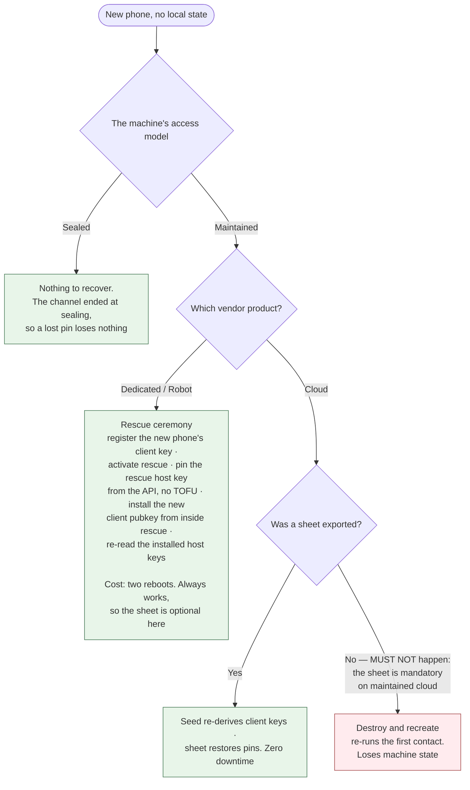

# 03 — Durable state and recovery

Two halves of one problem. **State** is what survives the worker being killed while the
phone is in the operator's hand. **Recovery** is what survives the phone being lost. The
decisions are in [ADR-0022](./docs/adr/0022-durable-state-is-an-append-only-journal.md) and
[ADR-0020](./docs/adr/0020-recovery-roots-in-the-vendor-account.md).

## Durable state

**STA-1** A single **harness worker** MUST be the only writer of durable state. Tabs,
command workers and adapters submit observations and requests; they do not mutate canonical
state.

**STA-2** Canonical state MUST be an **append-only event journal** with replayable
transitions, held in origin-private storage. Content-addressed with periodic compact
snapshots; in-memory state is authoritative only while a worker is running.

**STA-3** A canonical event MUST be durably appended **before** it is applied to in-memory
state. If the append fails, the transition does not occur. The rule is carried as
`TauWeb.Dispatch.append` (ADR-0032); `TauWeb.Dispatch.failed_append_keeps_barrier` is what it
costs a resolution whose own append fails, and `TauWeb.Dispatch.resolution_append_failed_refused`
and `TauWeb.Dispatch.resolution_append_failed_admitted` are the pair.

**STA-4** A side-effecting call MUST have a durable record, an approval decision, and an
idempotency identity **before execution begins**. For an off-machine call this is `SEC-12`;
for box-plane work it is the per-command record of `ARC-8`. The record is appended immediately
before the bytes leave, so on replay an intent with no terminal record means the call **may have
been sent**, never that it was not; an intent with no journaled approval decision was never
dispatched, and that is what `STA-7` cancels. A "sent" record written *after* transmission
would not help: its absence could mean a kill between the send and the append. The check a
request passes before its bytes leave is `TauWeb.Dispatch.admit`, run by `TauWeb.Dispatch.step`
(ADR-0032), and `TauWeb.Dispatch.dispatched_only_if` is what it establishes over every journal,
request and approval.

**STA-5** Every tool MUST declare its retry safety: pure, idempotent with a key strategy,
reconcile-before-retry, or never-retry-automatically. The Robot adapter is
**reconcile-before-retry**: its mutations return nothing that identifies the request, so each is
confirmed by observable state, as `STG-4` states. The inference adapter is
**never-retry-automatically for its record and unbarred for its dispatch**: a lost response
leaves its intent unresolved (`ARC-31a`) and does not stop the next request (`STA-24`).

Catalogue reads are pure. Authenticated account, inventory, machine-status and SSH-key-list reads, and renewal quotes, are repeat-safe reconciliation reads, idempotent under the same account public key; they can create its empty account row. Quote does not create a payment/invoice. Renewal-off is an idempotent assignment scoped to the recorded account, machine and subscription. Create/order, SSH-key registration, stop, restart and reinstall are reconcile-before-retry. No unresolved mutation is automatically replayed, including under a fresh call id, a fresh allocation index for the same approved entry, replay or successor session. No retry classification bypasses STA-8/STA-24.

Account PATCH and invoice-producing renew are never-retry-automatically. None bypasses STA-8 or STA-24.

`STA-8` says "It MUST NOT be retried automatically and no timer may clear it."
`STA-24` owns the dispatch barrier: "The unresolved barrier holds per resource, not per call."

**STA-6 Box-plane work is never-retry-automatically.** Arbitrary shell on a remote machine
cannot declare itself idempotent, so no honest declaration other than this exists. Its
recovery path is `ARC-10`: reconnect, read the machine's state, converge.

**STA-7** After a crash the worker MUST acquire its lock, load the latest snapshot, replay
subsequent events, classify incomplete calls, cancel those that cannot still exist,
reconcile or surface uncertain ones, and resume only where policy permits. **No model turn
is silently resumed from an uncertain destructive operation.** What replay does not change is the
barrier: `TauWeb.Dispatch.replay_same_unresolved` (ADR-0032) is that the worker reads back the
unresolved set it had. Cancelling the calls that were never dispatched is not carried there.

**STA-8** A call that may have produced an external effect but has no terminal record MUST
enter an unresolved state requiring evidence or operator inspection to leave. It MUST NOT be
retried automatically and no timer may clear it. Establishing *what happened* by a status
query is permitted and required where a tool supports one; doing it *again* is not. What the
unresolved state **blocks**, and for which resource, is `STA-20` and `STA-24`; an operator disposition ends
that state without establishing the earlier call's outcome, and what it restricts afterwards is
`STA-24`'s too. The state is derived and never journaled as its own event:
`TauWeb.Dispatch.unresolved` over `TauWeb.Dispatch.openIntents` and `TauWeb.Dispatch.settles`,
read through `TauWeb.Dispatch.inEffect` (ADR-0032).

**STA-9 The journal records what was sent, not what the machine did with it.** This is the
honest limit across the channel: `STA-2` says "Canonical state MUST be an **append-only event journal** with replayable transitions, held in origin-private storage."
If a mid-install interruption kills the worker
or drops SSH, on reconnect the journal knows exactly which commands were
recorded before transmission — and so may have been sent (`STA-4`) — and nothing about which
arrived or completed. Four outcomes are indistinguishable from the
journal alone: never arrived, started and died with the session, **still running**, or finished
with the output lost. Re-running is safe for three of them and is the corruption case for the
third.
`STA-23` says "An ordinary visibility-only hide MUST NOT end or pause an unlocked session, clear its runtime authority, or invalidate its approvals."
Hiding is therefore not itself proof that a worker or SSH session died.

**STA-20 Every box-plane command runs as a tracked job**, and on an installed system the
machine keeps a record on persistent disk (`/var/lib/tau-web/jobs`, root-only) holding:
the **command as received**, its output, its exit code once it has
one, and enough to tell whether **the command itself** is still alive. On reconnect the session
reads that record rather than guessing — exit code present means finished, the command's own
process alive means wait. A record with no exit code and a proven-ended command means it died;
the call stays unresolved (`STA-8`: it "has no terminal record") until the operator's
disposition (`STA-24`), and a continuation that continues then converges as `ARC-10` says:
"reconnect, read the machine's state, and continue from what is found". `ARC-43`'s
`delivery_reboot` is settled by its boot change instead. A missing record is unresolved, never
proof of death.
Record the boot identity with the job; a PID from another boot cannot establish liveness.

Browser-held copies use the representation in
[Protected browser evidence v1](docs/design/protected-evidence-v1.md#2-job-schema-and-replay);
the raw machine record keeps the layout above.

**A record names its machine, and holds no job's input.** Every record carries the machine the
command named (`ARC-7`); one machine's record settles nothing about a command sent to another.
A harness job that takes a value on standard input — `place_secret` (`ARC-43`) — is recorded by
its command like any other, and the job wrapper MUST NOT write that input to any file but the
job's destination: the input is not part of the command as received, and a spooled copy in the
job directory would be a second cleartext secret on the machine.

**An unresolved command holds its machine.** While a box-plane command to a machine is
unresolved (`STA-8`), the harness worker MUST NOT dispatch another box-plane command to that
machine, whatever its call id, tool, requester or session; a read through `exec` is a command,
and a job the harness composes is held too. Collecting a job record is not held, and other
machines are unaffected. Only a terminal record releases the hold: a finished record of any
command but `delivery_reboot`, `delivery_reboot`'s boot change (`ARC-43`), or a disposition,
which `STA-24` says "is a terminal record of its own kind"; otherwise an ended, missing or
incomplete record does not, and no timeout does. A disposition's continuation still restricts
as `STA-24` says, "A destructive continuation stops every box-plane job", and later evidence
does not lift that. The dispatch check carries the rule and the single writer serializes it
with the intent's append, so two requests cannot both pass. A held request is not run and
records no intent. The harness collects the calls holding it, waiting while a command's own
process or its runner is alive; a call whose own dispatch is still awaiting its record is not
collected separately, the held request waits on that same result. The wait does not hold the
writer, is shown to the operator and may be stopped; stopping settles nothing, and a machine
that cannot be reached is answered at once. A held model request's result names the holding
calls, carries what collection read, and says what can release them (a finished record or a
disposition; for `delivery_reboot`, a boot change or a disposition); the model then decides
again. A held harness job is not queued: the flow that needs it stays shown and composes it
afresh once the hold lifts, a first issue and not a retry; after a stopped wait only the
operator resumes that flow, and nothing left armed survives replay.

The admission guard is `TauWeb.Dispatch.commandHold`, consulted by
`TauWeb.Dispatch.barring` beside the cloud-plane barrier (ADR-0032). Its parameter's pair is
`TauWeb.Dispatch.second_command_held` / `TauWeb.Dispatch.second_command_without_hold`;
`TauWeb.Dispatch.hold_reads_and_other_machines` carries the permitted collection and independence.
The wait, collection, stopping, held result and harness-flow resumption remain prose here.

***"It" is the command, not everything the command started.*** A command that launches a daemon
finishes when the command finishes; whether the daemon it started is still up is a **service**
question, and services are `ARC-39`'s delivery declaration, which already distinguishes a tenant
needing a daemon *"enabled and surviving every reboot"* from one whose node *"dies on the first
reboot by design"*. Reading `STA-20`'s liveness to cover the spawned tree would duplicate that
requirement and cost the corpus its only non-POSIX dependency — because POSIX has no way to
observe a process that has left its session (`OPN-22`, closed on this reading). The job record
tracks the command; service lifecycle is declared, checked and owned elsewhere.

*Uniformly, rather than only for commands somebody marked long.* Nobody can reliably predict
which command is slow — a package install is ten seconds most days and ten minutes when a
mirror is struggling — and the mispredicted one is precisely the command that outlives its
session. Removing the prediction removes the failure. `ARC-7` already pays a round trip per
command, so the marginal cost is small against latency already being spent.

**STA-20a Output MUST be captured by redirection to a file, never by reading a pipe the job
holds open.** A command that starts a background process leaves that process holding the pipe's
write end, so a reader blocks until *the background process* exits rather than until the command
does. Measured on both declared distributions: a command that prints and exits immediately
returns after twenty seconds when captured through a pipe and immediately when redirected to a
file. This is not a liveness subtlety — it is `STA-20`'s "its output" field hanging, and it
inverts the failure mode in the damaging direction, since the record then reads *still running*
indefinitely and `CNF-40` requires the returning session to wait on exactly that.

**No orphan test may rest on a reparented process's new parent.** Verified: an orphan reparents
to PID 1 on one declared distribution and to a user-level subreaper on the other, so `PPID == 1`
is precisely the kind of check that is false on the other distribution.

The mechanism is POSIX and holds no init-system opinion, because `ARC-24` declares two
distributions with different init systems and anything specific to one would be false on the
other. That is a real constraint and a satisfiable one **precisely because `STA-20` tracks the
command**: a command's own process stays in the wrapper's process group and is observable by
ordinary POSIX means on both distributions. The wider reading — following a daemon that has
called `setsid()` out of its session — is what POSIX cannot do, and it is the service question
`ARC-39` owns rather than a gap here (`OPN-22`). **Jobs may be hosted inside a terminal multiplexer** so a human can attach and watch a
long install — useful during `STG-2`'s by-hand rehearsal — but that is an observation
convenience and never the record. On the installed system the files survive a reboot; the
recorded boot identity establishes that the old command ended, but not whether it succeeded.
`ARC-43` owns `delivery_reboot`'s boot-change result.

**STA-20b Rescue installation has a bounded exception to disk persistence.** Its tracked
jobs live in root-only `/run/tau-web/jobs` in the rescue system, outside every installation
disk. They survive an SSH disconnect, not a reboot. Each record carries the rescue boot ID
(`/proc/sys/kernel/random/boot_id`), the browser's command ID and the command fields of
`STA-20`. The wrapper runs detached from the SSH connection, captures output to files and
refuses to launch an existing command ID again within that boot. A reconnect checks this
record before issuing more work; the wait, including during partitioning, is `STA-20`'s hold.

Before a planned reset, the harness stops dispatch, waits until every tracked command has a
terminal record (`STA-20`), copies their records into the encrypted browser journal as
**advisory observations**, and durably records installed host-key pins and the reset intent.
If collection or the durable
append fails, it does not reset — and it does not *offer* the reset either: the offer is
checked against those durable prerequisites at the moment it is made, and an approval already
rendered is checked again at dispatch. **Dispatch resumes on the reset's confirmation
(`STG-4`), not on reconnection**: a reconnect to the rescue sshd while the reset has not yet
landed would otherwise let a disk-writing command race the reset that interrupts it. The
resumed probe uses the pin the reset intent named as its expected next pin, since two pins are
journaled at that point and a halt against the old one means the reset landed. On
installed-system entry it creates the persistent job directory before ordinary work. Rescue
records are not claimed to survive this transition.

**The reset into rescue at which a standing disposition's reinstall is dispatched is the one
exception to that wait** (`STA-24`; amended 2026-10-13, ADR-0044). It does not wait for a
command that disposition names and does not require that command's record: the missing evidence
is the uncertainty the operator accepted, and the reset ends the job. Every other tracked
command is still waited for and its record collected, as above; if one of those hangs, the
operator replaces the disposition to name it too. The reset's own intent is durably recorded
first, as always. A reinstall chosen while the server is already in rescue starts from a fresh
rescue boot — a new rescue activation and reset, then the install — and does so after an
unexpected rescue reboot too: one rule everywhere, and the second reset there is accepted.
Recording installed host-key pins is a prerequisite of a reset into the installed system, not of
a reset into rescue. Keeping the current rescue boot and running the install again is not a
destructive reinstall; it is continuing as if not done, under which `STA-20`'s hold still
applies to any other unresolved job. With an installed-system pin already recorded,
continuing as if not done keeps that installation: the re-run MUST NOT re-format the root
whose filesystem label equals the installation id the harness shows (`STG-20`). Changing the
installed system's keys requires a destructive reinstall. The reset into the installed system
MUST NOT be offered when the newest `ready_to_reset` read differs from the active installed pin;
the operator is told then, before reboot. The offer MUST NOT be made when the current
installation's first durable prerequisite read shares a fingerprint with any earlier
installation's prerequisite read or installed-system pin of that machine; the operator is told
then, before reboot. The offer MUST use the current installation's durable prerequisites to
make the offer; earlier installations' records are read only to withhold it.

After an unexpected rescue reboot, a changed boot ID proves the old command cannot still be
running; it does **not** prove its effects or exit status. Missing output, a missing job record,
or a record from the old boot leaves the operation unresolved under `STA-8` until the operator's
disposition: continuing on what inspection shows, or a new destructive reinstall. The
browser's record of what was sent remains authoritative throughout (`STA-21`).

The precondition of the offer of a reset into the installed system is
`TauWeb.Dispatch.offersReset` (ADR-0032), which reads whether `ready_to_reset`'s record of the
installed pins and the reset intent was durably appended in the current installation, and
compares the newest read's keys against the first durable prerequisite read there. Where that
first read shares a fingerprint with an earlier installation's prerequisite read or
installed-system pin, the offer stays withheld for that installation whatever a later read
shows; a new destructive reinstall is needed. The companion carries no earlier observations:
a first read refused only for overlapping an earlier observation is outside it.
`TauWeb.Dispatch.installationOf` derives that boundary from the journal's vendor reinstall
call, the reset into rescue that dispatches a standing reinstall disposition, or the reset
bound to a separately journaled reinstall approval not withdrawn since.
`TauWeb.Dispatch.prerequisiteKeys` reads those records. The guard's pairs are
`TauWeb.Dispatch.predecessor_reset_offer_refused` /
`TauWeb.Dispatch.predecessor_reset_offer_admitted_without_guard` and
`TauWeb.Dispatch.changed_keys_reset_offer_refused` /
`TauWeb.Dispatch.changed_keys_reset_offer_admitted_without_guard`.
Amended 2026-10-17: the earlier-keys comparison has the pair
`TauWeb.Dispatch.kept_keys_reset_offer_refused` /
`TauWeb.Dispatch.kept_keys_reset_offer_admitted_without_guard`;
`TauWeb.Dispatch.stale_first_prerequisite_keeps_offer_withheld` retains the first-read anchor.
Keys in this companion are one opaque ordinal per set: it carries identical sets only;
partial fingerprint overlap and the comparison against installed-system pins are Markdown-only.
`TauWeb.Dispatch.current_installation_reset_offered` carries a matching successor read and
`TauWeb.Dispatch.dedicated_reset_retires_prerequisites` the dedicated dispatch boundary.
The durable-append guard retains the pair
`TauWeb.Dispatch.reset_offered_after_failed_append_refused` and
`TauWeb.Dispatch.reset_offered_after_failed_append_admitted`.
Amended 2026-10-17: `TauWeb.Dispatch.failed_prerequisite_withdrawal_refused` /
`TauWeb.Dispatch.failed_prerequisite_withdrawal_admitted_without_guard` carries withholding after
any failed prerequisite append, including after an earlier durable read and across replay.
The durable per-command record of `ready_to_reset` precedes collection; without its durable
result the offer stays withheld, per entry and current installation, until a later durable
prerequisite read. `TauWeb.Dispatch.failed_collection_per_entry_and_installation` carries that
isolation. That a reset into rescue
under a disposition waits for the command the disposition does not name, and not for the one it
names, is `TauWeb.Dispatch.reset_waits_for_other_commands`, decided. What a changed boot ID
establishes is `TauWeb.Dispatch.confirms`, whose lattice keeps *ended* below *succeeded*, with
`TauWeb.Dispatch.boot_id_change_not_success_refused` and
`TauWeb.Dispatch.boot_id_change_not_success_admitted` its pair. That the halt against the old
pin is the reset's confirmation rather than an error is
`TauWeb.Pins.halt_on_expected_pin_confirms` over every trace, with
`TauWeb.Pins.pin_halt_is_confirmation` its decided trace.

**STA-21 The job record is machine-reported and advisory.** The browser journal is authoritative
for what was **sent** (`STA-3`, `ARC-8`); the machine's record says what it **received** and what
happened next. Comparing the two catches truncation, quoting damage and a mangled multi-line
command — the honest-mistake class, and a real one. It catches nothing against a machine that
lies, because such a machine writes whatever it likes. This stands exactly where the
deterministic verifier stands and MUST NOT be reported as more (`SEC-2`).

The protected browser copy and its genuine comparison outcomes are represented by
[Protected browser evidence v1](docs/design/protected-evidence-v1.md#2-job-schema-and-replay).
This does not add machine-truth or settlement authority.

**STA-24 The unresolved barrier holds per resource, not per call.** While any call naming a
resource is unresolved (`STA-8`), the harness worker MUST NOT dispatch a side-effecting
operation naming that resource — whatever its call id, through whichever tool, and whichever
session or model requests it, including a session that re-enters or succeeds the one that
raised it, and including the operator's abandonment flow. A machine with unresolved calls
therefore needs a disposition naming every one before that flow's destroy; an unnamed call
keeps barring it. A machine with none needs no disposition. The request is refused and the
unresolved call is shown in its place: to the model as the tool result where a model requested
it, to the operator on the screen. An approval already rendered does not clear
the barrier; it is checked again at dispatch.

**The resource is what the intent record named, assigned or checked by the harness and never
taken from the model.** For a machine it is the **approved machine entry** of the setup
(`ARC-15`'s batch), to which the reserved allocation index (`STA-22b`) and, once learned, the
immutable vendor machine id are associated — so a create and the machine it produced are one
resource, and a second attempt at the same entry sits behind the same barrier even if it would
reserve another index. A different approved entry is independent, and creating it while a
sibling is unresolved is permitted under its own approval, whose card shows the unresolved
sibling and that it may be billing. For an untyped call it is the **scope** itself, since no
adapter can say what the call touched (`SEC-4`): no further call under that scope is dispatched
while it is unresolved, and once the operator disposes of it only as the disposition permits
(below); nothing under a scope counts as a read, because nothing types it. A scope re-approved
for the same origin and credential inherits the outstanding call. An untyped vendor scope
(`SEC-4`) is a scope like any other here.

**What stays permitted.** Reads naming the resource — the adapter's status queries, the pinned
SSH attempt that is `STG-4`'s third predicate, the collection of job records — are permitted
and are how the barrier clears. Box-plane dispatch to the machine is governed by `STA-20` and
`STA-20b`, not by this rule, with one exception stated here: a cloud-plane operation that
**changes what the machine is running** — a reset, a reinstall, a destroy, or the stop that
stands in for a destroy (`ARC-22`) — stops box-plane dispatch to that machine from its intent
until its confirmation. Where the operator disposes of it instead, the stop lifts only as the
disposition permits (*What a disposition reaches*, below). An unresolved activation or key
registration touches no running system and blocks nothing on the box. Under
an untyped vendor scope no adapter can say which call changes what a machine is running, so the
same exception is taken wider there: while a call under that scope is open — sent, and not yet
answered — or unresolved, the harness worker MUST NOT dispatch a box-plane command to any
machine of the session's bound set at that vendor. The pause ends with the call's terminal
record: where that record is the operator's disposition, a continuation that continues ends
the pause and a destructive one does not (*the hold*, below). This pause is not carried by
`TauWeb.Dispatch` below. The inference request (`ARC-31a`) keeps its unresolved intent under
`STA-8`, shown as unaccounted spend against the session key's cap, and does **not** bar the next
request: its only effect is bounded spend, and the next request is the session's only way to
continue.

**What clears it.** Evidence is the observation the operation's own reconciliation contract
admits, or its expressly admitted exact-call receipt — for Robot, `STG-4`'s predicates, read from the vendor or from a pin-checked handshake
— durably appended before dispatch resumes (`STA-3`): a status read followed by a failed append
leaves the barrier standing. LNVPS's operation predicates are `STG-21a`'s.
Confirmation evidence MUST identify the expected account, machine and operation and be durably
appended before taking effect. Failed append, timeout and operator disposition establish no success.
Receipt evidence binds the successful response to the exact dispatched call, signed request,
account and target, received over browser-terminated vendor TLS, with its operation-specific
interpretation. A generic 2xx, an unrelated response or an unvalidated/malformed body is
insufficient. Receipt authority is limited to order, stop and restart;
no other mutation response becomes confirmation. For their predicates, see `STG-21a`.
The formal receipt operation mapping is:

<!-- formal: TauWeb.Render.receiptTable -->
| Receipt operation | Dispatch kind |
|---|---|
| `order` | `create` |
| `stop` | `destroy` |
| `restart` | `reset` |
<!-- /formal -->

`destroy` carries the LNVPS stand-in stop here; its successful receipt establishes stopped,
not destruction. Only LNVPS approvals carry a receipt binding; Robot's reset remains read-confirmed.
`TauWeb.Dispatch.cloud_observation_sources` retains read provenance refusal;
`TauWeb.Dispatch.cloud_receipt_correlated` states exact receipt correlation.
The deletion evidence record is distinct from
a dispatched-call receipt: it names the recorded key, account result, associated id, complete
listing omission and decoded exact-id error, and takes effect only after durable append. It
correlates no dispatched call and does not itself settle a distinct unresolved stop or renewal-off
call. A job record can settle the box-plane command it records, as
`STA-20` says and with the standing `STA-21` gives it; it cannot clear a cloud-plane barrier,
and neither can model text (`SEC-8`). Otherwise the operator **disposes**: a record of its own
kind naming the unresolved calls it ends, the continuation the operator chose — a destructive
reinstall (`STG-20`), abandonment (`ARC-21`), continuing as if done, continuing as if not done —
and the uncertainty accepted. A disposition keeps the outcome *unknown*; it is never written as
success, failure, zero spend or non-execution. Neither a timer nor the model supplies one.
**A disposition is a terminal record of its own kind**: it ends the call's unresolved state
with the outcome recorded as unknown, so the barrier stays one derivation — an intent with no
terminal record — and a disposed call is not an open one.

**What a disposition may name.** A disposition names at least one call, and every call it names
MUST be unresolved, on the disposition's own resource, in the journal as it stands before the
disposition. Otherwise it is refused and nothing is recorded, and the operator is shown that it
was refused, the record that settled the call if one did, and what is unresolved now. Naming
some of several unresolved calls is permitted; the unnamed ones stay unresolved and keep their
barrier. For an untyped call the resource is the scope. The operator MAY replace a standing
disposition: a new disposition may name the calls the standing one disposed, which is the one
exception to naming unresolved calls, since those calls already carry the standing disposition
as their terminal record. One disposition stands per resource, the latest, and its continuation
is the one in force; the operator is shown what it replaces. Neither a timer nor the model
replaces one. A call omitted by a replacement stays settled under the replaced record with
outcome unknown, adds no restriction, and may never be named again. The replacement screen
MUST list the calls it drops. This holds at LNVPS too. Which calls a disposition names decides
acceptance and display, never what it refuses on a machine: every disposed machine call barred
every cloud-plane side-effecting operation, and a destructive choice adds the box-plane stop.
Only the continuation changes those refusals.

When a destructive reinstall continuation is replaced by one that continues, the screen MUST
say that the model's commands resume and any reset is admitted subject to the other dispatch
checks. Where no reinstall approval stands it MUST say "the reinstall is cancelled", except
under an untyped vendor scope: there it MUST describe releasing the hold, without implying
that work done by hand at the vendor was cancelled. Where an undispatched reinstall approval
stands, the screen MUST instead make the operator choose "keep the reinstall approval" or
withdraw it, for each such approval. `STG-20` says "Only the operator's journaled withdrawal,
naming the entry, the reset call and the approval, withdraws a reinstall approval"; the
replacement and the withdrawal are separate journaled acts, neither implied by the other.
On the dedicated path only, the screen MUST say that, with the activation's state unknown,
a reset other than a standing approval's own reset may boot the installed system. It MUST
there offer the likely intent, a disposition of the activation with the reinstall continuation:
"retry the activation, keep the reinstall".

Visibility alone changes none of these approval choices. `STA-23` says "An ordinary visibility-only hide MUST NOT end or pause an unlocked session, clear its runtime authority, or invalidate its approvals."
`STG-20` says "An approval **stands** from its record until its reset is dispatched, a matching withdrawal is recorded, or the session it was rendered for ends; several approvals for an entry stand independently."
The keep/withdraw presentation above therefore still applies to a surviving session after an
ordinary hide. A previously chosen destructive continuation may remain eligible while
hidden; the permission is neither dispatch nor proof of an unknown outcome. Before each
dispatch the barrier and all other checks still apply, with no automatic replay of an
uncertain mutation.

**What a disposition reaches.** A standing disposition restricts, to its continuation, what the
calls it names barred while they were unresolved. An operation outside that reach is neither
restricted by it nor ends it. A read and the inference request are never restricted. A read
here is one named under *What stays permitted*; a box-plane job that reads is a command
(`STA-20`). So a disposed reset, reinstall or destroy keeps box-plane dispatch to that machine stopped except as
the continuation permits; a disposed create, activation or key registration bars nothing on the
box plane; and a disposed box-plane command restricts only what an unresolved box-plane command
bars. The disposition releases the named command's hold; unnamed unresolved commands retain
theirs. Within the reach the harness worker MUST NOT dispatch an operation the continuation does
not permit. A destructive reinstall permits only the reinstall, abandonment only the
abandonment flow. Continuing as if done and continuing as if not done restrict nothing:
everything the disposed calls barred is permitted again, a re-issue of the same operation
included. The two differ only in the assumption the operator recorded, which is shown and
never written as success, failure, zero spend or non-execution. A re-issue under either is the
operator's explicit choice, and `STA-8`'s prohibition of an automatic one is untouched. A
permission is not a dispatch: an operation the continuation permits still meets every other
dispatch requirement, the approval and the binding (`SEC-4`) among them, and for a reinstall
`STA-20b`'s prerequisites.

**A destructive continuation stops every box-plane job.** When the continuation is a
destructive reinstall or abandonment, the harness worker MUST refuse every box-plane job to
that machine, whatever the disposed call was and whoever starts it: the model's commands, a
harness-owned job the model requests (`ARC-43`), and the jobs the harness composes itself,
`delivery_reboot`, `replace_root_label`, Replace's key install and old-key removal (`STA-17`),
`digest_secret` and the delivery check's harness-composed reads among them. That the harness
composed or started a job changes nothing here: a stray command would pre-empt the reinstall
the operator chose, and each further one would defer it again. This is the one case where the
restriction exceeds what the disposed calls barred. Reads stay permitted throughout, the
pinned SSH attempt that is `STG-4`'s third predicate and the collection of job records among
them: they are how the operator learns whether a reinstall landed.

**When the restriction ends.** The restriction ends when the continuation it names is
dispatched, its intent durably appended (`STA-3`); from then on that call's own barrier governs,
and if it goes unresolved the barrier stands again. A continuation is its owner's flow and can
take several operations: it is dispatched at the one that changes what the machine is running.
For a destructive reinstall that is at LNVPS the vendor's reinstall call
(`ARC-22`), and on a dedicated server the **reset into rescue**. While its disposition stands,
the operations of that machine's return to rescue that touch no running system — the rescue
activation, and a key registration where one is owed — are admitted and do not end the
restriction, and the reset into rescue is a reset dispatched after that rescue activation is
confirmed and while the newest read of that activation still confirms it. Only an activation
dispatched after the standing disposition counts: it is the activation approved under the choice
in force, and one boundary scopes both the activation and its read. `CHN-R1` says the
plain rescue endpoint "reports inactive and empty once the boot has consumed the activation":
a confirmation already given can be stale. The newest read is the read of the activation
predicate (`STG-4`), `GET /boot/{n}/rescue`, journaled before the reset's intent at its dispatch
check, not a read of `/rescue/last`. The duty to read the activation again is `STG-4`'s.
A read whose append failed is not in the journal (`STA-3`)
and cannot be the newest read; reads after the reset's intent are irrelevant, since from that
intent the restriction has ended. A read that does not confirm the activation, inactive or one
that tells nothing, leaves it not counted: it settles nothing and reopens nothing, and the
activation call stays terminal. It only means the activation is not the one the reset into
rescue follows. Any other reset is refused while the disposition stands: with no confirmed rescue
activation it boots the installed system and would hand the machine back. A later read that
confirms it, or a fresh activation confirmed, admits the reset.

A reboot between that read and the reset leaves a window this rule does not close. The pin check bounds it only before first contact: if `/rescue/last` still has the pre-reset
snapshot's keys, the reset's confirmation never holds and its barrier stands. Fresh disjoint
keys published by an unrequested rescue boot can satisfy that predicate and match the pinned
SSH attempt; a late reset landing after first contact can then kill the install mid-write.
The real bounds are key publication taking about 80 s after the reset (`CHN-R1`) and damage
limited to disks already chosen for erasure. *What this requirement used to say* was that
"the pinned SSH attempt remains the bound"; that misses a reset landing after first contact.
If the activation itself goes unresolved, its own barrier refuses the reset; evidence can
settle that call but does not lift the reinstall's box-plane stop, which holds until the reset
or replacement of the disposition. *What this requirement used to say* was "the box plane stays
stopped until evidence or a further disposition"; evidence does not undo the operator's choice.
The model's install commands
follow the reset's confirmation: `STA-20b` says "Dispatch resumes on the reset's confirmation".
For abandonment it is that flow's operation naming the machine: the destroy, or the stop that
stands in for it (`ARC-22`), whose own barrier then holds the box plane as the exception above
says. A session's request for that destroy or stop under a standing abandonment MUST be refused:
abandonment permits only the abandonment flow. At LNVPS renewal-off waits for the stop's
confirmation: renewal control names the same resource and its barrier still holds.
Abandonment is setup-wide (`ARC-22`) and the restriction is not: apart
from the hold below, it covers a machine with a disposed call and nothing else; what an
abandoned setup permits afterwards, and that the flow runs outside any session, are `ARC-21`'s,
`ARC-22`'s and `STA-18`'s. A continuation that continues has no operation to be dispatched at:
it stands, restricting nothing, until the operator replaces it. Evidence about the calls the
disposition names that arrives after it is journaled and shown: it
neither reopens the call nor removes the disposition, which stands until its continuation is
dispatched or the operator replaces it. A read of the activation now decides which reset counts
(above), whatever call it also bears on; it still reopens nothing and removes nothing.

**On replay.** A disposition found in a replayed journal (`STA-7`) that the test above — what a
disposition may name, the replacement's exception included — would have refused is read as if
it had never been recorded: it ends no call and restricts nothing, every call it named that is
unresolved stays unresolved and keeps its barrier, and the operator is shown the record. The
same test decides at recording and at replay: a replacement that was valid when recorded is
valid on replay, and the continuation in force after a restart is the latest valid one.

**Under an untyped vendor scope a destructive continuation is a hold.** Nothing under a scope
can be recognised as the reinstall or the abandonment, so no call there counts as the
continuation. A destructive disposition on a scope refuses every further call under the scope
and keeps the model's box-plane commands to the machines of the session's bound set at that
vendor stopped until the operator replaces it. Before either destructive choice the screen
MUST say that the harness cannot carry it out there and that the operator acts at the vendor by
hand; doing so releases nothing by itself, and the replacement does. Machines outside the bound
set, or at another vendor, are not held by this (`SEC-4`, ADR-0038). How a reinstall or an
abandonment is carried out at an untyped vendor is undecided (`TASKS.md` T47). Like the pause,
the hold is stated here only and is not carried by `TauWeb.Dispatch` below.

The barrier is a fact of the journal — an intent with no terminal record — and survives
replay (`STA-7`) and session succession without an event of its own, because an event
recording "became unresolved" is exactly what a crash could fail to write. On one machine at
most one cloud-plane call is unresolved at a time, it is older than every box-plane command
unresolved beside it, and a call that changes what the machine is running is unresolved alone;
at most one box-plane command is unresolved (`STA-20`'s hold). Admission,
reservation and the dispatch check are serialized by the single writer (`STA-1`), so two
requests cannot both pass before either is unresolved. What this rule cannot reach is a journal
that is lost with the phone: `STA-14` states that transcripts are gone, and a recovery sheet is
not an outstanding-call record.

*The trap.* `STA-8` speaks of a call, and a model does not retry a call: it requests the action
again, and every request carries a fresh call id. `POST /reset` returns `running` with no
request identity (`STG-4`); with the response lost the reset is unresolved, the model sees no
confirmation and asks again, and nothing keyed on the first call id refuses the second. A
second create is a second billed machine and a second reset lands on a disk being written —
**money out** and **destroyed data**. A fresh allocation index would have been the same hole one
level up, which is why the resource is the approved entry and not the index. Per session was
rejected twice over: it stops nothing a session needs and it ends with the session, so a
re-entering or successor session would start clean on a machine that is not. Added 2026-09-16
from `lean-01.md` §2B, after two independent readers of one brief
(`docs/review/2026-09-16-barrier-panel.md`).

*What this requirement used to say about a disposition.* Until 2026-10-13 a disposition
"permits only the continuation it names, and a new unresolved call stops that continuation
again", and nothing said which operations that applied to. Read as every operation naming the
resource, a disposed activation began to bar the box plane and a read was refused; read as
nothing on the box plane, disposing of an unresolved reinstall lifted the stop on every command
at the moment the operator chose to abandon the machine. Three traps came with it: a status
read, being a later intent, ended an abandonment; a disposition was matched to a call by call
id alone, so one recorded against a machine ended a call on another; and nothing refused a
disposition that named no unresolved call. This requirement also said the worker admits at
most one outstanding effect per resource, which an activation unresolved beside a box-plane
command refutes. The reasons for the shape above, and what was rejected to reach it, are ADR-0044's.

This rule is carried in Lean under `TauWeb.Dispatch` (ADR-0032). The barrier is
`TauWeb.Dispatch.blocking` over `TauWeb.Dispatch.bars`, which holds the carve-outs above —
reads, the box plane, and `TauWeb.Dispatch.changesRunning`'s exception — and the resource is
`TauWeb.Dispatch.resolve`, assigned from what a model named. The key is the parameter, whose
pairs are `TauWeb.Dispatch.same_action_new_call_id_refused` and
`TauWeb.Dispatch.same_action_new_call_id_admitted` for the trap above and
`TauWeb.Dispatch.second_index_same_entry_refused` and
`TauWeb.Dispatch.second_index_same_entry_admitted` for the index one level up. What may be
unresolved together is `TauWeb.Dispatch.unresolvedTogether`, decided over the bound by
`TauWeb.Dispatch.bounded`. `TauWeb.Dispatch.tracesUpTo` filters out every sequence whose requests
repeat a call id; the bounded property also checks that freshness.

A disposition's four choices are `TauWeb.Dispatch.Continuation`. What it may name is
`TauWeb.Dispatch.acceptable`: `TauWeb.Dispatch.step` refuses one that fails it, and
`TauWeb.Dispatch.inEffect` reads a journal that already holds one without it. Its reach is
`TauWeb.Dispatch.reaches`, computed from the disposed calls through `TauWeb.Dispatch.bars`; what
a continuation permits within it is `TauWeb.Dispatch.permits`, the destructive stop is
`TauWeb.Dispatch.stops`, and `TauWeb.Dispatch.restricted` is the three together. The operation
a continuation is dispatched at is `TauWeb.Dispatch.dispatchesContinuation`, with
`TauWeb.Dispatch.rescueConfirmed` for the reset into rescue and `TauWeb.Dispatch.prepares` for
what is admitted before it; the disposition standing is `TauWeb.Dispatch.standing`. Over every
journal, `TauWeb.Dispatch.read_and_inference_unrestricted` is that neither a read nor the
inference request is restricted, and `TauWeb.Dispatch.dispatched_only_if` carries the reach in
its last clause. Each guard is a parameter with its pair:

- that a disposition restricts at all, `TauWeb.Dispatch.disposition_one_continuation_refused`
  and `TauWeb.Dispatch.disposition_unrestricted_admitted`;
- the reach taken from the disposed calls and not from the resource,
  `TauWeb.Dispatch.continuing_permits_what_was_barred` and
  `TauWeb.Dispatch.disposed_activation_bars_commands_without_guard`; not applied to every
  dispatch, `TauWeb.Dispatch.read_and_inference_never_restricted` and
  `TauWeb.Dispatch.read_and_inference_restricted_without_guard`; and not from the calls still
  unresolved, `TauWeb.Dispatch.replacement_in_force` and
  `TauWeb.Dispatch.replaced_continuation_dispatched_without_guard`;
- the destructive stop, `TauWeb.Dispatch.destructive_choice_stops_commands` and
  `TauWeb.Dispatch.command_preempts_reinstall_without_guard`, with
  `TauWeb.Dispatch.destructive_choice_stops_commands_after_activation` for a disposed call that
  barred nothing on the box; and `TauWeb.Dispatch.destructive_choice_stops_delivery_reboot` /
  `TauWeb.Dispatch.delivery_reboot_dispatched_without_destructive_stop` for the harness's reboot,
  with `TauWeb.Dispatch.abandonment_stops_delivery_reboot` under abandonment;
- the end at the continuation's dispatch and not at any later intent,
  `TauWeb.Dispatch.read_does_not_lift_abandonment` and
  `TauWeb.Dispatch.read_lifts_abandonment_without_guard`, nor at the reinstall's first
  operation, `TauWeb.Dispatch.preparation_keeps_restriction` and
  `TauWeb.Dispatch.preparation_lifts_restriction_without_guard`, with
  `TauWeb.Dispatch.abandonment_ends_at_its_destroy_alone` for the abandonment's end among
  operation kinds;
- the reset into rescue, `TauWeb.Dispatch.reset_without_rescue_refused` and
  `TauWeb.Dispatch.reset_without_rescue_admitted`, and
  `TauWeb.Dispatch.spent_activation_not_counted` and
  `TauWeb.Dispatch.spent_activation_counted_without_guard` for the newest activation read,
  with `TauWeb.Dispatch.return_to_rescue_trace` the return whole;
- the disposition's own resource, `TauWeb.Dispatch.disposition_names_own_unresolved_calls` and
  `TauWeb.Dispatch.disposition_ends_call_elsewhere_without_guard`;
- the session destroy under abandonment, `TauWeb.Dispatch.session_destroy_under_abandonment_refused`
  and `TauWeb.Dispatch.session_destroy_lifts_abandonment_without_guard`.

`TauWeb.Dispatch.replayed_invalid_disposition_means_nothing` is the replay, and
`TauWeb.Dispatch.evidence_after_disposition_changes_nothing` is that later evidence neither reopens
a disposed reset nor removes its disposition. Decided beside them, with no parameter of their own, are
`TauWeb.Dispatch.disposition_names_at_least_one_call` and
`TauWeb.Dispatch.disposition_names_every_call_unresolved` for what a disposition may name;
`TauWeb.Dispatch.activation_before_disposition_not_counted` and
`TauWeb.Dispatch.activation_under_replaced_disposition_not_counted` for which rescue activation
the reset into rescue follows; and `TauWeb.Dispatch.reinstall_does_not_refuse_key_registration`,
that the restriction does not refuse a key registration and still stands after one;
`TauWeb.Dispatch.command_bars_activation_and_reset` pins an unresolved command barring both
activation and reset. The companion carries nothing of whether a registration is owed, so no trace requests one under a
disposition. The companion's `exec` is box-plane work other than the harness's `deliveryReboot`,
and a request there is a session's; the destructive stop is by kind, whoever
starts the job. Its destroy under abandonment is refused; the guard-removed paired trace retains
the former admission as a trap. The operator flow's intent is appended outside admission in
`TauWeb.Dispatch.abandonment_ends_at_its_destroy_alone`, which now also states the session's
refusal. `TauWeb.Dispatch.undisposed_command_bars_flow_destroy` shows that the flow's intent
still meets an undisposed call's barrier; `TauWeb.Dispatch.omitted_call_stays_settled` carries
replacement's omission.
`TauWeb.Dispatch.restriction` is the continuation in force over a resource;
`TauWeb.Dispatch.admissible` and `TauWeb.Dispatch.receiptMatches` govern the two evidence
forms; `TauWeb.Dispatch.cloud_observation_sources` and
`TauWeb.Dispatch.cloud_receipt_correlated` retain their separate provenance and correlation; and
`TauWeb.Dispatch.inference_unbarred` is the inference request's exemption. The
untyped call's scope is not among the resources it carries, so neither the pause nor the hold
is carried.

## The exposure ledger

**STA-10** The **exposure ledger** is the per-machine history of every configured model that
has ever touched a machine. It is how `SEC-1`'s permanence clause is tracked, it lives in the
encrypted-at-rest store, and it is exported in the recovery sheet. An entry is made at
**binding**, for every machine of the session's bound set, and it records the set that machine
was bound in — so a configured model's footprint (`SEC-1`) is read from the ledger and never
reconstructed. A jump host (`CHN-R6`) has no entry and never gains one: no session is bound to
it.

**STA-11 The ledger's staleness rules bind only a tenant that is both maintained and
threshold-bearing, and none currently is.** The two halves cancel, and stating so keeps an
implementer from building machinery that governs nothing:

- Where exposure **matters** — a tenant with a threshold — btc-policy **seals** its machines,
  so nothing re-enters, so the ledger is complete when setup ends and never changes again. A
  recovery sheet's snapshot is therefore always current.
- Where the ledger **drifts** — a maintained machine, re-entered by later sessions — there is
  no threshold and no declared independence bound, so nothing is refused on the count: a
  configured model's footprint is counted and shown (`SEC-1`).

For a tenant that is both, which is possible and does not yet exist, the rules below apply.
They are recorded rather than deleted for that reason.

**STA-12** A restored ledger is a **floor, not a census**. The sheet records its export time;
the app requires a re-export whenever the ledger mutates; and a restored ledger is displayed
"as of" its export. Where it may be stale, re-entry binds only a configured model not
currently assigned to any other machine.

**STA-13** A machine recovered *without* a ledger carries **unknown past exposure**, displayed
as such, and re-entry then binds only a configured model not currently assigned to any other
machine — the conservative reading, since the unknown history could contain any of them.

## What survives a lost phone

**STA-14** For vendors with a separate account, the operator's **vendor account is the
recovery root**. It survives because it lives in their head or password manager and is
recoverable through the vendor's own processes, and it is the party that knows which machines
exist. At LNVPS, the vendor identity is to derive from the seed under the decision in ADR-0042;
inventory and credentials therefore share a root. T44 must make that decision operative in
the credential format and recovery rules before stage-1 completion. The table below describes
the separate-account case and the current credential format, not an available LNVPS Restore.

| Dies with the phone | Survives |
|---|---|
| Host-key pins | The vendor login |
| The machine inventory | **The seed** — in the operator's head or seed backup, never on the phone alone (`STA-22`) |
| Action transcripts | **The SSH client keys, re-derived from the seed plus allocation metadata** (`STA-22b`) |
| Provenance records | **The relay pass**, if its relay locator and pass index were exported (`STA-22b`) |
| The exposure ledger | The app URL |
| | The recovery sheet, **if exported** |
| **The inference account credential**, unless exported: it is bearer, there is no account behind it, and nothing re-derives it | The inference balance — **only** through the sheet (`SEC-5` row 14) |
| The vendor API credential and the session inference key — re-supplied or re-minted per session, deliberately not persisted | |

**Transcripts and provenance are gone and stated as gone.** They were records, not secrets;
nothing re-derives the past.

**STA-22 The operator holds a seed, and every per-machine credential the browser needs derives
from it.** A BIP-39 mnemonic, held encrypted at rest and backed up by the operator the way
this audience already backs up seeds. For machine *m*, the browser derives at index *m*: the
SSH client keypair (`SEC-5` row 3), the attest sender key (row 7) and the attest recipient key
(row 16); and for relay pass *n*, on its own branch, the relay key (row 4). A tenant whose
handoff slot declares a credential also derives one **post-harness credential** (row 17)
on its own branch. Derivation is the versioned, role-separated contract in `STA-22a`; an
implementation must not choose paths independently.

- **No session and no machine ever sees the seed.** What machine *m* receives is its client
  public key, its sender private key, its recipient public key, and — where the handoff slot
  declares that machine a target — the post-harness credential's *public* key: values nothing
  derives *from*. `SEC-1`'s cryptographic enforcement is untouched: machine 3 still holds
  machine 3's public key alone.
- **A machine's index is journaled before the create call and never reused.** The same index
  on two machines is the same client key on two machines, which is `SEC-1` broken by
  bookkeeping. `STA-3` already requires the record before the effect; the index is part of
  that record, and indices are monotonic.
- **The sheet no longer carries keys.** Its contents are listed in `STA-16`. The seed
  reconstructs a key only when its role and index are known. Seed-only recovery is refused:
  a seed alone does not discover indices or relay purchases.
- **A stolen seed is not revocable.** Replace (`STA-17`) is therefore a **new seed**, from which
  new client keys derive, with the old public keys removed from every maintained machine during
  re-entry — the same flow as before, with a different origin for the new keys and one more
  thing to back up again.

*What this reverses.* ADR-0020 rooted recovery in the vendor account and rejected a seed-shaped
root by omission; the sheet existed because nothing re-derived the client keys. At vendors
with a separate account, that account still roots **inventory**, while the seed roots
**credentials**. ADR-0042 decides that LNVPS instead shares the seed root for both, pending
T44's coordinated implementation.

**STA-22a Credential format v1 is normative.**
[`docs/design/credential-format-v1.md`](./docs/design/credential-format-v1.md) fixes mnemonic
handling, hardened derivation paths, role numbers, key encodings and known-answer vectors.
Every allocation and recovery export records that version. Unknown versions are refused;
an upgrade never silently reinterprets an existing identity. The seed is a dedicated harness
seed, never an existing wallet or social-identity seed.

For the recovery payload's version-3-to-version-4 compatibility conversion, see the
[credential format](./docs/design/credential-format-v1.md). For publisher-key mismatch and
migration, see `CHN-19`.

**STA-22b Allocation metadata is recoverable state.** The journal owns a seed identifier,
derivation version, next unused index for each role family (machines, passes, handoffs),
and allocated entries, including tombstones for failed or destroyed allocations. A jump host
(`CHN-R6`) takes a machine-family index like any machine, and its entry records that it is in
no session's bound set. A machine entry maps vendor/account reference and immutable vendor machine
ID to its index and expected SSH public key; a pass entry maps `relay_locator` and the holder's
relay-key public half to its pass index; a handoff entry maps tenant and **handoff ID** to its
index. A pass's `relay_locator` is exactly `{"publisher":P}` for publisher discovery or
`{"url":R}` for a direct locator. The publisher's discovery key is not the holder's seed-derived
relay key. The journal also retains CHN-19's signed discovery high-water event per recorded
publisher key, including withdrawals and expired events; it is recoverable metadata, not proof of
the newest remote state. The handoff ID is the identifier the profile's
handoff slot names for the thing its credential is issued to — stable for that credential's
declared lifetime, so a resumed or restored setup re-derives the same key (btc-policy's is
the federation ID). Machine roles share one machine index. Reserve it
durably before any external effect, including registering a key for an already-rented server.
All this metadata is included in `STA-16` exports, with an export time and journal sequence.

Import checks the seed identifier, derives each listed public key and compares it, validates
unique indices within each family and next-unused counters above all listed indices, and
cross-checks vendor inventory before binding machines. A stale sheet cannot prove the latest
counter. Therefore **every imported seed may restore listed identities but MUST NOT allocate
new ones**, from a recovery sheet or an imported local-store backup, even when it claims to
be current. To allocate again, use Replace with a freshly generated seed; old records are
retained until migration is complete. An import bringing a seed with neither a sheet nor a
store backup MUST be refused, saying that a seed alone restores nothing: bring the sheet,
or start fresh.

Under a generated seed, allocation in every family — machines, relay passes and handoffs —
MUST be refused until that seed id has the journaled ceremony record of `STA-23`.
Replace's machine-migration and new-relay-pass allocations wait for its fresh seed's record;
generating that fresh seed is never gated. The ceremony gate's pair is
`TauWeb.Allocation.backup_missing_refused` and `TauWeb.Allocation.backup_missing_admitted`.
Existing identities remain usable during non-revoking Restore. Restored knowledge beyond allocation
is governed by `STA-16`. The index rules are carried as
`TauWeb.Allocation.allocate` (ADR-0032): under the restriction above,
`TauWeb.Allocation.issued_nodup` proves over every trace that no two allocations share an
identity, and the restriction is the parameter whose pair is
`TauWeb.Allocation.stale_sheet_refused` and `TauWeb.Allocation.stale_sheet_admitted`.

With no sheet, or for machines missing from a stale sheet, Robot recovery installs keys from
a fresh seed through vendor-authenticated rescue and re-reads host pins; it does not guess old
indices. Cloud destroys and recreates (`STA-15`). A pass whose metadata is missing cannot be
discovered or revoked from the seed alone: it must expire, its remaining quota may be lost,
and a new pass uses the fresh seed. Neither vendor inventory nor the publisher is an index
backup service. Export is recommended after each allocation, including on dedicated.

**STA-23 The local store has an explicit unlock boundary.** The operator chooses a local
passphrase, separate from the seed backup and the recovery-sheet passphrase. A random data
key encrypts the journal, snapshots, seed, pins, ledger, inference account credential and
placed-secret scan references (`SEC-5` row 23);
only a passphrase-wrapped data key persists. The credential format defines the local envelopes, KDF and authentication rules,
including the authenticated fenced-key birth extension for fresh local stores. There is no plaintext or device-synced fallback.

The harness worker alone unwraps and holds the data key and seed. The UI passes the
passphrase once and clears its input; it never receives the unwrapped data key. The mnemonic
MUST always be shown in the dedicated seed-backup ceremony, outside any session, and MUST
be hidden while the operator answers. This is its only display, including re-display on
demand: the same ceremony, after the local passphrase is entered again, with no session
running. The ceremony starts by stopping dispatch, ending session workers and closing their
channels, as lock below does.

A generated seed with no journaled ceremony record for its seed id owes this ceremony: at
create, at the unlock that finishes eligible fenced creation (after staged-attempt
recovery, an authenticated fenced envelope with no seed record generates the seed there),
and for Replace's fresh seed. An imported seed owes none: a sheet's seed is
typed, while a local-store backup carries the ceremony record, if any, it was exported with.
Regardless of that record, `STA-22b` says "every imported seed may
restore listed identities but MUST NOT allocate new ones".
Local encryption eligibility and counted attempt/creation recovery have one home in
[Protected browser evidence v1](docs/design/protected-evidence-v1.md#5-scan-reservations-and-attempt-fences).
An unprovable legacy-key budget permits a protected nonempty read-only prefix, with no
append or ordinary send requiring a durable intent; a seedless legacy envelope receives a
structured operational refusal and never becomes an initialized Store. This is the explicit
legacy exception to creation-finishing unlock and append continuation. It neither invents
budget nor replaces a key. Authenticated fresh fenced stores instead complete valid staged
appends or durably count unresolved attempts and resume creation/ordinary appends within
the existing bound. No ordinary interruption permanently disables such a fresh store.

This is a state, not a step in a flow. A closed tab, hidden page or killed worker interrupting
it leaves it owed at the next unlock.

Completion is all or zero: the operator either re-enters all twelve words, checked as an
import that MUST yield the same seed id (a mismatch returns to the display), or explicitly
skips the check. The record MUST say `full_reentry` or `skipped`, for that seed id, and MUST
be durably appended before it takes effect (`STA-3`: "A canonical event MUST be durably
appended **before** it is applied to in-memory state"). A failed append leaves no completion.
Neither completion is displayed as a verified backup (`SEC-2`).

Key derivation gives a session only its permitted child credentials. **Explicit app Lock**
is the operator's local lock action. An ordinary visibility-only hide is a visibility change
without pagehide, reload or worker loss, outside the seed-backup ceremony. Device screen lock
is not explicit app Lock; the harness makes no portable promise to distinguish it from an
ordinary hide.

An ordinary visibility-only hide MUST NOT end or pause an unlocked session, clear its runtime authority, or invalidate its approvals.
While the browser schedules the surviving worker, its model loop and permitted tool work
MUST be allowed to continue under the same dispatch checks as foreground work. A required
operator decision waits for the operator; absence supplies no approval. There is no new idle
or hidden-time lock deadline. A surviving eligible return uses the same session and needs no
passphrase merely because of the hide.

Phones may freeze or discard the page without a final callback; no background execution window, memory survival, socket continuity or timely cleanup is promised.
Freezing is loss of scheduling, not proof of termination, erasure or revocation. If a freeze
notification can be processed, the harness MUST close or cancel ordinary transport work where
safe, retain bindings and writer ownership, and leave possibly sent effects uncertain until
their ordinary reconciliation establishes an outcome. A begun durable append MUST finish
whole rather than be cancelled partway. No cleanup handler is assumed to run before freezing
or discard.

Before further ordinary sends or actionable result publication after a processed suspension or interruption, the surviving worker MUST validate its current authority, bindings, holds, connection state and scan readiness.
This check precedes continued work whether execution resumes hidden or visible. A transport
object or reconnection alone supplies no evidence about an earlier effect. The worker MUST
admit only an identifiable safe unsent continuation; if it cannot identify one it MUST show
reconciliation or required operator action and wait. Lifecycle messages, approvals and results
MUST be ordered against current worker/session authority at every relevant pre-send and
post-await boundary, including probes, document reads, connects, authentication, rekey,
approval consumption, model results and delivery publication. A stale message or late result
MUST NOT revive ended authority or publish an actionable result under stale authority. A
processed lifecycle transition is the observable worker boundary; no instantaneous fence at
the physical app switch or physical resumption is claimed. Current authority and dispatch
checks still apply when no lifecycle notification arrives.

`STA-8` says "It MUST NOT be retried automatically and no timer may clear it."
`STA-7` says "**No model turn is silently resumed from an uncertain destructive operation.**"
Neither visibility, timeout, connection loss, abort, a fresh call id nor return establishes
non-execution. Already accepted remote work may continue even after local Lock or loss.

`STA-1` says "A single **harness worker** MUST be the only writer of durable state."
Hiding or freezing MUST NOT release writer ownership to another instance while the original
worker can still act. A second tab or instance MUST show in-use and wait; missing heartbeat
or a timeout is not confirmed predecessor termination. The original live session retains its
bindings and context; hiding cannot free its machines for a successor.

Explicit app Lock, pagehide including entry to the back-forward cache, reload, or worker shutdown MUST stop dispatch, end session workers and close channels; the worker clears its keys and credential buffers and returns locked.
During the seed-backup ceremony an ordinary hide MUST take this full Lock path too, clear
displayed words and input, leave an interrupted ceremony owed, and never re-display words
automatically. Individual session end destroys that session's runtime authority and pending
approvals; it does not revive on return. The actual end fence is irreversible and MUST NOT be
reset to implement continuation. A killed or discarded worker restarts locked with journal
replay and fresh session admission, never durable resurrection of memory-only credentials or
an unjournaled continuation. No unload callback is relied on for journaling.

Ordinary hiding, suspension and return MUST NOT extend a procured session key's original absolute expiry, replenish its remaining cap, mint a replacement key or renew that key.
Account funding or payment settlement MUST NOT renew a session, replenish or raise its key's cap, extend its expiry, or revive an ended session.
At expiry or cap exhaustion, that session MUST end at the next execution opportunity before
further ordinary dispatch or actionable continuation. Uncertain clock validity MUST withhold
further authority until validity is established or the session ends. A new session requires
separately confirmed limits and admission. In-flight uncertainty remains recorded; expiry
does not turn an unknown outcome into failure or authorize retry. This is the continuity
interaction, not a selection of limit units, expiry origin, clock source or in-flight
accounting semantics. No procured-key expiry is imputed to bring-your-own or local paths.
An inference expiry does not expire SSH, seed, data-key or account authority or stop arbitrary
remote commands. Ending one session does not by itself lock the whole store or end another
eligible session.

`ARC-31a` says "A **session inference key** is minted per session with a spend cap and an expiry, and revoked when the session ends."
Actual end retains that revocation; an ordinary hide is no longer that end.
It also says "**A session MUST NOT receive the account credential, and no model sees either tier.**"
`SEC-12` says "**Every off-machine call made with an operator credential MUST be recorded before it is sent.**"
No new credential persistence or off-device executor is authorized by continuity.

Before session admission, and beside the app Lock action, the harness MUST plainly show that
switching apps or locking the device screen may leave data-key, seed, account and machine
authority unlocked in memory indefinitely; permitted work, including already approved
destructive actions such as a disk wipe, may run unseen. It MUST state that explicit app Lock
ends local sessions, while already accepted remote work may continue, and that the phone may
freeze or discard the page. This is a standing disclosure, not a new acknowledgement on
every return or a promise of time to withdraw before an eligible approved action dispatches.
The UI MUST show the actual running, reconciling, ended, expired, locked or lost state on return.

Clearing buffers is best effort in a browser, not a claim of physical memory erasure.
Wrong passphrases, tampered envelopes or unsupported versions fail closed without creating a
replacement store. Lost local passphrases require seed/sheet/vendor recovery; the publisher
cannot reset them. The browser MUST request persistent storage and visibly report a refusal.
This is a request, not a promise that storage will be granted or that eviction, device loss or
corruption cannot lose it; recovery remains necessary.

## Recovery, by access model and vendor

**STA-15** The recovery sheet MUST be exported before a **maintained cloud** machine's setup
completes. On Robot the ceremony always works, so there the sheet is an optimisation and
stays optional. A sealed tenant's machines need none: their pins die at sealing, and a phone
lost mid-setup is answered by the tenant's own all-or-nothing rule — abandon and recreate.
This asymmetry is stated, not smoothed over.

Where a maintained cloud machine's pin is lost with no sheet anyway, the machine is destroyed
and recreated, which re-runs its first contact and loses its state. The keyed rescue login
this section's figure once offered beside that — a rescue system whose host key nothing can
check — is withdrawn with `CHN-R5`'s: it accepted a key through the relay with no pin, which
`CHN-R4` refuses.

At LNVPS the unavailable-destroy treatment and reinstall's new first contact belong to
`ARC-22`: it says "a vendor-API reinstall of the same machine stands in and is a **new first
contact**". No old pin is reused for that system.

**STA-16** The recovery sheet holds the allocation metadata of `STA-22b`, the seed-backup
ceremony record or explicit no-record marker for its seed id (`STA-23`), host-key
fingerprints with the route that produced each pin (`CHN-R1`, `CHN-R5`, `CHN-R6` or `CHN-R7`), the
per-machine installation groups and their compact recorded LNVPS publication fingerprints
(including incomplete observations and complete candidates refused for overlap), and the
installation to which each installed pin belongs, which marks it active or retired (`CHN-R7`), the
exposure ledger, placement metadata
(`machine_index`, application name, secret name, path and placement time), each live machine's
**machine state as approved** — its declaration in force (`ARC-39`), its class (`ARC-36a`),
its access model (`ARC-27`) and the acceptable weaker modes standing on its bound set (`SEC-14`) — with whether
its installation is pinned (`ARC-25`) and its installed applications beside it, and, on the
procured path, the **inference account credential**, wrapped under a passphrase the operator chooses. A jump host carries no machine
state, and a part not yet approved when an earlier sheet is exported is marked unapproved there.
None of the machine state is secret, and all of it exists by the export `STA-15` requires. **It no longer carries the SSH client keys**, which re-derive from the seed
(`STA-22`). The export screen MUST say what the sheet can do in the wrong hands with the
passphrase: **spend the remaining inference balance**. Reaching a machine needs the seed, and
the seed is never in the sheet. Placement records carry no value, digest, scan key, byte
length or other value-derived reference. Their versioned wire shape and association checks
live in the credential format; incompatible sheet payloads MUST be refused, never imported
as though no placements or applications existed.

The sheet includes every pass's typed relay locator and retained signed discovery events
(`STA-22b`). For discovery-event merging, publisher-key mismatch and direct-locator identity
on Restore, see `CHN-19`.

Every machine-state entry MUST record the operator's installed applications by name and, for
each, its model provider: the party `TRU-E12` names, recorded whether or not that
application's secret is placed. What the trust display lists is `TRU-E12`'s own rule.
Every placement MUST record its application's name separately from its secret name; the
application MUST be recorded on the same machine. Import MUST refuse a placement with no such
application before binding, as the credential format defines.
A machine without applications has an explicit empty list; an application without a model of
its own has an explicit no-model marker in place of a provider. Neither is an absent field.
Applications and providers are recorded facts, not approved state, and never use the
unapproved marker. The credential format owns their wire shape and validation; missing or
malformed application data, and a duplicate JSON member name, MUST be refused before binding.

**A restored sheet is knowledge as of export.** The placement inventory and each machine's state
as approved — declaration, class, access model and the standing weaker modes — are restored as
the sheet holds them and MUST be shown as **"unknown since export"** after store loss. That
qualification MUST be restated at every later irreversible act until the operator explicitly
reapproves the relevant restored state. Whether an installation is pinned, or not yet made,
and each pin's route are restored and shown beside it, as of export like the rest; they record
what happened, not something the operator approves. Restore also brings back each machine's
complete recorded application/provider list, explicitly labelled **"as of export"** until the
harness records that application again: no re-check reads which applications are installed or
which provider each uses, so a re-check does not lift the label, and the list MUST NOT imply
current installation or provider state while it stands. This
list requires no reapproval. A restored provider is listed beside its application exactly where
a restored placement names that application on its machine: `TRU-E12` says "listed in the trust display
beside the application for as long as its secret is placed". Installation pin status and pin routes
are the history modes of `SEC-14`, and a Restore does not reapprove them — only a reinstall, a new installation, is accepted afresh; the restored conduct modes were the exporting session's, which ended, and a
re-entering session accepts its own rather than reapproving them, while what they left live
stays "unknown since export". The sheet carries no check result and no
finding, so after store loss each maintained machine is shown as **unchecked**, its findings
unknown, until a re-check runs, and no secret is placed on it before that re-check
(`ARC-17`). No machine report or scan re-arm
is reapproval of a declaration or weaker mode. The missing-placement question and re-arm
procedure belong to `ARC-43`; reapproval cannot establish an inventory of forgotten secrets.
These knowledge limits are additional to the allocation restriction in `STA-22b`.

Restore MUST retain every recorded installation boundary, its publication observations,
and each installed pin's active or retired status from the sheet. An active pin remains
usable under its recorded route; a retired pin admits no new contact. `CHN-R7` says
"A complete candidate for the current installation MUST share no fingerprint with any observation or installed-system
pin from any source in any earlier installation of that machine" and "Within the current
installation, a complete candidate MUST contain every fingerprint previously observed there".
Restore supplies those comparisons with the recorded incomplete and refused observations.
Restore does not open an installation group, renew a consumed attest introduction, or
authorize a new first contact under an old pin. The sheet says nothing about vendor
observations or reinstalls after export, so before an active `lnvps_retrieve` pin restored
from it admits a contact, the harness MUST read the machine's current published set by
`CHN-R7`'s direct fetch. Only a complete set equal to the pin keeps it active. Otherwise —
an empty, partial or different set, or a failed read — the restored pin admits no contact and
the machine's first contact is unresolved, as past `CHN-R7`'s maximum wait: no new first contact
opens and no pin is retired on that reading alone; the operator chooses a destructive reinstall
(`ARC-22`), which opens a new installation, or abandonment.

**The balance is in the sheet because the alternative is worse, not because it is comfortable.**
The account credential is bearer and unrevocable (`SEC-5` row 14), so exporting it raises the
value of a stolen sheet. Leaving it out means a lost phone burns whatever the operator funded,
with no recovery path at all. Now that the keys have moved to the seed, the balance is the
**most** valuable thing in the sheet rather than an addition to something worse, and the screen
must say so plainly rather than inheriting the old warning.

**STA-17** Recovery after a *lost* phone revokes; restore after a *dead* one may not. A
stolen phone's encrypted store may eventually be unlocked, so the flows are named and
distinct, and the screen says which one is happening
([ADR-0040](./docs/adr/0040-stage-one-includes-restore-and-replace.md)):

- **Replace** (the default, for a phone that is lost): generate a **new seed** (`STA-22`), then
  in a model-free harness flow — no session is bound and no model sees either key (`SEC-1`) —
  re-enter each maintained machine using its old client key and the sheet's old host pin,
  install the new seed's client public key, confirm a connection authenticated by it, then
  remove the old public key; a failed confirmation leaves the old key in place. The old seed is
  not revocable; changing what the browser uses is not removing a thief's access. The old
  relay pass is revoked by its own key's signature and a new pass bought against a key from
  the new seed on the paid/public path. Stage 1's manually enrolled relay instead requires
  publisher confirmation that the old hand-recorded pass is retired and the new key recorded.
  The UI MUST NOT claim the old pass revoked before that confirmation. The old sheet belongs to
  the retired seed, so Replace ends with an export of the new seed's sheet (`STA-15`); until it
  is saved, the machines are shown as having no current sheet.
- **Restore** (for a phone that died in hand): the same seed plus sheet re-derives the same
  keys and reuses the old host pin, with no first contact, explicitly presented as non-revoking.
  New allocations remain barred until Replace with a fresh seed (`STA-22b`).

**Direct Replace needs both seeds and the old allocation metadata, and MUST say so before
it starts.** Re-entering a machine to remove
the old key uses the old key; signed revocation on the paid/public path uses the old pass key.
Both derive from the seed being retired, so the operator needs its backup *during* Replace and abandons it after.
If the old seed or an index is missing, direct re-entry and pass revocation cannot finish.
Robot machines can still be rekeyed through vendor-authenticated rescue (`STA-15`); cloud
machines are destroyed and recreated, as that section says. At LNVPS a missing old seed or index
also loses that machine's vendor key, so the harness can neither reinstall nor stop it; the
machine remains shown as existing and billed. `STG-21a` says "Without the key, no read confirms deletion, and the placed-secret duties continue."
For abandonment duties, see `ARC-22`.
The screen names unrecovered machines
and unrevocable passes, and never reports a complete Replace or complete revocation while
either remains outstanding, including a manual relay retirement awaiting confirmation.

Replace's machine-migration MUST move the machine component to the machine's new index and
carry its installation ordinal `n` with it (`STG-20`). It MUST refuse to migrate a machine
whose install is unfinished in rescue: from the rescue reset that starts the first install
or dispatches a destructive reinstall until the reset into the installed system is confirmed
(`STG-4`), including after `ready_to_reset` records pins. `STA-20b` says "With an installed-system
pin already recorded, continuing as if not done keeps that installation"; its root still carries
the current label. Replace's screen MUST name the refused machine as not yet migrated, with
the reason, and MUST NOT report a complete Replace while it remains outstanding.

A machine under `STA-20`'s hold or a standing destructive reinstall or abandonment disposition
(`STA-24`) MUST be shown as not yet migrated, with the reason, and MUST keep its old key;
Replace migrates the others. After the hold, or a destructive reinstall's restriction,
ends, its migration steps are first issues, starting with the key install in the order
above; the completion refusal above applies.

For the direct re-entry in Replace's bullet above, a dedicated machine MUST have its root
filesystem's label rewritten after the connection authenticated by the new key is confirmed
and before the old public key is removed. The harness MUST decide whether the machine is
dedicated from the journal's record of its vendor in its `STA-22b` machine entry, never from
the disk: a missing or damaged root label, or one carrying another id, does not exempt a
dedicated machine. The rewrite is one typed, harness-composed `replace_root_label` job
(`ARC-43`), never a model command. It writes `<new machine component>-<n>`: the lowercase
hexadecimal of the new index and the same ordinal `n`, encoded as `STG-20` specifies. Like
any harness job it MUST be recorded before transmission (`ARC-8`) and have its machine-side
job record (`STA-20`).

In that flow, the harness MUST confirm that write by a harness-composed read of the label
taken after the write, using captured job output (`ARC-43`), never model text. That read
confirms only the job's own write; it checks nothing about how the install brief uses the
label. If the job fails or no read shows the new id, the machine MUST remain not migrated,
its old public key MUST NOT be removed, and Replace remains incomplete. The screen MUST name
that machine as not yet migrated, with the reason; the completion refusal above applies.

Until a read of the label succeeds, the harness MUST re-read it on each later connection to
the machine, once `STA-20` and `STA-24` admit the re-read: a write that landed with its
read-back lost leaves the root at the new id while the harness still shows the old one. A
later read showing the new id
confirms the relabel without another write. Re-issuing the write
with the same new id MUST be a fresh issue the operator chooses in Replace's flow, never an
automatic retry (`STA-6`). In this direct re-entry, a dedicated machine counts as migrated
only when a read shows the new id; that is when the shown installation id (`STG-20`) MUST move
to the new index, never before the disk does, and only after that may the old key be removed.
At LNVPS, and at any other non-dedicated vendor, the shown id still moves to the new index
when Replace's bullet above migrates it, as before, but there is no relabel step and nothing
is written to the disk.

**Replace cannot cover the inference account credential, and MUST say so.** This credential
has no account behind it, so there is nothing to revoke against (`SEC-5` row 14). What Replace *can* do is revoke every session key
minted from it and mint no more — which stops the harness's own use and does nothing about a
thief's. The only real remedy is to spend the balance down or move it, and the screen should
offer that rather than implying the Replace flow handled it.

Application secrets a thief could have read require rotation at their services; replacing
SSH keys or re-arming a scan does not revoke them. A thief may also have left persistence on
a machine. Replace MUST state these limits and offer destroy/rebuild where persistence is
suspected; a successful key replacement is no claim that the machine is clean.

For LNVPS rebuilds, `ARC-22` says "it is a new order under the new seed's key"; the old machine
takes its unavailable-destroy treatment. The deferred vendor-key
carry-forward and disclosure amendment remains T44's, not an available Replace behavior.

**STA-18** Inventory recovery makes the vendor list authoritative. Listing the account is how
a new phone learns what exists. That listing is performed by the deterministic recovery flow
under the operator's approval, **before any session exists**, so it is not a session
operation and `SEC-4`'s machine-binding rule for typed operations is not in play.

**STA-19** Transcript retention has no policy yet. A maintained machine accumulates command
records for its whole life in an encrypted store on a phone, and nothing states when they
compact or expire. `OPN-19` tracks it.
